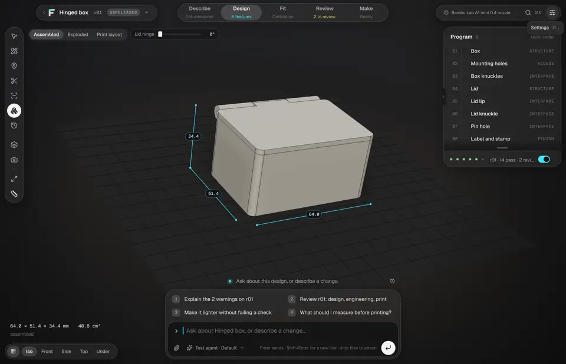
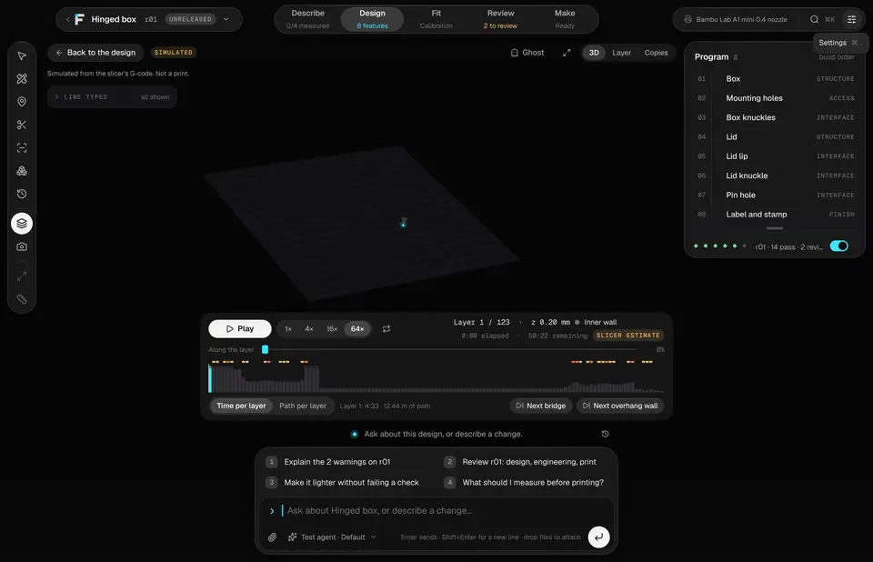
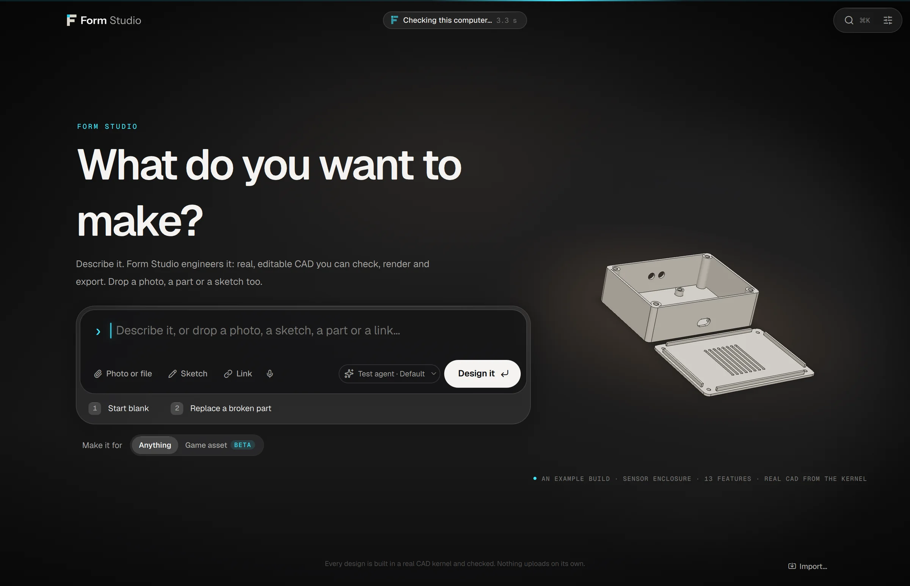
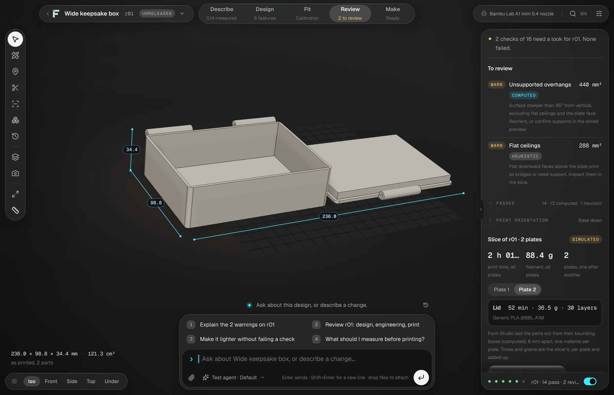
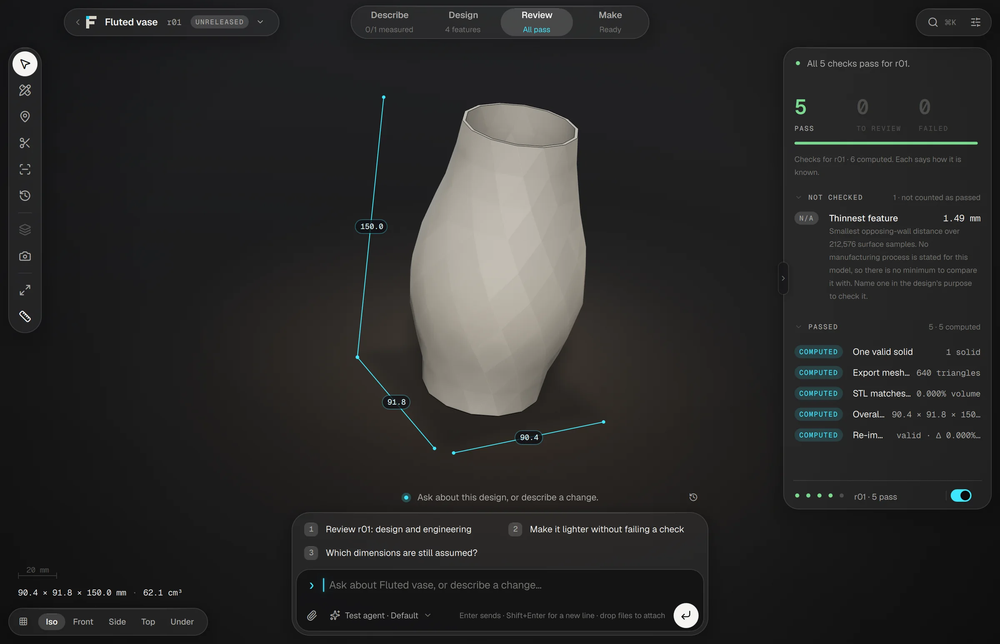
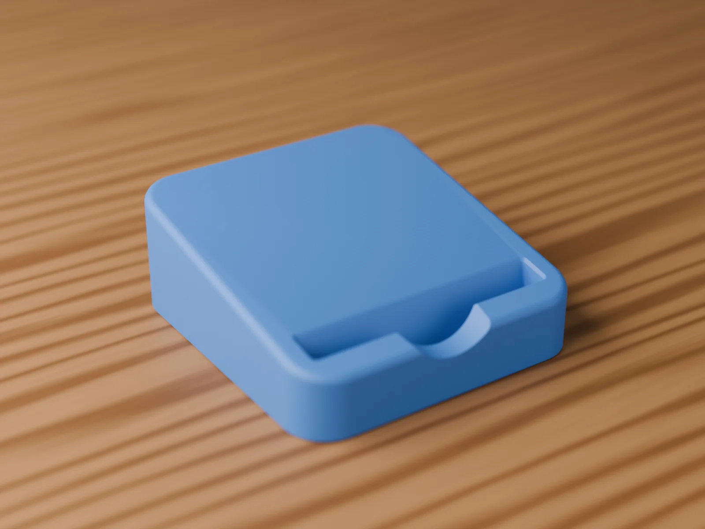
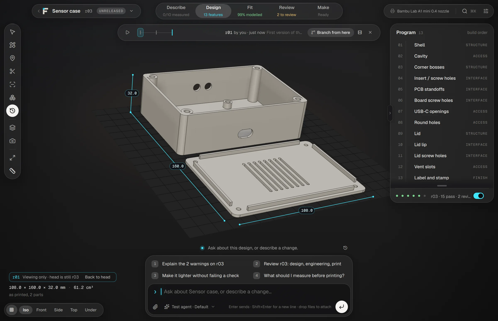
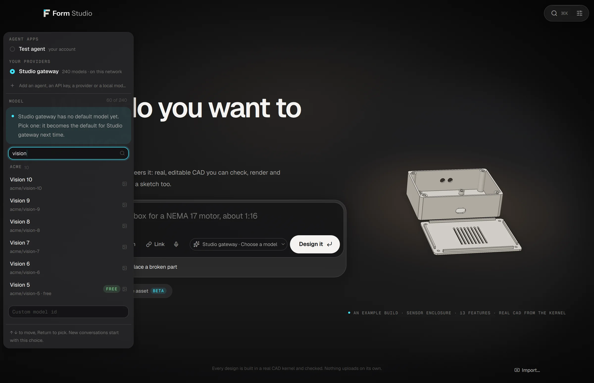
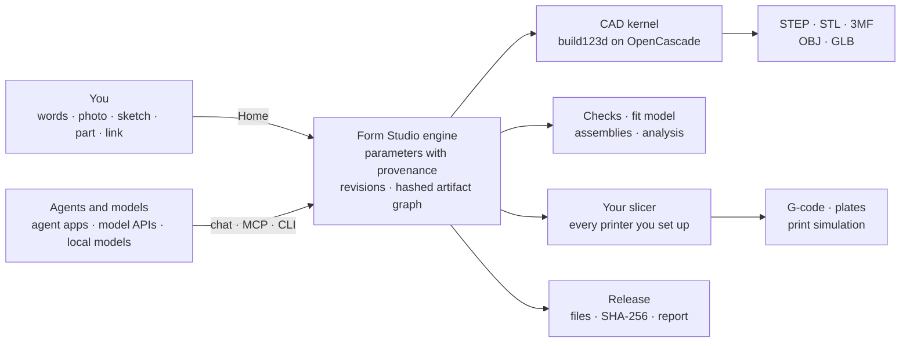

<p align="center">
  <a href="https://kaizensx.github.io/form-studio/">
    <picture>
      <source media="(prefers-color-scheme: dark)" srcset="brand/lockup.svg">
      
    </picture>
  </a>
</p>

<h3 align="center">What are we making?</h3>

<p align="center">
  Describe it, drop a photo, sketch it or paste a link. An AI agent designs it in a real CAD kernel,<br>
  Form Studio checks every revision, slices it with your slicer and plays the print back before you start it.
</p>

<p align="center">
  <a href="https://github.com/kaizensx/form-studio/releases/latest"></a>
  <a href="https://github.com/kaizensx/form-studio/actions/workflows/ci.yml"></a>
  <a href="https://github.com/kaizensx/form-studio/actions/workflows/slicers.yml"></a>
  <a href="https://kaizensx.github.io/form-studio/compat/"></a>
  <a href="LICENSE"></a>
  <a href="https://github.com/kaizensx/form-studio/discussions"></a>
</p>

<p align="center">
  <a href="https://github.com/kaizensx/form-studio/releases/latest/download/FORM-macos-arm64.zip"></a>
  <a href="https://github.com/kaizensx/form-studio/releases/latest/download/FORM-windows-x64.zip"></a>
  <a href="https://github.com/kaizensx/form-studio/releases/latest/download/FORM-linux-x64.tar.gz"></a>
  <a href="https://kaizensx.github.io/form-studio/"></a>
</p>

<p align="center">
  <a href="https://kaizensx.github.io/form-studio/"></a>
</p>

<p align="center">
  <a href="#see-it-move"><b>See it move</b></a> ·
  <a href="#a-tour">Tour</a> ·
  <a href="#download">Download</a> ·
  <a href="#headless-cli-and-mcp">CLI and MCP</a> ·
  <a href="docs/FEATURES.md">All features</a> ·
  <a href="https://kaizensx.github.io/form-studio/docs/">Docs</a> ·
  <a href="https://kaizensx.github.io/form-studio/recipes/">Recipe gallery</a>
</p>

---

**Form Studio** is an open-source desktop app for macOS, Windows and Linux. You bring an idea in whatever form you
have it; an agent of your choice (Claude Code, Codex, Gemini CLI, Cursor, any model API or a local model) builds it as
parametric B-rep geometry in [build123d](https://github.com/gumyr/build123d) on OpenCascade while you watch. Every
revision is rebuilt and checked on the solid, its fit is modelled, it is sliced by **your** slicer with **your**
presets, and the toolpaths are played back layer by layer. When you approve, the files are frozen with their hashes.

Everything runs on your computer. Form Studio never uploads a design and never starts a print.

<table>
<tr>
<td align="center" width="20%"><b>66</b><br><sub>MCP tools for any agent</sub></td>
<td align="center" width="20%"><b>7</b><br><sub>slicers, sliced for real in CI</sub></td>
<td align="center" width="20%"><b>13</b><br><sub>design skills for agents</sub></td>
<td align="center" width="20%"><b>5</b><br><sub>export formats, STEP to GLB</sub></td>
<td align="center" width="20%"><b>3</b><br><sub>desktop platforms, one app</sub></td>
</tr>
</table>

## See it move

Recorded from the Form Studio window at 30 frames a second. The hinged box is one of the building blocks, built as a
solid by the CAD kernel; the lid turns on the joint the design declares, and the print is played back from the G-code
the slicer wrote for it.

<table>
<tr>
<td width="44%" valign="top"></td>
<td width="56%" valign="top"></td>
</tr>
<tr>
<td valign="top"><b>Parts that move together.</b> Joints swept through their range and checked for collisions, with Assembled, Exploded and Print layout views.</td>
<td valign="top"><b>Watch it print before you print it.</b> Every layer and line type from the slicer's G-code, timed by the slicer's own estimate.</td>
</tr>
</table>

## Why it is different

<table>
<tr>
<td width="33%" valign="top">
<h4>Start from anything</h4>
Words, a photo with a card or coin for scale, a sketch with dimensions, a STEP, STL or 3MF part, a PDF drawing or a
link. One composer takes all of them.
</td>
<td width="33%" valign="top">
<h4>Concepts, not one guess</h4>
A new idea comes back as three or four genuinely different designs, each real CAD with its computed size and
volume. Pick one, or ask for a mix.
</td>
<td width="33%" valign="top">
<h4>Real CAD, real checks</h4>
A B-rep solid you can export as STEP, checked on every revision. Every number says whether it was computed, modelled,
simulated, measured or assumed.
</td>
</tr>
<tr>
<td valign="top">
<h4>With or without a printer</h4>
For your printer: checked against it, sliced and simulated. Just a 3D model: STEP, STL, 3MF, OBJ and GLB for CAD,
CNC, laser cutting or rendering, with no print checks in the way.
</td>
<td valign="top">
<h4>Any agent, any model</h4>
Agent apps you already use, model APIs from your keys, local models from Ollama, LM Studio or llama.cpp, or any
provider added by its address.
</td>
<td valign="top">
<h4>Parts that move together</h4>
Assemblies with chained hinges and slides, fits for pins and threads, joint sweeps for collisions, and Assembled,
Exploded and Print layout views.
</td>
</tr>
</table>

And every capability works without the window: as a `form` command that prints JSON, and as one of 66 MCP tools for
any agent.

## From an idea to released files

<table>
<tr>
<td align="center" width="20%"><br><b>1 · Start</b><br><sub>Words, a photo, a sketch, a part or a link</sub></td>
<td align="center" width="20%"><br><b>2 · Concepts</b><br><sub>Three or four real designs to pick from</sub></td>
<td align="center" width="20%"><br><b>3 · Prove</b><br><sub>Checks on the solid, fit, slicing</sub></td>
<td align="center" width="20%"><br><b>4 · Simulate</b><br><sub>The G-code played back, layer by layer</sub></td>
<td align="center" width="20%"><br><b>5 · Release</b><br><sub>You approve; files frozen with SHA-256</sub></td>
</tr>
</table>

## A tour

Click a section to open it. Every picture is a screenshot of Form Studio.

<details open>
<summary><b>Home: what are we making?</b> &nbsp;<sub>one composer for words, photos, sketches, parts and links</sub></summary>
<br>


Type it, dictate it, drop a photo or a part, draw on the sketch pad or paste a link. Choose **For my printer** or
**Just a 3D model** for what starts next, or **Start blank**. With a bank card, a coin or a ruler in the photo, the
agent estimates sizes from it and keeps them marked *estimated from the photo* until you measure.

<table>
<tr>
<td width="50%"></td>
<td width="50%"></td>
</tr>
<tr>
<td valign="top"><b>A photo with the words.</b> The agent sees the picture and what you said about it.</td>
<td valign="top"><b>The sketch pad.</b> Lines, rectangles, circles, arcs, freehand and dimensions in millimetres. The agent receives structured geometry, not just a picture.</td>
</tr>
</table>
</details>

<details>
<summary><b>Concepts and measurements</b> &nbsp;<sub>several real designs, and the numbers that matter asked for</sub></summary>
<br>


For a new idea the agent proposes three or four genuinely different concepts, each built as real CAD and shown side by
side with its computed size and volume. Continue with one, or ask for a mix in words. The workspace opens the moment
you send, and each build grows into the viewport feature by feature, in build order.


When a real number matters, the agent asks for it with a card: where to measure, the unit, the tolerance that
matters and what the design assumes now. Your number is committed as a new revision together with how you measured
it, and the part updates.
</details>

<details>
<summary><b>Assemblies that move like the real thing</b> &nbsp;<sub>joints, chains, exploded views, collision sweeps</sub></summary>
<br>

<table>
<tr>
<td width="50%"></td>
<td width="50%"></td>
</tr>
</table>

Parts are fixed to other parts or move on joints mounted on them, so turning an arm swings everything it carries.
Hinges and slides are swept through their range for collisions, pins and threads are checked against their clearance,
and the checks finish in seconds within a time budget. Hardware comes with its source: screw clearances to ISO 273,
heat-set insert pockets, nut traps, magnet pockets and printable threads.
</details>

<details>
<summary><b>Look closer</b> &nbsp;<sub>annotate, measure, analyse, colours and materials</sub></summary>
<br>

<table>
<tr>
<td width="50%"></td>
<td width="50%"></td>
</tr>
<tr>
<td valign="top"><b>Annotate (N).</b> Pick faces, edges and points or paint regions; see area, tilt, overhang, wall thickness and height computed on the solid; keep it as a pin, or ask the agent about it with the exact numbers.</td>
<td valign="top"><b>Colours and materials</b> per design or per part, drawn in the viewport, exported as a coloured 3MF and used by the checks and the slicer's filament choice.</td>
</tr>
<tr>
<td width="50%"></td>
<td width="50%"></td>
</tr>
<tr>
<td valign="top"><b>Maps computed on the solid.</b> Wall thickness, overhangs, flat ceilings and plate contact, with the thinnest spot marked.</td>
<td valign="top"><b>Measure.</b> Snapped distances, faces and hole diameters, in any arrangement of an assembly.</td>
</tr>
</table>
</details>

<details>
<summary><b>Prove it, then release it</b> &nbsp;<sub>checks with evidence, plates, print simulation, frozen files</sub></summary>
<br>


<table>
<tr>
<td width="50%"></td>
<td width="50%"></td>
</tr>
<tr>
<td valign="top"><b>Watch it print before you print it.</b> The slicer's toolpaths, every layer and line type, timed by the slicer's own estimate, with a jump to the next bridge or overhang.</td>
<td valign="top"><b>Several plates.</b> Parts that do not fit one plate are laid out on as many as needed, each sliced, with time, filament and cost added up.</td>
</tr>
</table>


One approval, by a person, freezes STEP, STL, 3MF, OBJ, GLB and G-code with SHA-256 hashes and a report of every
check and its evidence. Agents propose and build; they cannot release.
</details>

<details>
<summary><b>Just a 3D model</b> &nbsp;<sub>no printer needed: CAD, CNC, laser, moulding, rendering</sub></summary>
<br>

<table>
<tr>
<td width="50%"></td>
<td width="50%"></td>
</tr>
</table>

Tell Form Studio once that you just design, or set it per design. Print checks and slicing step aside; size, a valid
solid, a closed mesh and the STEP round trip are still checked, and the release holds the formats you need.
</details>

<details>
<summary><b>Renders, share cards and the timeline</b> &nbsp;<sub>pictures of what you made, and how it got there</sub></summary>
<br>

<table>
<tr>
<td width="50%"></td>
<td width="50%"></td>
</tr>
<tr>
<td valign="top"><b>Photoreal renders</b> in Blender, in your filament colour.</td>
<td valign="top"><b>A share card</b> with every number and its evidence.</td>
</tr>
<tr>
<td width="50%"></td>
<td width="50%"></td>
</tr>
<tr>
<td valign="top"><b>The timeline.</b> Scrub through revisions, or play them as a morph.</td>
<td valign="top"><b>Variants.</b> Named alternatives, compared and promoted.</td>
</tr>
</table>
</details>

<details>
<summary><b>Any agent, any model, any provider</b> &nbsp;<sub>agent apps, model APIs, local models, your own endpoints</sub></summary>
<br>

<table>
<tr>
<td width="50%"></td>
<td width="50%"></td>
</tr>
</table>

Chat with the agent apps you already use, with model APIs from your keys (Anthropic, OpenAI, Gemini, OpenRouter,
Mistral, xAI, DeepSeek, Groq) or with local models. Add any OpenAI-, Anthropic- or Gemini-compatible provider by its
address. The model menu searches hundreds of models and remembers the ones you use.
</details>

The full list of features, with more pictures: **[docs/FEATURES.md](docs/FEATURES.md)**.

## Download

| Platform | Download | First launch |
|---|---|---|
| macOS, Apple Silicon | [`FORM-macos-arm64.zip`](https://github.com/kaizensx/form-studio/releases/latest/download/FORM-macos-arm64.zip) | Unzip, right-click **FORM.app** › **Open** |
| macOS, Intel | [`FORM-macos-x64.zip`](https://github.com/kaizensx/form-studio/releases/latest/download/FORM-macos-x64.zip) | The same |
| Windows 10 and 11 | [`FORM-windows-x64.zip`](https://github.com/kaizensx/form-studio/releases/latest/download/FORM-windows-x64.zip) | Unzip, run `FORM.exe`; in SmartScreen, **More info** › **Run anyway** |
| Linux x64 | [`FORM-linux-x64.tar.gz`](https://github.com/kaizensx/form-studio/releases/latest/download/FORM-linux-x64.tar.gz) | Unpack, run `FORM/FORM` |

Every release ships with `SHA256SUMS`, signed build provenance and an SBOM.

<details>
<summary><b>Install from a terminal</b> &nbsp;<sub>macOS and Linux script, or uv on any platform</sub></summary>
<br>

From a terminal (macOS and Linux), with its own Python 3.12:

```bash
curl -LsSf https://raw.githubusercontent.com/kaizensx/form-studio/main/install.sh | sh
form app
```

With [uv](https://docs.astral.sh/uv/), on any platform:

```bash
uv tool install --python 3.12 "form-studio[all] @ git+https://github.com/kaizensx/form-studio"
```
</details>

## Quick start

1. **Open Form Studio.** The first start asks once whether you have a 3D printer or just design, then installs what is
   missing by itself (the standard-parts libraries, a slicer if you print, an agent and its sign-in). It pauses only
   when you have to sign in or download something.
2. **Say what you are making** on Home, with a photo, a sketch, a part or a link if you have one.
3. **Pick a concept**, answer the agent's questions, measure what it asks you to measure.
4. **Prove** the revision, watch the print, and **release** when you are happy.

## Agents and providers

| | Chat inside the app | MCP from its own window |
|---|:---:|:---:|
| **Claude Code** | ✓ | ✓ |
| **Codex** | ✓ | ✓ |
| **Gemini CLI** | ✓ | ✓ |
| **Cursor CLI** | ✓ | ✓ |
| **OpenCode** · **Qwen Code** · **GitHub Copilot CLI** | ✓ | ✓ |
| **Model APIs:** Anthropic, OpenAI, Gemini, OpenRouter, Mistral, xAI, DeepSeek, Groq | ✓ | |
| **Local models:** Ollama, LM Studio, llama.cpp | ✓ | |
| **Any provider by its address** (OpenAI-, Anthropic- or Gemini-compatible) | ✓ | |
| **Claude Desktop and any MCP client** | | ✓ |

Agents are never asked about a printer when you only design: the in-app agent and MCP clients are told whether you
print and what each design is for.

## Slicers and other programs

| Slicer | Linux | Windows | macOS |
|---|:---:|:---:|:---:|
| Bambu Studio | CI real slice | CI real slice | ✓ |
| OrcaSlicer (including packed `.opc` profiles) | CI real slice | CI real slice | ✓ |
| PrusaSlicer | CI real slice | CI real slice | ✓ |
| SuperSlicer | CI real slice | CI real slice | ✓ |
| QIDISlicer | CI real slice | CI real slice | ✓ |
| ElegooSlicer | CI real slice | CI real slice | ✓ |
| Snapmaker Orca | CI real slice | CI real slice | ✓ |

Every printer set up in any installed slicer can be chosen, per design or as the default. Every night every recipe is
sliced by every slicer and published as the **[compatibility matrix](https://kaizensx.github.io/form-studio/compat/)**;
pipeline timings are tracked as **[benchmarks](https://kaizensx.github.io/form-studio/bench/)**.

Plus **FreeCAD** (STEP re-import check and a parameter macro), **OpenSCAD** (`.scad` designs with Customizer
parameters), **Blender** (photoreal renders in your filament colour) and **STEP or STL** reference parts to design
around. Details: [Compatibility and testing](docs/VERIFICATION.md).

## Headless: CLI and MCP

Form Studio is an MCP server. Add it once and your agent can design, check, slice and prepare a release from its own
window, while the open app follows along.

<details open>
<summary><b>Add Form Studio to your agent</b></summary>
<br>

| Agent | How |
|---|---|
| Claude Code | `claude mcp add --scope user form -- form-mcp` |
| Codex | `codex mcp add form -- form-mcp` |
| Gemini CLI | add the server to `~/.gemini/settings.json` |
| Cursor | add the server to `~/.cursor/mcp.json` |
| Any other MCP client | `{ "mcpServers": { "form": { "command": "form-mcp" } } }` |

`form setup` writes the configuration for you. Claude Code can also install thirteen design skills as a plugin:
`claude plugin marketplace add kaizensx/form-studio`, then `claude plugin install form@form-studio`.
</details>

<details>
<summary><b>Or without any window</b> &nbsp;<sub>every action is a <code>form</code> command that prints JSON</sub></summary>
<br>

```bash
form start --text "a hook for my headphones under the desk" --photo desk.jpg   # start from words and a photo
form new "Desk stand" device_stand device_width=75.6                           # from a building block: solid, checks, slice
form commit desk-stand lean=18 --expect-head 1                                 # a new revision, rebuilt, checked and sliced
form plates desk-stand                                                          # how its parts go onto plates
form simulate desk-stand --png print.png --layer 40                            # the print at layer 40, from the G-code
form purpose desk-stand model --process cnc                                    # just a 3D model from now on
form export desk-stand --out desk-stand.formstudio                             # the design, its code and conversations
form chat "Make the base 92 mm deep" --project desk-stand --agent codex
```
</details>

Reference: [every command](docs/CLI.md) · [66 MCP tools](docs/MCP.md) · [guide for coding agents](AGENTS.md)

## How it works



Form Studio does not replace your CAD program or your slicer. It sits between the agent and that software and keeps
the record of what was designed, checked and released. An output is current only when it exists under the hash of its
inputs, so a changed clearance invalidates exactly what depends on it. More in
[docs/ARCHITECTURE.md](docs/ARCHITECTURE.md).

| Principle | What it means |
|---|---|
| **Local** | Designs are never uploaded and prints are never started. |
| **A person releases** | Agents propose and build; only you approve the files. |
| **Every number says how it is known** | Computed, modelled, simulated, measured or assumed. |
| **No capability exists only in the window** | Everything is also a command and an MCP tool. |

## Building blocks and the community gallery

<p align="center"></p>

Agents start from parametric building blocks made of the things people print most: Gridfinity bins and baseplates,
boxes with sliding, press-on or hinged lids, SKÅDIS pegboard accessories, phone and tablet stands, cable organizers,
under-desk hangers, shelf brackets, hose adapters, self-watering planters, faceted vases and lamp shades, battery and
card holders, and electronics enclosures. Each passes its checks at its defaults and prints without supports.

Browse them, and what the community adds, in the **[recipe gallery](https://kaizensx.github.io/form-studio/recipes/)**.
To share one, **[open a recipe issue](https://github.com/kaizensx/form-studio/issues/new?template=3-recipe.yml)** or run
`form recipes submit`: the recipe is built, checked and sliced automatically and the issue is answered with pictures.
How to write one: [docs/RECIPES.md](docs/RECIPES.md) and [community/recipes](community/recipes/README.md).

## Community

| | |
|---|---|
| **[Discussions](https://github.com/kaizensx/form-studio/discussions)** | Questions, ideas, and Show and tell for the parts you made. |
| **[Issues](https://github.com/kaizensx/form-studio/issues/new/choose)** | Bugs, slicer and printer support, agent support, recipes, docs. |
| **[Contributing](CONTRIBUTING.md)** | Recipes, slicer adapters, agent integrations and measured print results. Branch from `dev` and open a pull request against it; every pull request gets before/after previews. |
| **More** | [Code of Conduct](CODE_OF_CONDUCT.md) · [Support](SUPPORT.md) · [Security](SECURITY.md) · [Changelog](CHANGELOG.md) |

<p align="center">
  <a href="https://star-history.com/#kaizensx/form-studio&Date"></a>
</p>

## Licence

MIT. Form Studio calls build123d (Apache-2.0), OpenCascade (LGPL-2.1), your slicer and other programs as separate
programs; none of them is bundled into its code. three.js (MIT) draws the website. The Gridfinity system was created by
Zack Freedman and SKÅDIS is a product of IKEA; Form Studio's building blocks follow their published dimensions and are
not affiliated with either.
