<p align="center">
  
</p>

<p align="center">
  <a href="https://github.com/kaizensx/form-studio/actions"></a>
  
  
  
  
</p>

<p align="center">
  <b>Your coding agent can already write code. FORM lets it design real objects:</b><br>
  build them in a CAD kernel, look at them, check them, slice them, and tell you honestly what is known.
</p>

<p align="center">
  
  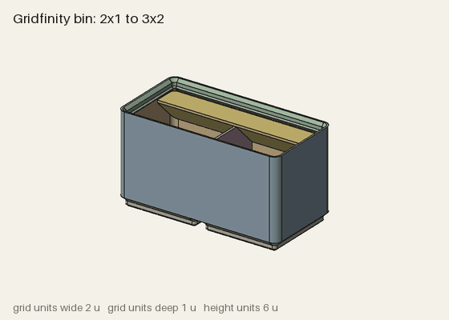
</p>
<p align="center"><sub>Every frame above is a separate build of the real parametric model, not a 3D-modelling trick.</sub></p>

---

## A desktop app. Describe a part, watch it get built.

FORM is a native app for macOS, Windows and Linux. Claude is on the left and your part is in the middle. Describe what you need:

> *Design a case for a Raspberry Pi 5 with a snap-on lid*

<p align="center">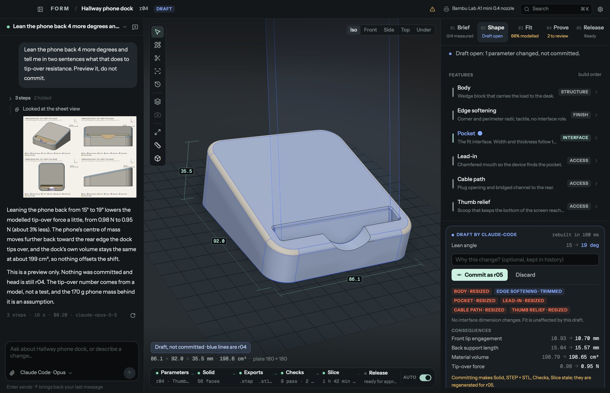<br>
<sub>A real run in the app: Claude previewed a 4° lean change, the kernel rebuilt it in 160 ms, and the app shows what it would cause before anything is saved. 3 steps, 16 s, $0.20 on the user's account.</sub></p>

Claude then works through the request:

1. **Finds the official mechanical drawing** and reads it as an image, so a drawing's dimensions aren't lost the way they are in text extraction.
2. **Writes the design as CAD code inside FORM:** typed parameters, named features and constraints.
3. **Builds, renders and checks it.** It slices it with your printer's settings, and fixes what the checks catch.

<table><tr>
<td>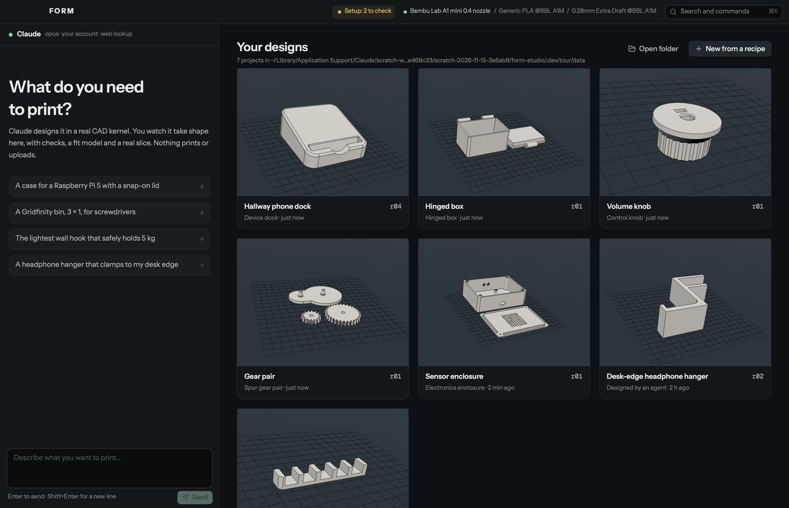</td>
<td>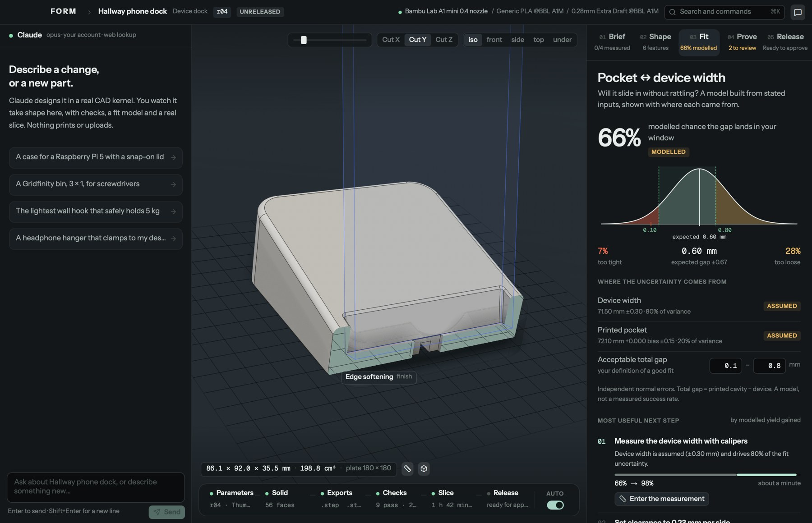</td>
</tr><tr>
<td></td>
<td>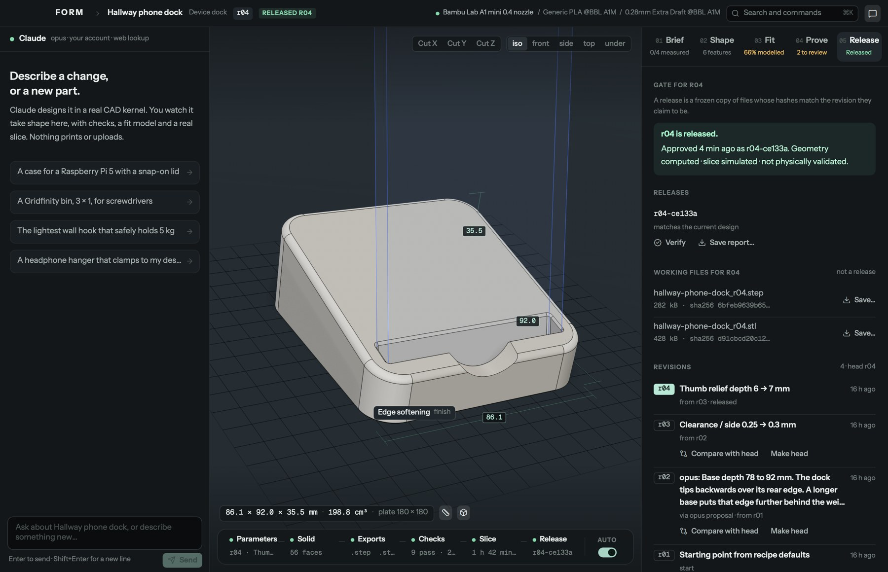</td>
</tr></table>

What is in the app:

- **A native 3D viewport.** The kernel's real geometry, one mesh per feature. Click a feature to edit it. Dimensions are drawn on the plate; a section cut shows solid cut faces.
- **Five stages:** Brief, Shape, Fit, Prove, Release. Each one answers one question about the design and says how each number is known.
- **It follows any agent.** Use FORM from Claude Code or Codex and the open app follows along: drafts, views, commits.
- **No browser.** The interface is Qt Quick, drawn on the GPU, in the same process as the CAD engine.

Get it from the [Desktop app workflow](https://github.com/kaizensx/form-studio/actions/workflows/app.yml) (bundles for every platform, not yet signed), or run `form app` after installing with the `all` extra. Details: [docs/APP.md](docs/APP.md).

## See what you are about to print

<p align="center">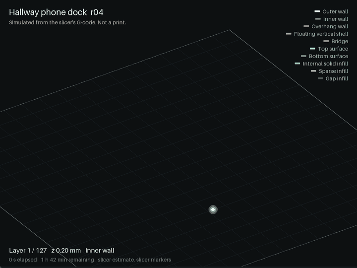<br>
<sub>The slicer's own G-code, played back in 3D. Simulated, not a print. Made with <code>form simulate hallway-phone-dock --gif out.gif</code>.</sub></p>

<table><tr>
<td width="50%">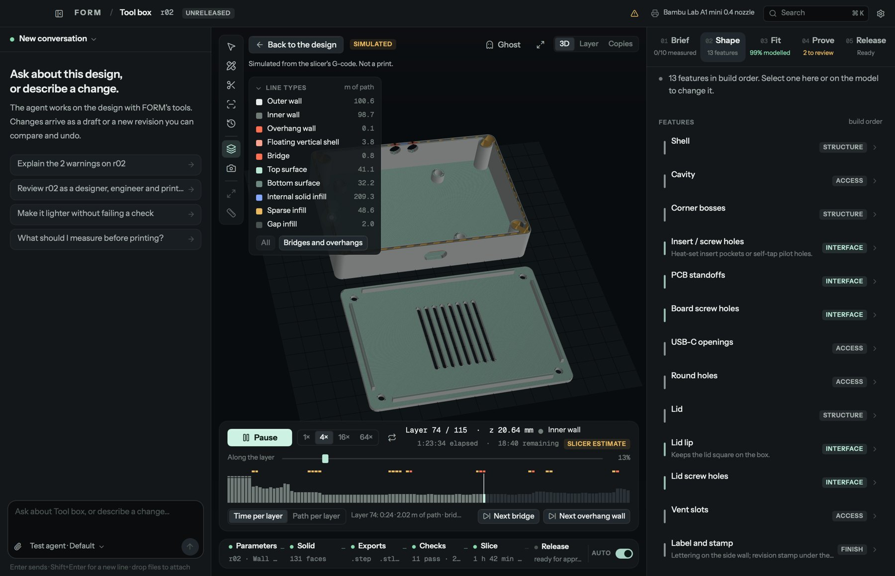</td>
<td width="50%">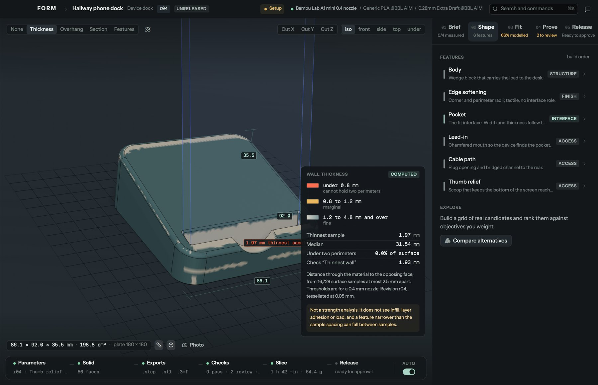</td>
</tr><tr>
<td>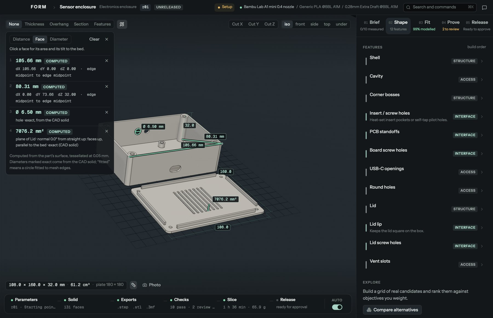</td>
<td></td>
</tr></table>

- **Watch it print:** play, scrub, filter by line type, jump to the next bridge. Time is the slicer's estimate.
- **Analysis on the model:** wall thickness, overhang, layer cross-section and small features, computed from the real geometry. Each legend says what the map does not tell you. None of them is a strength analysis.
- **Measure** distances, faces and holes; **find the best orientation** with the numbers behind the ranking.
- **Conversations** are saved per design. Pick the agent and model per conversation, attach photos, drawings and STEP files.
- **Design tools:** a revision timeline you can scrub, variants, text and revision stamps, vent patterns, cost from your prices, copies on a plate, a share card.
- **First start installs what FORM needs from inside the app.** No terminal, no example projects. Updates install from the app too.
- **Tested by clicking:** nine scripted journeys drive the real window with mouse and keyboard events on every change (`tests/journeys`).

Website: **https://kaizensx.github.io/form-studio/**

## Works with what you already use

FORM drives existing software instead of replacing it. On first launch it shows what it found and sets up only what you tick.

<table><tr>
<td width="50%">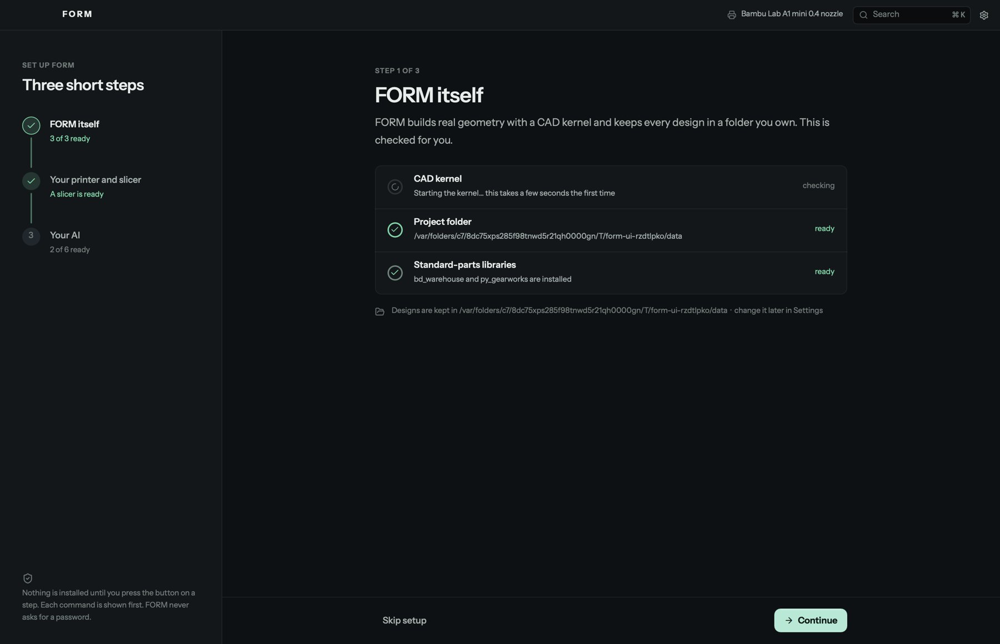</td>
<td width="50%">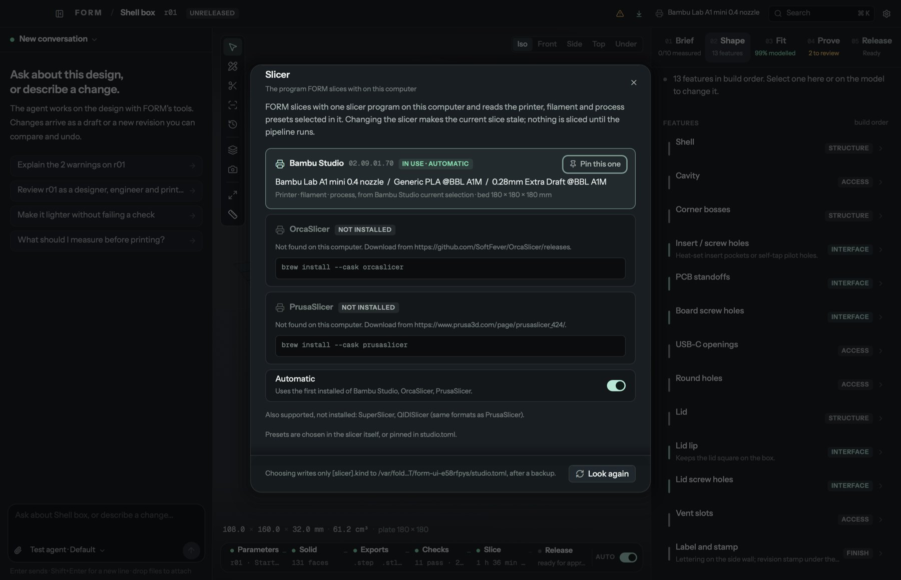</td>
</tr></table>

| | What FORM does with it | Run for real here |
|---|---|---|
| **build123d / OpenCascade** | The CAD kernel: every solid, STEP, B-rep checks | yes |
| **Bambu Studio** | Slices with your printer, filament and process presets | yes |
| **PrusaSlicer** | Same, picked automatically or in the Slicer sheet | yes (2.9.7: a full slice, layers, simulation, cost) |
| **OrcaSlicer** (SuperSlicer, QIDISlicer) | Same; reads OrcaSlicer 2.5's packed presets (`.opc`) | OrcaSlicer yes (2.5.1: a full slice, layers, simulation, cost). The others: fixtures only |
| **OpenSCAD** | Designs written in `.scad`; Customizer ranges become parameters | yes |
| **Blender** | Illustrative renders; its 3D-Print Toolbox checks when installed | renders yes |
| **FreeCAD** | Open the STEP, an optional re-import check, a macro with every parameter | yes (1.1.4: re-check and macro) |
| **STEP / STL from makers** | Imported as reference parts to design around | yes |
| **Claude Code, Codex, Gemini CLI, Cursor** | Use FORM's 44 MCP tools; the app follows along live. Claude Code and Codex also chat inside the app | Claude Code, Codex |

<table><tr>
<td width="50%">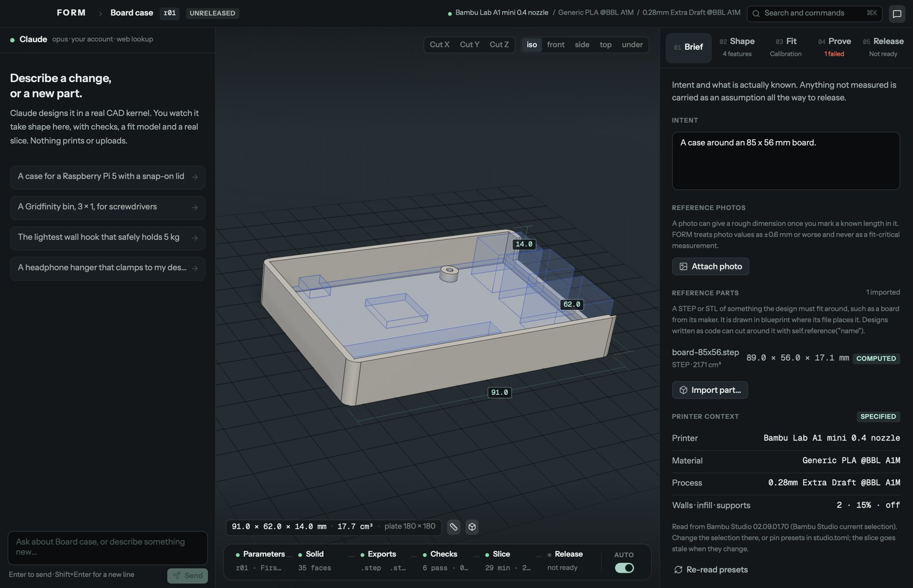</td>
<td width="50%">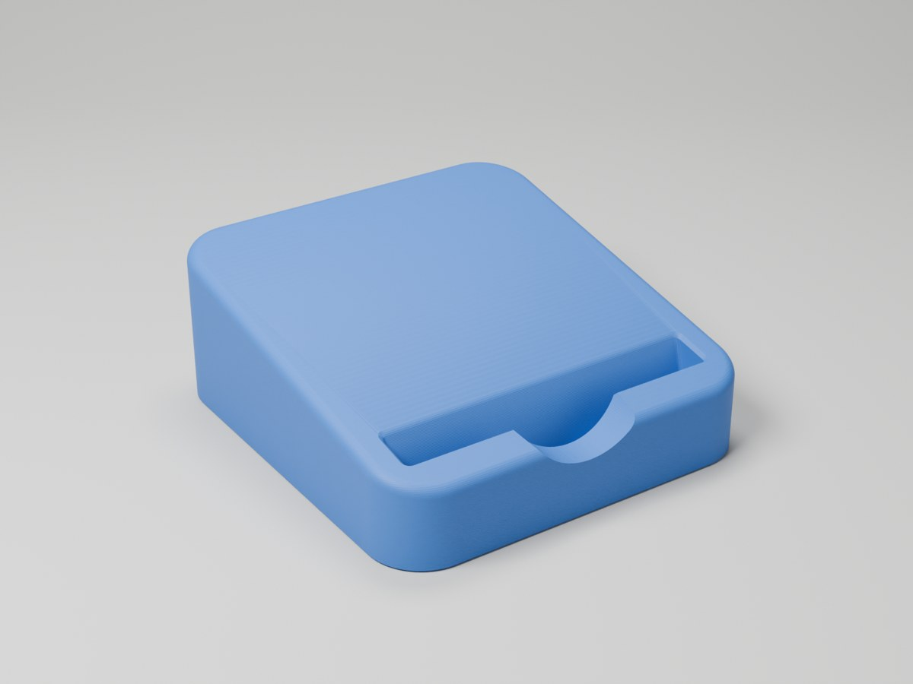</td>
</tr><tr>
<td><sub>A board imported as STEP. The case is designed around it.</sub></td>
<td><sub>Rendered in Blender from the real export. An illustration, not a photo of a print.</sub></td>
</tr></table>

## Real hardware, real assemblies

Designs use **`form.parts`**: screw clearances (ISO 273), heat-set insert pockets, nut traps, magnet pockets, bearing seats, printable threads and gears, each with its published dimension and source. Parts that go together are checked **assembled**: overlap, the smallest gap, each hinge or slide swept through its range, and screwdriver access. A release writes the bill of materials, assembly steps with exploded images, a print report and a measurement plan.

<table><tr>
<td width="50%">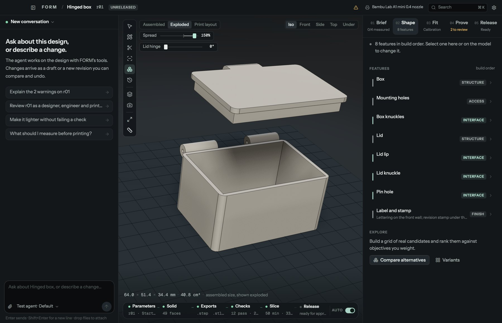</td>
<td width="50%"></td>
</tr></table>

## Expertise, not just tools

- **A Claude Code plugin** with 13 skills (intake, parametric design, FDM engineering, fit calibration, hardware, assemblies, industrial design, design review, release, print feedback…) and the MCP server: `/plugin marketplace add kaizensx/form-studio`, then `/plugin install form@form-studio`.
- **Start from a brief:** six templates (remote holder, desk accessory, organizer, bathroom mount, enclosure, car accessory) ask the questions that matter, then hand your answers to Claude.
- **Design review on demand:** silhouette, relationships and details, scored with evidence, from the Release stage.
- **Updates:** FORM tells you when a new release is on GitHub. It never downloads or installs anything by itself.

<p align="center">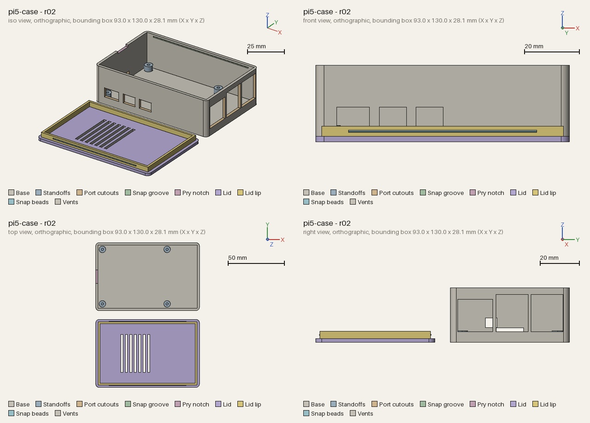<br>
<sub>A case Claude designed in FORM from the official drawing: 10 steps, $1.04. Base and lid print side by side. The answer lists which numbers came from the drawing and which are estimates to check.</sub></p>

## Install in one line

```bash
curl -LsSf https://raw.githubusercontent.com/kaizensx/form-studio/main/install.sh | sh
```

The installer:

1. installs [uv](https://docs.astral.sh/uv/) if it's missing, after asking,
2. installs FORM with its own Python 3.12 (your system Python is never touched),
3. runs **`form setup`**.

`form setup` finds what's missing and lets you choose what to fix. It shows each command before it runs and backs up every config file it edits:

```
FORM setup
 ✔ Python 3.12               Running 3.12.15
 ✔ CAD kernel                build123d 0.13.0 / OCP 8.0.1.1
 ✔ Project folder            ~/FORM
 ✔ Slicer (Bambu Studio)     02.09.01.70 · Bambu Lab A1 mini 0.4 nozzle · Generic PLA
 ✔ Printer size              Bambu Lab A1 mini [180, 180, 180] mm
 ✘ Claude Code               Installed; FORM is not registered   [1]
 ✘ Codex                     Installed; FORM is not registered   [2]
 ✘ Gemini CLI                FORM is not in ~/.gemini/settings.json   [3]

Set up which? [Enter = recommended 1,2,3 · a = all · 1,3 · n = none]
```

Restart your agent, then ask it for a part.

To add the desktop app to this install:

```bash
uv tool install --force --python 3.12 "form-studio[all] @ git+https://github.com/kaizensx/form-studio"
```

```bash
form app
```

## Watch an agent use it

<p align="center"></p>

This is a trimmed replay of a real session (Claude Code with Opus 5.5: 8 turns, 36 seconds, $0.23). The agent:

- recorded the caliper numbers as **measured**,
- previewed the change before saving it,
- **looked at** a four-view render,
- reported the slice as a *simulation* and the fit as a *model*,
- handed approval back to the human.

Codex ran the same kind of session with no changes to FORM. When it tried thinner walls, FORM refused (the pocket would cut into the rounded corners), and Codex explained why.

## What makes it different

| | |
|---|---|
| 🧱 **Real geometry** | Every change rebuilds a boundary-representation solid in OpenCascade, in 0.1 to 1.5 s depending on the part. You get STEP and STL out, not a picture of a part. |
| 👁️ **Agents can see** | `render` returns a PNG drawn from the kernel's own mesh, coloured by feature, with a scale bar. `animate` makes turntables and morphs. |
| 🎯 **Goal seek** | *"Lightest hook that still holds 3 kg with a 3× safety factor."* FORM builds dozens of real candidates and returns the best one, plus the constraint that blocked the rest. |
| 🧾 **Honest evidence** | Every number says where it came from: *measured, specified, assumed* or *calibrated*, and *computed, model, simulated* or *physical*. Nothing is called validated until you print it. |
| ⛓️ **Stale-proof outputs** | Outputs are keyed by hashes of their inputs. Change one dimension and the old G-code can't be released. |
| 📏 **Fit under uncertainty** | FORM gives the chance a part fits and the cheapest next step to improve it: measure, print a coupon, or print a test ring. It learns your printer from coupons. |
| 🙋 **A human signs off** | Agents can do everything except approve a release. That button exists only on the bench, your local web page. |

## Things you can make today

<p align="center">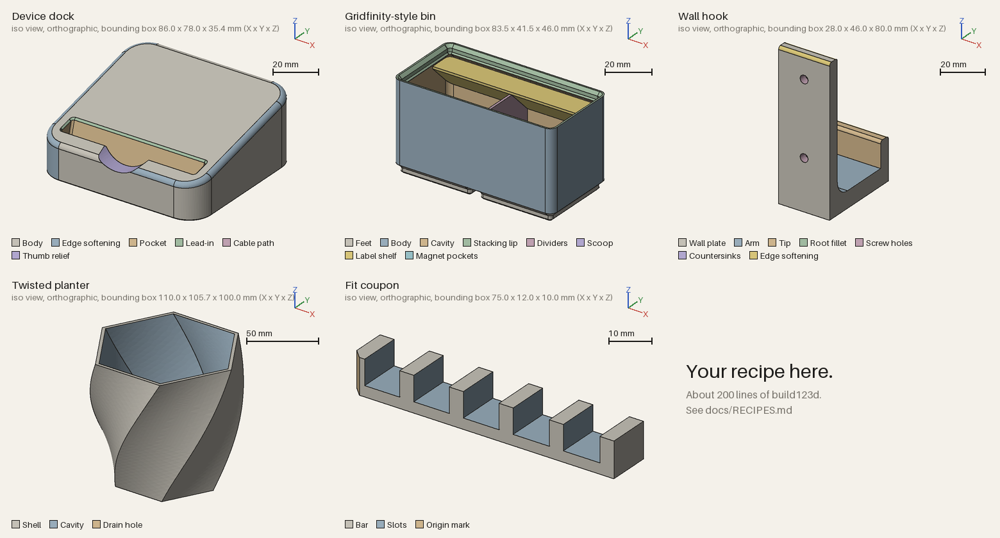</p>

| Recipe | What it is | What FORM checks |
|---|---|---|
| `dock` | Leaning phone or tablet dock with a cable path | Pocket fit, tip-over force when you tap the screen |
| `gridfinity` | Gridfinity-style bin with stacking lip, dividers, scoop, label shelf, magnet pockets | Magnet press fit, wall thickness, usable depth |
| `hook` | Two-screw wall hook sized to a load | Bending safety factor, screw pull-out load, screwdriver clearance |
| `planter` | Twisted polygon planter with a drain-plug hole | Overhangs on the real mesh, plug fit |
| `coupon` | Slot comb that calibrates your printer | Feeds measured bias and spread into every later fit |

Each recipe is about 200 lines of [build123d](https://github.com/gumyr/build123d), with typed parameters, named features and constraints that explain themselves. **[Write your own →](docs/RECIPES.md)**

<table><tr>
<td></td>
<td>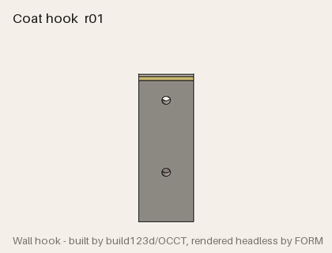</td>
<td>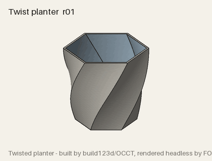</td>
<td>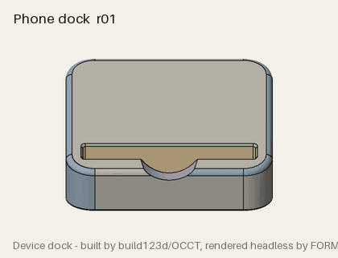</td>
</tr></table>

## Goal seek

```text
optimize(project="coat-hook",
         vary=[{"key":"arm_t","min":4,"max":20}, {"key":"plate_w","min":14,"max":40}],
         objective={"minimize":"solid_mass_g"},
         constraints=["statics.safety_factor >= 3"])
```

<p align="center">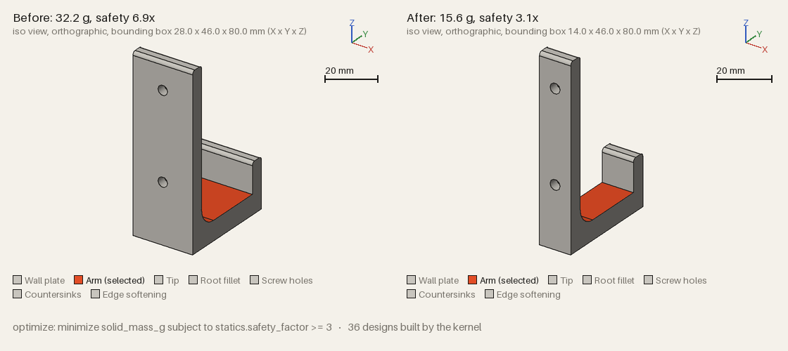</p>

FORM built 36 candidates in under 3 seconds and halved the material while keeping the safety margin you asked for. Nothing is saved until the agent previews the result, renders it and commits it.

<p align="center"><br>
<sub>Made by Claude Code in a real session: "lightest hook for a 5 kg bag, safety factor ≥ 3, my screws are 4.5 mm". It optimised 4 parameters across 40 builds, committed the result, and animated the change.</sub></p>

The safety factor comes from a beam model with an assumed material strength, and FORM labels it as a model. It isn't a load rating.

## How it works

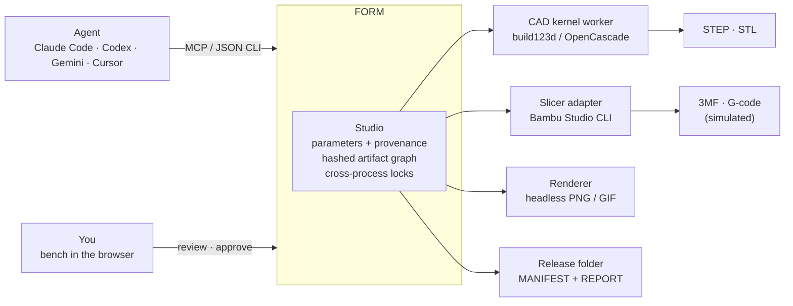

FORM doesn't compete with your CAD program or your slicer. It sits between the agent and that software, and keeps the record neither of them keeps. More in [ARCHITECTURE.md](docs/ARCHITECTURE.md).

## Tools for agents

| Explore | Design | Check & prove | Ship |
|---|---|---|---|
| `form_overview` | `create_project` | `get_project` | `request_release` → bench link |
| `design_guide` | `create_design` / `update_design` | `read_document` | `get_design_source` |
| `describe_recipe` | `preview_change` | `run_pipeline` / `get_job` | `verify_release` |
| `setup_status` | `commit_change` | `slice_test_piece` | `open_in` (Bambu Studio, CAD, ...) |
| `render` | `optimize` | `record_physical_result` | `open_bench` |
| `animate` | `explore_alternatives` | `compare_revisions` | `checkout_revision` |
| | `set_print_setup` | | |

Full reference: [docs/MCP.md](docs/MCP.md). With no MCP, every action is also a `form` command that prints JSON.

<details>
<summary><b>Manual MCP configuration</b> (if you skip <code>form setup</code>)</summary>

**Claude Code:**

```bash
claude mcp add --scope user form -- form-mcp
```

**Codex:**

```bash
codex mcp add form -- form-mcp
```

**Gemini CLI** (`~/.gemini/settings.json`), **Cursor** (`~/.cursor/mcp.json`) and **Claude Desktop** use the same shape:

```json
{ "mcpServers": { "form": { "command": "form-mcp" } } }
```

</details>

<details>
<summary><b>The bench</b>: the same review tools as a local web page (<code>form serve</code>)</summary>

`form-mcp` also serves `http://127.0.0.1:4173`. Run `form serve` to open it on its own. There you can:

- turn the model and click a feature,
- drag a parameter and watch the computed impact,
- compare revisions,
- step through the slice layer by layer,
- approve releases.

While it's open, it follows what agents change, and labels each revision with the agent's name.

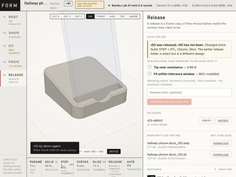
</details>

## Honesty and safety

- **Local only.** FORM listens on loopback only. It never uploads files and never starts a print.
- **Agents propose, people release.** Agents are told never to record a physical result you didn't report. A stale `expect_head` is refused rather than overwritten.
- **Evidence classes are never mixed.** A slice is *simulated*, fit yield is *modelled*, and strength is a *model with stated assumptions*.
- **Status of this release.** [docs/VERIFICATION.md](docs/VERIFICATION.md) says exactly what was tested (PASS, NOT RUN or BLOCKED) and on what. Nothing in this repository has been physically printed by the authors as part of verification.

## Status and roadmap

The engine's tests run on macOS, Windows and Linux in CI (no slicer there; slicing is tested on a Mac with Bambu Studio, OrcaSlicer and PrusaSlicer). Every build also launches the packaged app on each platform and requires its interface to load and its CAD kernel to start. The macOS Apple Silicon app was also used by hand. Nobody has used the Windows, Linux or Intel macOS app by hand yet; please report what you find.

Not verified yet, and wanted next:

- OrcaSlicer on Windows and Linux and with non-Bambu printers, SuperSlicer, QIDISlicer and Gemini CLI
- signed and notarized app bundles, and in-app updates beyond a notice
- printer monitoring (left off on purpose until it can be read-only and local)
- scan-to-CAD and photo-to-dimensions
- a recipe gallery site

See [CONTRIBUTING.md](CONTRIBUTING.md).

## License

MIT. Third-party licences:

- three.js: MIT
- build123d: Apache-2.0
- OCP/OpenCascade: LGPL-2.1, installed as a dependency and not bundled
- Bambu Studio: AGPL-3.0, invoked as a separate program and not bundled

The Gridfinity system was created by Zack Freedman. FORM's bin follows its published dimensions, but isn't affiliated with Gridfinity or endorsed by its creator.
