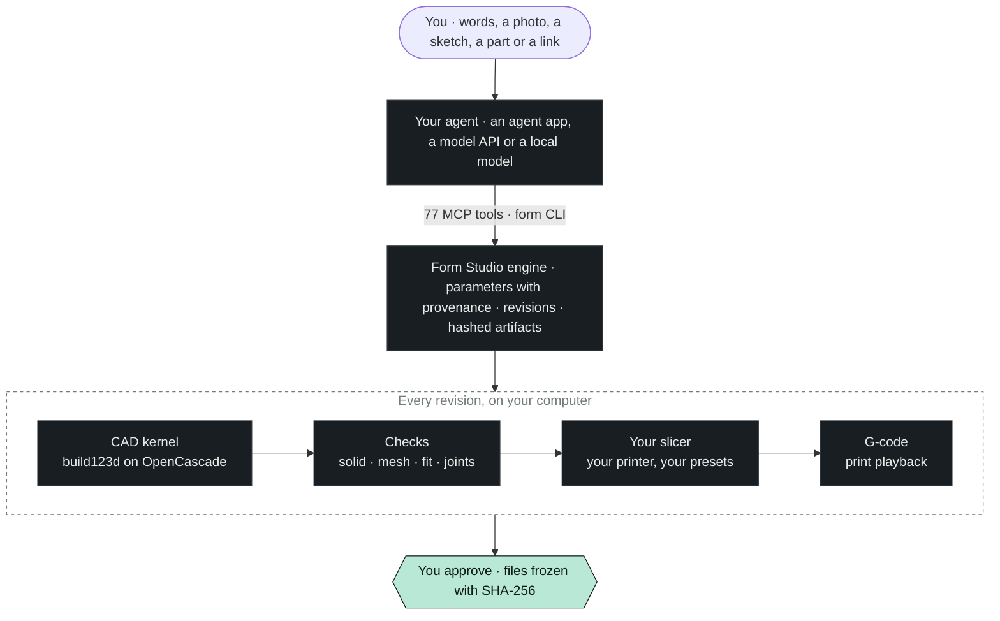
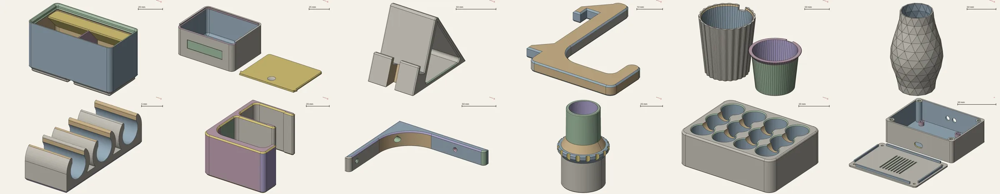

<p align="center">
  <picture>
    <source media="(prefers-color-scheme: dark)" srcset="docs/readme/header-dark.svg">
    
  </picture>
</p>

<p align="center">
  <a href="https://github.com/kaizensx/form-studio/releases/latest"></a>
  <a href="https://github.com/kaizensx/form-studio/actions/workflows/ci.yml"></a>
  
  <a href="docs/MCP.md"></a>
  <a href="LICENSE"></a>
  <a href="https://github.com/kaizensx/form-studio/stargazers"></a>
  <a href="https://github.com/kaizensx/form-studio/discussions"></a>
</p>

<p align="center">
  <a href="https://github.com/kaizensx/form-studio/releases/tag/v1.0.0"><b>Form Studio 1.0.0 is out: the first public release.</b></a> &nbsp;<a href="CHANGELOG.md">What is in it →</a>
</p>

<p align="center">
  <picture>
    <source media="(prefers-color-scheme: dark)" srcset="docs/readme/hero-dark.svg">
    
  </picture>
</p>

<p align="center">
  <a href="https://kaizensx.github.io/form-studio/#try"></a>
  &nbsp;
  <a href="https://github.com/kaizensx/form-studio/releases/latest/download/FORM-macos-arm64.zip"></a>
  <a href="https://github.com/kaizensx/form-studio/releases/latest/download/FORM-windows-x64.zip"></a>
  <a href="https://github.com/kaizensx/form-studio/releases/latest/download/FORM-linux-x64.tar.gz"></a>
</p>

<p align="center">
  <a href="#see-it-work">See it work</a> ·
  <a href="#how-it-works">How it works</a> ·
  <a href="#install">Install</a> ·
  <a href="#use-it-from-your-agent">Use it from your agent</a> ·
  <a href="#keyboard">Keyboard</a> ·
  <a href="docs/FEATURES.md">All features</a> ·
  <a href="https://kaizensx.github.io/form-studio/docs/">Docs</a> ·
  <a href="https://kaizensx.github.io/form-studio/recipes/">Recipe gallery</a>
</p>

<br>

**Form Studio** is an open-source desktop app for macOS, Windows and Linux. Describe a physical part, drop a photo,
sketch it or paste a link; an agent of your choice designs it as parametric B-rep geometry in
[build123d](https://github.com/gumyr/build123d) on OpenCascade while you watch. Every revision is rebuilt and checked on
the solid, sliced by **your** slicer with **your** presets, and played back layer by layer. When you approve, the files
are frozen with their hashes.

> [!TIP]
> The app on this page is drawn, not filmed: the parts are the CAD kernel's own meshes, and the checks, slice times,
> G-code and joint sweep are what a real run of the engine reported. [`scripts/readme_art.py`](scripts/readme_art.py)
> draws them again from a fresh run. To use the real thing without installing anything,
> [try it in your browser](https://kaizensx.github.io/form-studio/#try).

<table>
<tr>
<td align="center" width="20%"><h3>77</h3><sub>MCP tools for any agent</sub></td>
<td align="center" width="20%"><h3>7</h3><sub>slicers, sliced for real in CI</sub></td>
<td align="center" width="20%"><h3>13</h3><sub>design skills for agents</sub></td>
<td align="center" width="20%"><h3>5</h3><sub>export formats, STEP to GLB</sub></td>
<td align="center" width="20%"><h3>0</h3><sub>uploads. Everything runs on your computer</sub></td>
</tr>
</table>

## See it work

<table>
<tr>
<td width="50%" valign="top">
<picture>
  <source media="(prefers-color-scheme: dark)" srcset="docs/readme/prove-dark.svg">
  
</picture>
<h4>Proved on the solid</h4>
Every revision is checked on the B-rep and the exported mesh. Each result says how it is known:
<b>computed</b>, <b>heuristic</b> or <b>model</b>.
</td>
<td width="50%" valign="top">
<picture>
  <source media="(prefers-color-scheme: dark)" srcset="docs/readme/hinge-dark.svg">
  
</picture>
<h4>Parts that move together</h4>
Joints declared by the design, swept through their range and checked for collisions, with Assembled, Exploded and
Print layout views.
</td>
</tr>
<tr>
<td width="50%" valign="top">
<picture>
  <source media="(prefers-color-scheme: dark)" srcset="docs/readme/print-dark.svg">
  
</picture>
<h4>Watch it print before you print it</h4>
Your slicer's G-code, every layer and line type, timed by the slicer's own estimate. A simulation, labelled as one.
</td>
<td width="50%" valign="top">
<h4>Every number says how it is known</h4>

| Class | Means | Example |
|---|---|---|
|  | from the solid or the mesh | thinnest wall 4.86 mm |
|  | a rule of thumb, stated | plate contact 7735 mm² |
|  | a stated model, not a test | tip-over 1.12 N |
|  | your slicer's estimate | 1 h 56 min, 72.4 g |
|  | until you measure it | phone 9.5 mm thick |
|  | you measured it, and how | calipers |

Agents propose and build. Only a person approves a release.
</td>
</tr>
</table>

<details>
<summary><b>From an idea to released files</b> &nbsp;<sub>the five stages of a design</sub></summary>
<br>

| | Stage | What happens |
|:-:|---|---|
| **1** | **Start** | Words, a photo with a card or coin for scale, a sketch with dimensions, a STEP, STL or 3MF part, a PDF drawing or a link. One composer takes all of them. |
| **2** | **Concepts** | A new idea comes back as three or four genuinely different designs, each real CAD with its computed size and volume. Pick one, or ask for a mix. |
| **3** | **Shape and fit** | Features in build order, parameters with their provenance, fits for pins, threads and slots modelled against your printer. The agent asks you to measure what matters. |
| **4** | **Prove** | Checks on the solid, assemblies swept for collisions, the slice from your slicer, the print played back from its G-code. |
| **5** | **Release** | You approve. STEP, STL, 3MF, OBJ, GLB and G-code are frozen with SHA-256 hashes and a report of every check and its evidence. |

Just designing, not printing? Choose **Just a 3D model** on Home: print checks and slicing step aside, and the release
holds the formats you need for CAD, CNC, laser cutting or rendering.
</details>

<details>
<summary><b>Start from anything</b> &nbsp;<sub>words, photos, sketches, parts, drawings, links</sub></summary>
<br>

Type it, dictate it, drop a photo or a part, draw on the sketch pad or paste a link. With a bank card, a coin or a ruler
in the photo, the agent estimates sizes from it and keeps them marked *estimated from the photo* until you measure. The
sketch pad gives the agent structured geometry in millimetres, not just a picture. When a real number matters, the agent
asks for it with a card: where to measure, the tolerance that matters and what the design assumes now.
</details>

<details>
<summary><b>Finish it and hand it off</b> &nbsp;<sub>text on faces, what changed, instructions, every file</sub></summary>
<br>

| | |
|---|---|
| **Text on any flat face** | Pick a flat face in Annotate, type the words, raised or sunk. Stroke width and cap height are checked against your nozzle as you type, and the lettering becomes a feature in the design's own code. `form engrave` |
| **What changed, on the solids** | Compare two revisions in the kernel: material added in green, removed in red, with the volume and regions of each. `form diff` |
| **Assembly instructions** | A PDF with a parts page and one page per part, in the order the assembly attaches them, each at its exploded offset. `form instructions` |
| **Screw bosses and snap hooks** | Click a flat face: a screw boss sized for a tapped hole, a heat-set insert or a clearance hole, or a snap-fit hook, checked against your nozzle. `form feature` |
| **Every printer, compared** | One click slices the design for real on every printer in your slicers: time, filament and cost side by side. `form compare-printers` |
| **Turntable videos** | The part turning once, as MP4, WebP, GIF or PNG frames. `form turntable` |
| **Make it lighter** | Thinner walls, bigger pockets, less infill: only versions that still pass every check, with the grams saved. `form lighter` |
| **Replace a broken part** | A photo with a coin or card beside it; the agent estimates the sizes, asks for the ones that matter and designs the replacement. `form replace` |
| **Every file of a release** | **Save files…** gives one .zip with STEP, STL, the sliced 3MF, G-code, the report and documents. `form release-files` |
</details>

<details>
<summary><b>Any agent, any model</b> &nbsp;<sub>agent apps, model APIs, local models, your own endpoints</sub></summary>
<br>

| | Chat inside the app | MCP from its own window |
|---|:---:|:---:|
| **Claude Code** · **Codex** · **Gemini CLI** · **Cursor CLI** | ✓ | ✓ |
| **OpenCode** · **Qwen Code** · **GitHub Copilot CLI** | ✓ | ✓ |
| **Model APIs:** Anthropic, OpenAI, Gemini, OpenRouter, Mistral, xAI, DeepSeek, Groq | ✓ | |
| **Local models:** Ollama, LM Studio, llama.cpp | ✓ | |
| **Any provider by its address** (OpenAI-, Anthropic- or Gemini-compatible) | ✓ | |
| **Claude Desktop and any MCP client** | | ✓ |

The model menu searches hundreds of models and remembers the ones you use. Agents are never asked about a printer when
you only design.
</details>

<details>
<summary><b>Slicers and the programs you already have</b> &nbsp;<sub>seven slicers, FreeCAD, OpenSCAD, Blender</sub></summary>
<br>

| Slicer | Linux | Windows | macOS |
|---|:---:|:---:|:---:|
| Bambu Studio | CI real slice | CI real slice | ✓ |
| OrcaSlicer (including packed `.opc` profiles) | CI real slice | CI real slice | ✓ |
| PrusaSlicer | CI real slice | CI real slice | ✓ |
| SuperSlicer | CI real slice | CI real slice | ✓ |
| QIDISlicer | CI real slice | CI real slice | ✓ |
| ElegooSlicer | CI real slice | CI real slice | ✓ |
| Snapmaker Orca | CI real slice | CI real slice | ✓ |

Every printer set up in any installed slicer can be chosen, per design or as the default. Every night every recipe is
sliced by every slicer and published as the **[compatibility matrix](https://kaizensx.github.io/form-studio/compat/)**;
pipeline timings are tracked as **[benchmarks](https://kaizensx.github.io/form-studio/bench/)**. Plus **FreeCAD** (STEP
re-import check and a parameter macro), **OpenSCAD** (`.scad` designs with Customizer parameters), **Blender**
(photoreal renders in your filament colour) and **STEP or STL** reference parts to design around.
</details>

## How it works



Form Studio does not replace your CAD program or your slicer. It sits between the agent and that software and keeps the
record of what was designed, checked and released. An output is current only when it exists under the hash of its
inputs, so a changed clearance invalidates exactly what depends on it. More in [docs/ARCHITECTURE.md](docs/ARCHITECTURE.md).

| Principle | What it means |
|---|---|
| **Local** | Designs are never uploaded and prints are never started. |
| **A person releases** | Agents propose and build; only you approve the files. |
| **Every number says how it is known** | Computed, heuristic, modelled, simulated, measured or assumed. |
| **No capability exists only in the window** | Everything is also a `form` command and an MCP tool. |

## Install

Download the app for your platform; the first start installs what is missing (the standard-parts libraries, a slicer
if you print, an agent and its sign-in), one click of consent each.

<details open>
<summary><b>macOS</b> &nbsp;<sub>Apple Silicon and Intel</sub></summary>
<br>

[`FORM-macos-arm64.zip`](https://github.com/kaizensx/form-studio/releases/latest/download/FORM-macos-arm64.zip) ·
[`FORM-macos-x64.zip`](https://github.com/kaizensx/form-studio/releases/latest/download/FORM-macos-x64.zip). Unzip,
then right-click **FORM.app** › **Open** the first time. Or from a terminal:

```bash
curl -LsSf https://raw.githubusercontent.com/kaizensx/form-studio/main/install.sh | sh
form app
```
</details>

<details>
<summary><b>Windows</b> &nbsp;<sub>10 and 11</sub></summary>
<br>

[`FORM-windows-x64.zip`](https://github.com/kaizensx/form-studio/releases/latest/download/FORM-windows-x64.zip). Unzip
and run `FORM.exe`; in SmartScreen choose **More info** › **Run anyway**. Or with [uv](https://docs.astral.sh/uv/):

```powershell
uv tool install --python 3.12 "form-studio[all] @ git+https://github.com/kaizensx/form-studio"
form app
```
</details>

<details>
<summary><b>Linux</b> &nbsp;<sub>x64</sub></summary>
<br>

[`FORM-linux-x64.tar.gz`](https://github.com/kaizensx/form-studio/releases/latest/download/FORM-linux-x64.tar.gz).
Unpack and run `FORM/FORM`. Or from a terminal:

```bash
curl -LsSf https://raw.githubusercontent.com/kaizensx/form-studio/main/install.sh | sh
form app
```
</details>

Every release ships with `SHA256SUMS`, signed build provenance and an SBOM.

## Use it from your agent

Form Studio is an MCP server. Add it once and your agent can design, check, slice and prepare a release from its own
window while the open app follows along. `form setup` finds the agents on your computer and writes the entry for you.

<details open>
<summary><b>Claude Code</b></summary>

```bash
claude mcp add --scope user form -- form-mcp
```

Thirteen design skills (intake, parametric design, fit calibration, verify print and more) install as a plugin:

```bash
claude plugin marketplace add kaizensx/form-studio
claude plugin install form@form-studio
```
</details>

<details>
<summary><b>Codex</b></summary>

```bash
codex mcp add form -- form-mcp
```
</details>

<details>
<summary><b>Gemini CLI</b> &nbsp;<sub><code>~/.gemini/settings.json</code></sub></summary>

```json
{ "mcpServers": { "form": { "command": "form-mcp" } } }
```
</details>

<details>
<summary><b>Cursor</b> &nbsp;<sub><code>~/.cursor/mcp.json</code></sub></summary>

```json
{ "mcpServers": { "form": { "command": "form-mcp" } } }
```
</details>

<details>
<summary><b>Claude Desktop and any other MCP client</b></summary>

```json
{ "mcpServers": { "form": { "command": "form-mcp" } } }
```
</details>

<details>
<summary><b>Or without any window</b> &nbsp;<sub>every action is a <code>form</code> command that prints JSON</sub></summary>

```bash
form start --text "a hook for my headphones under the desk" --photo desk.jpg   # start from words and a photo
form new "Desk stand" device_stand device_width=75.6                           # from a building block: solid, checks, slice
form commit desk-stand lean=18 --expect-head 1                                 # a new revision, rebuilt, checked and sliced
form simulate desk-stand --png print.png --layer 40                            # the print at layer 40, from the G-code
form purpose desk-stand model --process cnc                                    # just a 3D model from now on
form chat "Make the base 92 mm deep" --project desk-stand --agent codex
```
</details>

Reference: [every command](docs/CLI.md) · [77 MCP tools](docs/MCP.md) · [guide for coding agents](AGENTS.md)

## Keyboard

| | macOS | Windows and Linux |
|---|---|---|
| Search and commands | <kbd>⌘</kbd> <kbd>K</kbd> | <kbd>Ctrl</kbd> <kbd>K</kbd> |
| New design | <kbd>⌘</kbd> <kbd>N</kbd> | <kbd>Ctrl</kbd> <kbd>N</kbd> |
| New conversation | <kbd>⇧</kbd> <kbd>⌘</kbd> <kbd>O</kbd> | <kbd>Ctrl</kbd> <kbd>Shift</kbd> <kbd>O</kbd> |
| Show or hide the conversation | <kbd>⌘</kbd> <kbd>J</kbd> | <kbd>Ctrl</kbd> <kbd>J</kbd> |
| All designs | <kbd>⇧</kbd> <kbd>⌘</kbd> <kbd>H</kbd> | <kbd>Ctrl</kbd> <kbd>Shift</kbd> <kbd>H</kbd> |
| Undo, redo | <kbd>⌘</kbd> <kbd>Z</kbd> · <kbd>⇧</kbd> <kbd>⌘</kbd> <kbd>Z</kbd> | <kbd>Ctrl</kbd> <kbd>Z</kbd> · <kbd>Ctrl</kbd> <kbd>Shift</kbd> <kbd>Z</kbd> |
| Settings | <kbd>⌘</kbd> <kbd>,</kbd> | <kbd>Ctrl</kbd> <kbd>,</kbd> |

In the workspace: <kbd>V</kbd> select · <kbd>M</kbd> measure · <kbd>N</kbd> annotate · <kbd>X</kbd> section ·
<kbd>A</kbd> analyse · <kbd>E</kbd> assembly · <kbd>T</kbd> history · <kbd>F</kbd> frame the part.

## Building blocks and the community gallery

<p align="center"></p>

Agents start from parametric building blocks made of the things people print most: Gridfinity bins and baseplates,
boxes with sliding, press-on or hinged lids, SKÅDIS pegboard accessories, phone and tablet stands, cable organizers,
under-desk hangers, shelf brackets, hose adapters, self-watering planters, faceted vases and lamp shades, battery and
card holders, and electronics enclosures. Each passes its checks at its defaults and prints without supports.

Browse them, and what the community adds, in the **[recipe gallery](https://kaizensx.github.io/form-studio/recipes/)**.
To share one, **[open a recipe issue](https://github.com/kaizensx/form-studio/issues/new?template=3-recipe.yml)** or run
`form recipes submit`: the recipe is built, checked and sliced automatically and the issue is answered with pictures.
How to write one: [docs/RECIPES.md](docs/RECIPES.md).

## Community

| | |
|---|---|
| **[Q&A](https://github.com/kaizensx/form-studio/discussions/categories/q-a)** | How to do something, or setup help. |
| **[Printers and slicers](https://github.com/kaizensx/form-studio/discussions/categories/printers-slicers)** | Presets, filaments and slicer questions, answered by people who print. |
| **[Agents and models](https://github.com/kaizensx/form-studio/discussions/categories/agents-models)** | Which agents, models and providers design well, and how to connect them. |
| **[Ideas](https://github.com/kaizensx/form-studio/discussions/categories/ideas)** | Talk an idea through before it becomes a feature request. |
| **[Show and tell](https://github.com/kaizensx/form-studio/discussions/categories/show-and-tell)** | The parts you made, with how they printed. |
| **[Issues](https://github.com/kaizensx/form-studio/issues/new/choose)** | Bugs, slicer and printer support, agent support, recipes, docs. |
| **[Contributing](CONTRIBUTING.md)** | Recipes, slicer adapters, agent integrations and measured print results. Branch from `dev` and open a pull request against it. |
| **More** | [Code of Conduct](CODE_OF_CONDUCT.md) · [Support](SUPPORT.md) · [Security](SECURITY.md) · [Changelog](CHANGELOG.md) |

<p align="center">
  <a href="https://github.com/kaizensx/form-studio/graphs/contributors"></a>
</p>

<p align="center">
  <a href="https://star-history.com/#kaizensx/form-studio&Date">
    <picture>
      <source media="(prefers-color-scheme: dark)" srcset="https://api.star-history.com/svg?repos=kaizensx/form-studio&type=Date&theme=dark">
      
    </picture>
  </a>
</p>

## Licence

MIT. Form Studio calls build123d (Apache-2.0), OpenCascade (LGPL-2.1), your slicer and other programs as separate
programs; none of them is bundled into its code. three.js (MIT) draws the website. Instrument Sans and Geist Mono (SIL OFL 1.1) and Lucide icons (ISC)
are drawn in the app and in the pictures above. The Gridfinity system was created by Zack Freedman and SKÅDIS is a
product of IKEA; Form Studio's building blocks follow their published dimensions and are not affiliated with either.
