<p align="center">
  <a href="https://kaizensx.github.io/form-studio/">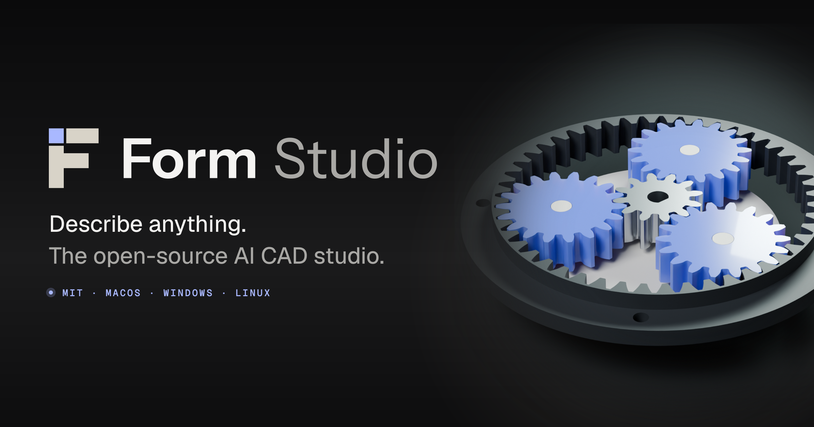</a>
</p>

<h1 align="center">Form Studio</h1>

<p align="center"><b>An engineer-grade agent builds what you describe as real, editable CAD.</b><br>
Parametric build123d on OpenCascade, every requirement proved on the solid, on your computer.</p>

<p align="center">
  <a href="https://github.com/kaizensx/form-studio/releases/latest/download/FORM-macos-arm64.zip"></a>
  <a href="https://github.com/kaizensx/form-studio/releases/latest/download/FORM-macos-x64.zip"></a>
  <a href="https://github.com/kaizensx/form-studio/releases/latest/download/FORM-windows-x64.zip"></a>
  <a href="https://github.com/kaizensx/form-studio/releases/latest/download/FORM-linux-x64.tar.gz"></a>
</p>

<p align="center">
  <sub><a href="https://github.com/kaizensx/form-studio/releases/latest"><b>Version 1.1.0</b></a>: a new look, bring anything, scans and sculpts as designs &nbsp;·&nbsp; <a href="CHANGELOG.md">What is in it</a> &nbsp;·&nbsp; <a href="https://kaizensx.github.io/form-studio/#try">Try it in your browser</a> &nbsp;·&nbsp; <a href="https://kaizensx.github.io/form-studio/docs/">Docs</a> &nbsp;·&nbsp; <a href="https://discord.gg/b6ZgyndkmS">Discord</a></sub>
</p>

<p align="center">
  <picture>
    <source media="(prefers-color-scheme: dark)" srcset="docs/readme/building-dark.svg">
    
  </picture>
</p>

<p align="center"><sub><b>New in 1.1.</b> Lightdesk: the 3D view fills the window, every control is a pane of glass, the conversation is a column beside the stage, and one colour, electric cyan, says where you are. Bring anything and a triage step works out what it is: scans and sculpts become designs, imperfect meshes are repaired, heavy ones are welcome. Every design is checked against the numbers you asked for and refined after it builds.</sub></p>

<p align="center">
  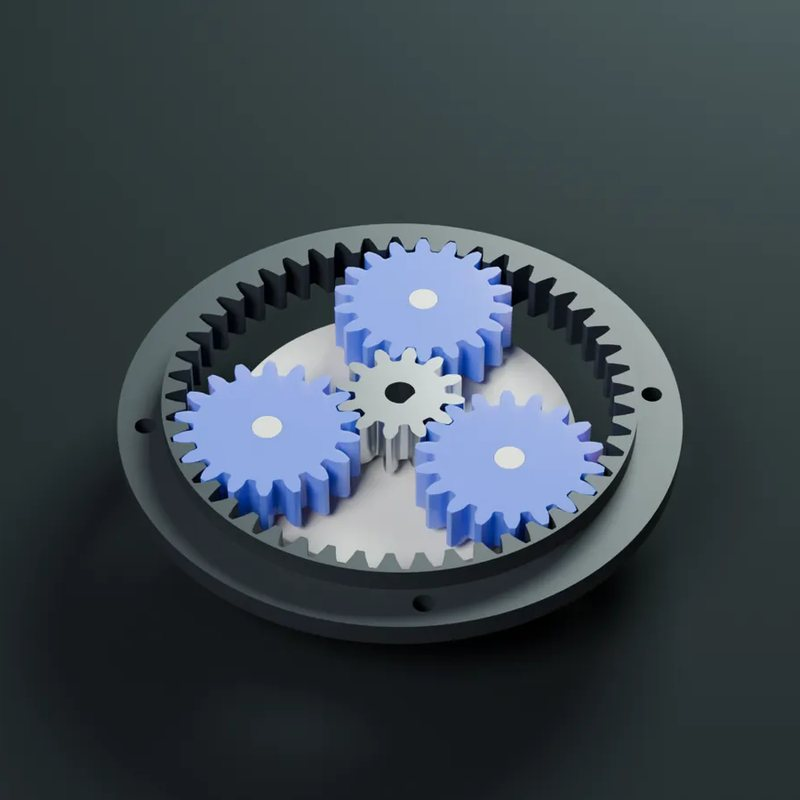
  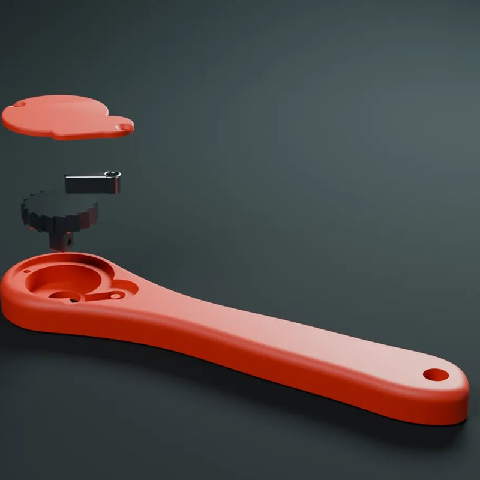
  
  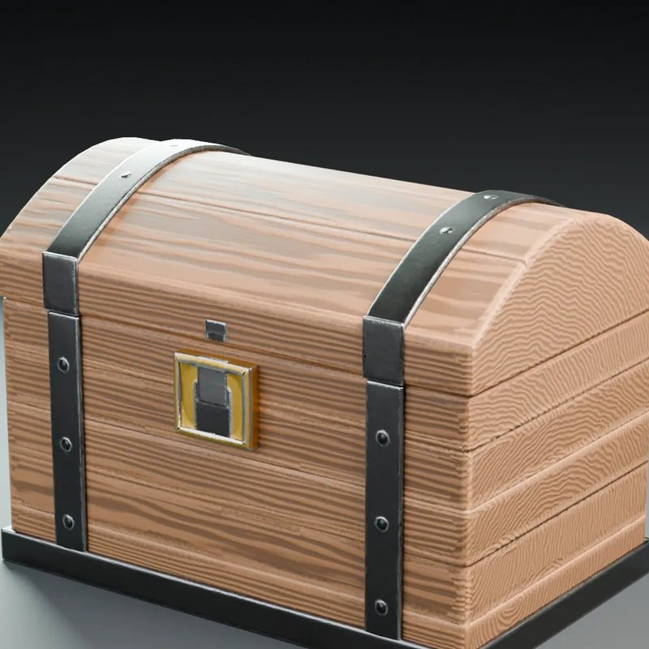
  <br>
  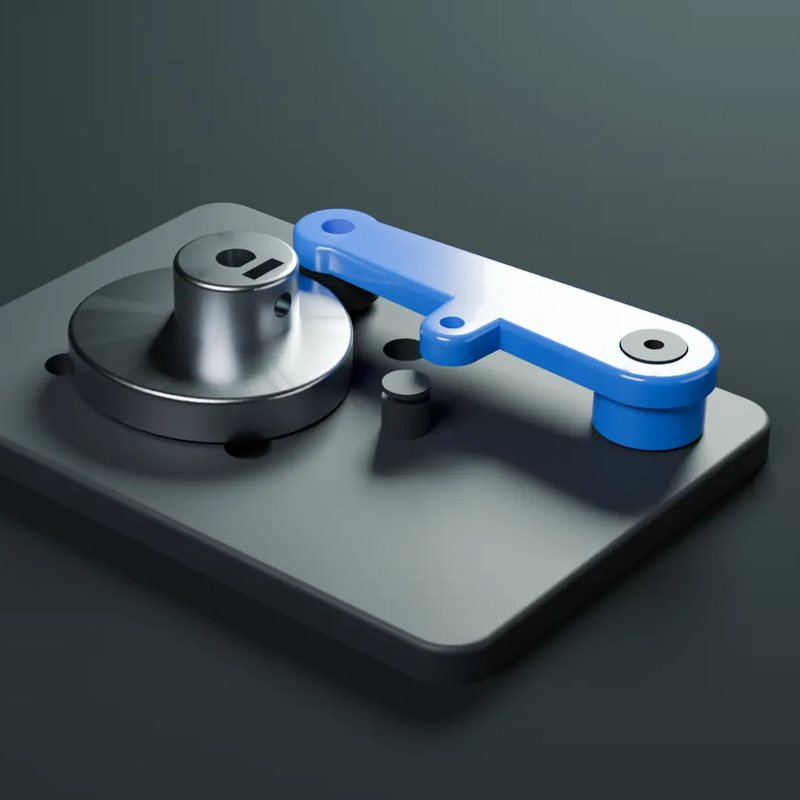
  
  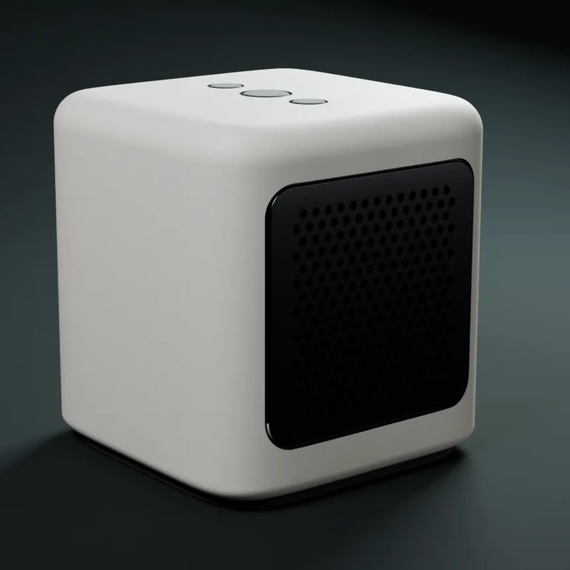
  
  <br>
  <sub>Mechanisms, assemblies, organic shells, products and game assets (Beta): every picture is a real build, an original design written as parametric code. <a href="https://kaizensx.github.io/form-studio/#make">See what it makes</a> · <a href="https://kaizensx.github.io/form-studio/measure/">How we measure</a></sub>
</p>

<p align="center">
  <a href="https://github.com/kaizensx/form-studio/actions/workflows/ci.yml?query=branch%3Amain"></a>
  <a href="https://github.com/kaizensx/form-studio/actions/workflows/codeql.yml"></a>
  <a href="https://scorecard.dev/viewer/?uri=github.com/kaizensx/form-studio"></a>
  <a href="https://github.com/kaizensx/form-studio/releases/latest"></a>
  <a href="https://github.com/kaizensx/form-studio/releases"></a>
  <a href="LICENSE"></a>
  <a href="https://github.com/kaizensx/form-studio/discussions"></a>
</p>

**Form Studio is the open-source AI CAD studio: describe anything, and an engineer-grade agent builds it as real, editable CAD.** Type what you need, drop a photo or a sketch, or bring a part. The agent of your choice writes a parametric design in [build123d](https://github.com/gumyr/build123d), and the OpenCascade kernel builds it as a B-rep solid while you watch: features you can click, parameters you can change, and every revision checked on the solid itself. Take it out as STEP for your CAD program or a CNC shop, as meshes for renders and the web, or to your own slicer if you print. Everything runs on your computer.

<p align="center">
  <picture>
    <source media="(prefers-color-scheme: dark)" srcset="docs/readme/numbers-1-dark.svg">
    
  </picture>
  <picture>
    <source media="(prefers-color-scheme: dark)" srcset="docs/readme/numbers-2-dark.svg">
    
  </picture>
</p>

## How it works

<p align="center">
  <picture>
    <source media="(prefers-color-scheme: dark)" srcset="docs/readme/steps-1-dark.svg">
    
  </picture>
  <picture>
    <source media="(prefers-color-scheme: dark)" srcset="docs/readme/steps-2-dark.svg">
    
  </picture>
</p>

Form Studio sits between your agent and the CAD kernel and keeps the record of what was designed, checked and released. Every number carries how it is known, every revision is kept, and an output is current only when it exists under the hash of its inputs, so a changed clearance invalidates exactly what depends on it.

<details>
<summary><b>What runs where</b></summary>
<br>

```mermaid
flowchart LR
  you(["You: words, a photo,<br/>a sketch, a part, a link"]) --> agent["Your agent<br/>app, model API or local model"]
  agent -- "127 MCP tools · form CLI" --> engine["Form Studio engine<br/>parameters with provenance<br/>revisions · hashed outputs"]
  engine --> kernel["CAD kernel<br/>build123d on OpenCascade"]
  kernel --> checks["Checks<br/>solid · mesh · fits · joints"]
  checks --> release{{"You approve<br/>files frozen with SHA-256"}}
  release --> out["STEP · STL · OBJ · GLB<br/>renders · your slicer"]
  classDef datum fill:#3ee6ff,stroke:#0b0b0c,color:#0b0b0c
  classDef plate fill:#19191a,stroke:#2f2f31,color:#f4f3f1
  class release datum
  class agent,engine,kernel,checks,out plate
```

| Principle | What it means |
|---|---|
| **Local** | Form Studio never uploads your files on its own. With a cloud AI agent, the conversation and the renders you share go to that agent's provider. |
| **A person releases** | Agents propose and build; only you approve the files. |
| **Every number says how it is known** | Computed, heuristic, modelled, simulated, measured or assumed. |
| **Nothing exists only in the window** | Every action is also a `form` command and an MCP tool. |

More in [docs/ARCHITECTURE.md](docs/ARCHITECTURE.md).
</details>

## Design

<p align="center">
  <picture>
    <source media="(prefers-color-scheme: dark)" srcset="docs/readme/feature-start-dark.svg">
    
  </picture>
  <picture>
    <source media="(prefers-color-scheme: dark)" srcset="docs/readme/feature-shape-dark.svg">
    
  </picture>
</p>

Start from words, a photo with a card or coin for scale, a sketch with real dimensions, a part to design around, a PDF drawing or a link. For a new idea the agent proposes several genuinely different concepts, each a real CAD model, and you pick one. When a number decides the fit, it asks you to measure it and shows where. The result is a parametric design, not a frozen mesh: every face belongs to a named feature, and every parameter has a unit, a range and a source.

## Engineer

<p align="center">
  <picture>
    <source media="(prefers-color-scheme: dark)" srcset="docs/readme/feature-gears-dark.svg">
    
  </picture>
  <picture>
    <source media="(prefers-color-scheme: dark)" srcset="docs/readme/feature-move-dark.svg">
    
  </picture>
</p>

Agents design with engineering parts that carry their sources: ISO 273 screw clearances, heat-set insert pockets, nut traps, bearing seats, printable threads and involute gears. Assemblies are declared as parts, joints and mates; every joint is swept through its range and checked for collisions, with Assembled and Exploded views and assembly instructions as a PDF. Constraints refuse impossible combinations with the feature, the parameters and a way forward, and an optimiser finds the best values under the requirements you state.

Bring a circuit board (KiCad `.kicad_pcb` or IDF) and the agent makes an enclosure around it: standoffs on its mounting holes, openings aligned to its connectors, a lid with a lip. The board is checked against the enclosure on the solids at every revision, so a moved connector or a taller part shows up as a failed check; with KiCad installed, its own DRC and ERC and the fab files come from your copy ([docs/BOARDS.md](docs/BOARDS.md)).

A library of design helpers gives the agent proven building blocks for mechanisms (hinges, snap fits, bayonets, ratchets, cams, gear trains and planetary sets), for surfaces (lofts, sweeps, shells and variable fillets), for organic forms (helmet shells, grips, handles) and for texture (knurls and embossed patterns on the solid itself, fine grain as a mesh texture), each with typed fallbacks and a clear error when a value cannot work.

## Reconstruct

Bring the part you already have, from whatever program or scanner made it: STEP, IGES, STL, OBJ, 3MF, PLY, glTF, Collada, VRML, VTK, a point cloud (XYZ, PTS, LAS, E57), a DXF or SVG drawing, or a zip of them. A board, a phone or a motor becomes a reference the design is built around, with clearance cut from the real geometry. A photo of a broken part with a card or coin beside it starts **Replace a broken part**: sizes estimated from the photo stay *assumed* until you measure the ones that decide the fit, then the agent designs the replacement and strengthens it where it broke.

Whatever you bring is assessed first. **Triage** reads a mesh, a STEP, a photo, a sketch, a PDF, a link or plain words, says what it is and takes the right route by itself; `form triage FILE` prints the same assessment in a terminal. A mesh is repaired on a copy (sliver triangles, flipped faces, small holes, flat openings, loose debris; every repair is listed and no vertex is moved) and classed mechanical, organic or mixed from its own surface.

| What you bring | What it becomes |
|---|---|
| A mechanical part that closes | Parametric CAD, verified against the mesh |
| A smooth closed sculpt | A surface body: NURBS faces over a cage you can edit, with STEP |
| A scan or sculpt with fine detail, handles or many triangles | A mesh body with Scale and Flat base, into which exact CAD features are cut |
| Several closed bodies | One design, one part per body |
| A surface that does not close | A reference to design around; nothing is guessed |

**Make editable** turns a mechanical mesh or scan into CAD you can change: it always builds an exact solid from the triangles, then fits planes, cylinders, cones, spheres and tori where the surface allows and, for a part that is one extrusion or one revolution, rebuilds the profile, holes and patterns as parameters. A report gives the two-sided deviation, the volume change and how much of the area became parametric; anything that does not fit within tolerance stays exact rather than being guessed.

## Review

<p align="center">
  <picture>
    <source media="(prefers-color-scheme: dark)" srcset="docs/readme/feature-proved-dark.svg">
    
  </picture>
  <picture>
    <source media="(prefers-color-scheme: dark)" srcset="docs/readme/feature-release-dark.svg">
    
  </picture>
</p>

Every revision is checked on the B-rep and its mesh: a valid solid, a closed export mesh, the STL against the CAD volume, the STEP re-imported in FreeCAD, fits, joints and loads. Each result says whether it was computed, a stated rule of thumb or a model. Compare any two revisions on the solids themselves, branch, keep variants, and go back at any point. Only a person approves a release, and its files are frozen with their hashes and a report of every check.

## Make it

<p align="center">
  <picture>
    <source media="(prefers-color-scheme: dark)" srcset="docs/readme/feature-slicer-dark.svg">
    
  </picture>
</p>

One design, the output you need:

| Output | What you get |
|---|---|
| **CAD exchange** | STEP from the B-rep, re-imported in FreeCAD as a check; a native FreeCAD PartDesign feature tree (sketches, pads, holes, fillets, patterns, a spreadsheet of the parameters) with editable history, recomputed in FreeCAD and checked against the solid; and OpenSCAD designs welcome as a source. |
| **CNC, laser and moulding** | Mark a design *Just a 3D model* for its process: its thinnest feature is compared with what that process can make, and no print checks get in the way. Give it an engineering material (aluminium 6061 or 7075, steel, stainless, brass, titanium, woods, POM and more) for its look and its computed mass. |
| **Renders and the web** | OBJ and GLB, four-view sheets, turntable videos and photoreal renders in Blender. |
| **Game engines (Beta)** | Four levels of detail inside triangle budgets, UVs, baked textures and collision, for Unreal, Unity, Godot and glTF. Every asset passes its technical checks; visual quality is still improving. |
| **3D printing (optional)** | Your own slicer with your printer's presets, slices played back layer by layer, every printer you have compared, fits modelled against your printer's accuracy. Turn it on when you print; it stays out of the way when you do not. |

Also in Form Studio: automatic refinement you can undo change by change, a switch in Settings for every engine you install, concepts that come back as several genuinely different designs, screw bosses and snap-fit hooks placed with a click, text on any flat face, what changed between two revisions on the solids, assembly instructions as a PDF and turntable videos. All of it is in the [changelog](CHANGELOG.md) and [docs/FEATURES.md](docs/FEATURES.md).

> [!NOTE]
> Nothing on this page is mocked up. The parts are the CAD kernel's own meshes and edges, and the gears turn by their own tooth counts. The two designs at the top are build123d code in [`scripts/readme_designs/`](scripts/readme_designs), built through the same `create_design` tool an agent calls; the checks, ratios, G-code layer, joint sweep and file hashes are what a real run of the engine produced. [`scripts/readme_art.py`](scripts/readme_art.py) draws every picture again from a fresh run.

## Install

Download the app for your platform and open it. The first start installs what is missing (the standard-parts libraries, an agent and its sign-in, and a slicer only if you print), one click of consent each, in its own window.

The first start asks what you want to make and installs only that: mechanical parts, an agent, photoreal renders, CAD exchange, mesh to CAD, or 3D printing. Turn any of them on later in Settings › Set up for.

<details>
<summary><b>macOS</b> &nbsp;·&nbsp; Apple silicon and Intel</summary>
<br>

Download [`FORM-macos-arm64.zip`](https://github.com/kaizensx/form-studio/releases/latest/download/FORM-macos-arm64.zip) or [`FORM-macos-x64.zip`](https://github.com/kaizensx/form-studio/releases/latest/download/FORM-macos-x64.zip), unzip it, then right-click **Form Studio.app** › **Open** the first time. Or from a terminal:

```bash
curl -LsSf https://raw.githubusercontent.com/kaizensx/form-studio/main/install.sh | sh
form app
```
</details>

<details>
<summary><b>Windows</b> &nbsp;·&nbsp; 10 and 11</summary>
<br>

Download [`FORM-windows-x64.zip`](https://github.com/kaizensx/form-studio/releases/latest/download/FORM-windows-x64.zip), unzip it and run `FORM.exe`; in SmartScreen choose **More info** › **Run anyway**. Or with [uv](https://docs.astral.sh/uv/):

```powershell
uv tool install --python 3.12 "form-studio[all] @ git+https://github.com/kaizensx/form-studio"
form app
```
</details>

<details>
<summary><b>Linux</b> &nbsp;·&nbsp; x64</summary>
<br>

Download [`FORM-linux-x64.tar.gz`](https://github.com/kaizensx/form-studio/releases/latest/download/FORM-linux-x64.tar.gz), unpack it and run `FORM/FORM`. Or from a terminal:

```bash
curl -LsSf https://raw.githubusercontent.com/kaizensx/form-studio/main/install.sh | sh
form app
```
</details>

Every release ships with `SHA256SUMS`, signed build provenance and an SBOM.

## Use it from your agent

<p align="center">
  <picture>
    <source media="(prefers-color-scheme: dark)" srcset="docs/readme/feature-talk-dark.svg">
    
  </picture>
</p>

Form Studio is an MCP server. Add it once and your agent can design, check, review and prepare a release from its own window while the open app follows along. `form setup` finds the agents on your computer and writes the entry for you.

<details>
<summary><b>Claude Code</b></summary>
<br>

```bash
claude mcp add --scope user form -- form-mcp
```

Nineteen design skills (intake, parametric design, industrial design, assemblies and mechanisms, remodel from mesh, design review and more) install as a plugin:

```bash
claude plugin marketplace add kaizensx/form-studio
claude plugin install form@form-studio
```
</details>

<details>
<summary><b>Codex</b></summary>
<br>

```bash
codex mcp add form -- form-mcp
```
</details>

<details>
<summary><b>Gemini CLI</b> &nbsp;·&nbsp; <code>~/.gemini/settings.json</code></summary>
<br>

```json
{ "mcpServers": { "form": { "command": "form-mcp" } } }
```
</details>

<details>
<summary><b>Cursor</b> &nbsp;·&nbsp; <code>~/.cursor/mcp.json</code></summary>
<br>

```json
{ "mcpServers": { "form": { "command": "form-mcp" } } }
```
</details>

<details>
<summary><b>Claude Desktop and any other MCP client</b></summary>
<br>

```json
{ "mcpServers": { "form": { "command": "form-mcp" } } }
```
</details>

Agents follow the same rules as the app: units in millimetres, preview before commit, provenance kept honest, and no release without a person. The guide for coding agents is [AGENTS.md](AGENTS.md); every tool is in [docs/MCP.md](docs/MCP.md).

## Headless

<p align="center">
  <picture>
    <source media="(prefers-color-scheme: dark)" srcset="docs/readme/feature-headless-dark.svg">
    
  </picture>
</p>

Every action is a `form` command that prints JSON, and every MCP tool can be called as `form tool NAME '{json}'`.

```bash
form start --text "a planetary stage, 1:5, on a 5 mm shaft" --purpose model    # start from words
form start --text "a hook for my headphones under the desk" --photo desk.jpg    # from words and a photo
form new "Desk stand" device_stand device_width=75.6                            # from a building block
form commit desk-stand lean=18 --expect-head 1                                  # a new revision, rebuilt and checked
form diff desk-stand 1 2 --png diff.png                                         # what changed in the solid
form triage scan.stl                                                            # what a file is, and the route it takes
form tool get_project '{"project": "desk-stand"}'                               # any MCP tool, from the shell
```

| | |
|---|---|
| **Every command** | [docs/CLI.md](docs/CLI.md) |
| **127 MCP tools** | [docs/MCP.md](docs/MCP.md) |
| **How the engine is built** | [docs/ARCHITECTURE.md](docs/ARCHITECTURE.md) |
| **Strength studies and their verification** | [docs/STRENGTH.md](docs/STRENGTH.md) |
| **Engineering calculators and their verification** | [docs/CALCULATORS.md](docs/CALCULATORS.md) |
| **CNC toolpaths and their stock simulation** | [docs/CAM.md](docs/CAM.md) |
| **Print physics: orientation, strength as printed, warp risk** | [docs/PRINT_PHYSICS.md](docs/PRINT_PHYSICS.md) |
| **Inverse design and topology optimisation, with their verification** | [docs/OPTIMISATION.md](docs/OPTIMISATION.md) |
| **Cost per process, with sourced rates** | [docs/COST.md](docs/COST.md) |
| **Tolerance stack-up and its verification** | [docs/TOLERANCES.md](docs/TOLERANCES.md) |

## Community

**[Join the Form Studio Discord](https://discord.gg/b6ZgyndkmS)**: help, the things people made, ideas and every release as it ships.

| | |
|---|---|
| **[Q&A](https://github.com/kaizensx/form-studio/discussions/categories/q-a)** | How to do something, or help with setup. |
| **[Agents and models](https://github.com/kaizensx/form-studio/discussions/categories/agents-models)** | Which agents and models design well, and how to connect them. |
| **[Ideas](https://github.com/kaizensx/form-studio/discussions/categories/ideas)** | Talk an idea through before it becomes a feature request. |
| **[Show and tell](https://github.com/kaizensx/form-studio/discussions/categories/show-and-tell)** | The things you made, and how they came out. |
| **[Printers and slicers](https://github.com/kaizensx/form-studio/discussions/categories/printers-slicers)** | Presets, filaments and slicer questions, answered by people who print. |

**Contributing.** Design helpers, agent integrations, software adapters and measured results are all welcome: see [CONTRIBUTING.md](CONTRIBUTING.md). Branch from `dev` and open the pull request against it.

**Security.** Report a vulnerability privately as described in [SECURITY.md](SECURITY.md). [Code of Conduct](CODE_OF_CONDUCT.md) · [Support](SUPPORT.md) · [Changelog](CHANGELOG.md)

## Licence

MIT. Form Studio calls build123d (Apache-2.0), OpenCascade (LGPL-2.1), your slicer and other programs as separate programs; none of them is bundled into its code. py_gearworks (Apache-2.0) draws involute gears, bd_warehouse (Apache-2.0) builds standard hardware, and bd_materials and threejs-materials (Apache-2.0) give engineering materials their density and look. three.js (MIT) draws the website. Geist and Geist Mono (SIL OFL 1.1) are drawn in the app and in the pictures on this page, and Instrument Sans (SIL OFL 1.1) on share cards and renders, and Lucide icons (ISC) in the app. The Gridfinity system was created by Zack Freedman and SKÅDIS is a product of IKEA; Form Studio's building blocks follow their published dimensions and are not affiliated with either.

One folder is not MIT: [`form/recon/cadfit/`](form/recon/cadfit/PERMISSION.md) holds code from CADFit (Nehme, Whalen, Ahmed), licensed CC BY-NC 4.0 and included and modified with its author's permission. It is an optional mesh-to-CAD candidate, off unless `[recon] cadfit = true`; see its [PERMISSION.md](form/recon/cadfit/PERMISSION.md) and [LICENSE](form/recon/cadfit/LICENSE). Optional engines installed from Settings › Engines & software keep their own licences, listed in [THIRD_PARTY_NOTICES.md](THIRD_PARTY_NOTICES.md).
