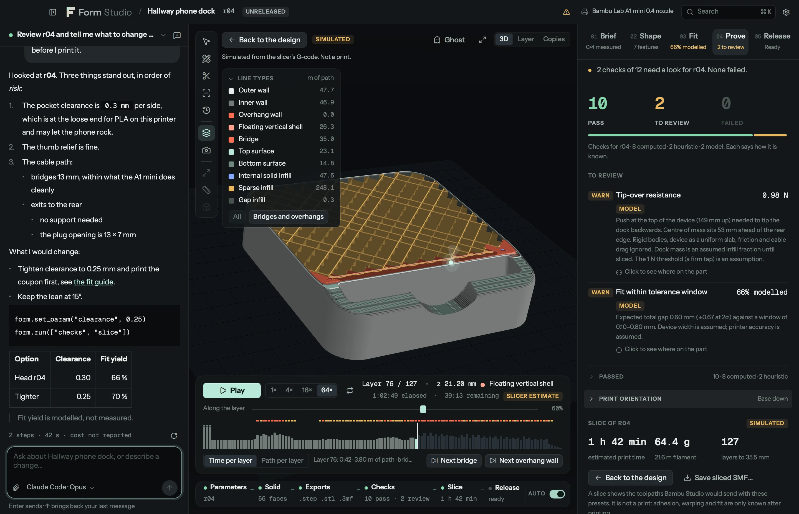
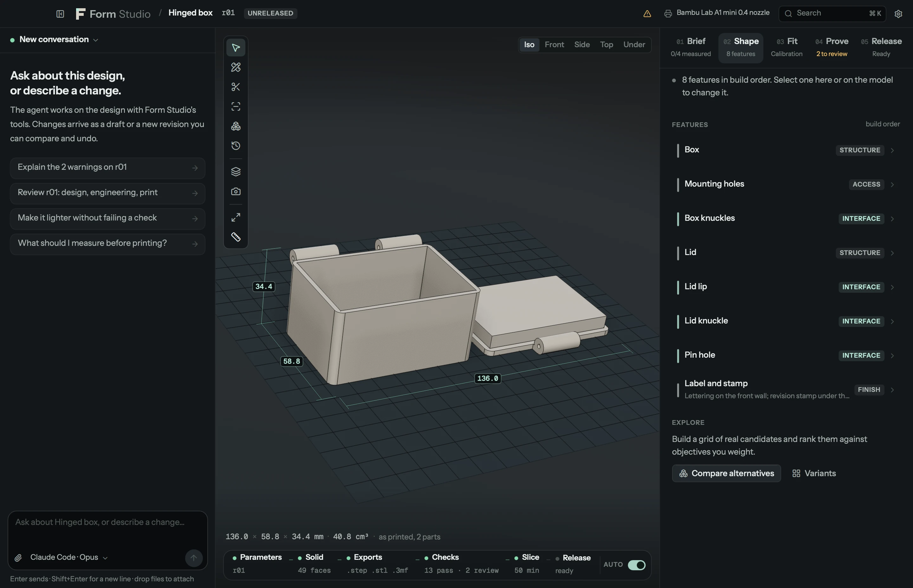
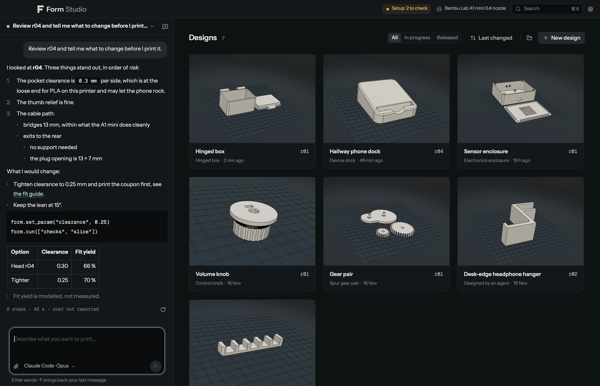
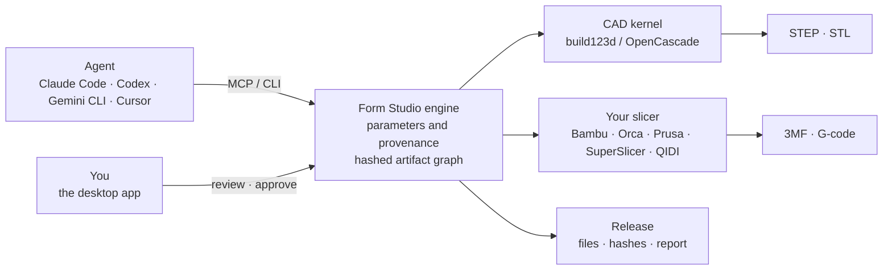

<p align="center">
  <picture>
    <source media="(prefers-color-scheme: dark)" srcset="brand/lockup.svg">
    
  </picture>
</p>

<p align="center"><b>Describe a part. Get a file you can print.</b></p>

<p align="center">
  An AI agent designs your part with a real CAD kernel, checks it, slices it with your own slicer<br>
  and simulates the print layer by layer. A native desktop app for macOS, Windows and Linux.
</p>

<p align="center">
  <a href="https://github.com/kaizensx/form-studio/releases/latest"><b>Download</b></a> ·
  <a href="https://kaizensx.github.io/form-studio/">Website</a> ·
  <a href="docs/APP.md">Guide</a> ·
  <a href="docs/MCP.md">MCP tools</a> ·
  <a href="CHANGELOG.md">Changelog</a>
</p>

<p align="center">
  <a href="https://github.com/kaizensx/form-studio/actions/workflows/ci.yml"></a>
  <a href="https://github.com/kaizensx/form-studio/actions/workflows/slicers.yml"></a>
  
  
</p>

<p align="center"></p>

## What it does

You describe what you need in plain language: what it holds, where it goes, the sizes you measured. The agent builds the part in a parametric CAD model while you watch, and Form Studio carries it the rest of the way:

- **Design.** Real B-rep geometry from build123d on OpenCascade, exported as STEP and STL. Every change is a revision you can compare, branch from and undo.
- **Check.** Twelve checks per revision: a valid solid, wall thickness, overhangs, bridges, bed contact, fit within its tolerance window, tip-over resistance. Each result says how it is known: measured, computed, modelled or assumed.
- **Fit.** The gap between a pocket and the object it holds is modelled from your measurements and your printer's accuracy, and Form Studio tells you the cheapest way to raise the odds.
- **Slice.** Your own slicer, with your printer, filament and process presets: Bambu Studio, OrcaSlicer, PrusaSlicer, SuperSlicer or QIDISlicer.
- **Simulate.** The toolpaths are read back from the G-code and played layer by layer, with line types, bridges and the slicer's time and filament estimate.
- **Release.** A frozen folder of STEP, STL, 3MF and G-code with hashes and a report, approved by you.

<table>
<tr>
<td width="50%"></td>
<td width="50%"></td>
</tr>
<tr>
<td><b>Conversations.</b> Many conversations per design or free-standing, with search, pins, attachments, cost per conversation, and a choice of agent and model for each.</td>
<td><b>Fit.</b> A section cut through the interface, the clearance per side and the modelled chance the part fits.</td>
</tr>
<tr>
<td></td>
<td></td>
</tr>
<tr>
<td><b>Print simulation.</b> Every layer from the slicer's own G-code. Jump to the next bridge or overhang.</td>
<td><b>Release.</b> One approval freezes the files. Verify them at any time against their hashes.</td>
</tr>
<tr>
<td></td>
<td></td>
</tr>
<tr>
<td><b>Assemblies.</b> Several parts, their joints and clearances, with an exploded view and moving hinges.</td>
<td><b>Home.</b> Every design as a live 3D card, filtered by released and in progress.</td>
</tr>
</table>

## Get started

Download the app for your platform from the [latest release](https://github.com/kaizensx/form-studio/releases/latest):

| Platform | File |
|---|---|
| macOS, Apple Silicon | `FORM-macos-arm64.zip` |
| macOS, Intel | `FORM-macos-x64.zip` |
| Windows 10 and 11 | `FORM-windows-x64.zip` |
| Linux x64 | `FORM-linux-x64.tar.gz` |

On first start, Form Studio checks what it needs and offers to install the rest from inside the app: the standard-parts libraries, a slicer, an agent and its sign-in. Each command is shown before it runs, and nothing is installed until you press Install.

<p align="center"></p>

Prefer the command line:

```bash
curl -LsSf https://raw.githubusercontent.com/kaizensx/form-studio/main/install.sh | sh
```

This installs [uv](https://docs.astral.sh/uv/) if it is missing (after asking), Form Studio with its own Python 3.12, and runs `form setup`.

## Works with what you already have

| | Used for |
|---|---|
| **Claude Code, Codex, Gemini CLI** | Chat inside the app, with the agent and model chosen per conversation |
| **Claude Code, Codex, Gemini CLI, Cursor, Claude Desktop** | 44 MCP tools, so your agent can design, check, slice and release from its own window |
| **Bambu Studio, OrcaSlicer, PrusaSlicer, SuperSlicer, QIDISlicer** | Slicing with your own presets; OrcaSlicer 2.5's packed vendor profiles are read directly |
| **FreeCAD** | Open the STEP, a re-import check, a macro with every parameter |
| **OpenSCAD** | Designs written in `.scad`; Customizer ranges become parameters |
| **Blender** | Photoreal renders of the current revision |
| **STEP and STL** | Reference parts to design around: a board, a phone, a bracket |

## Headless

Everything the app does is also a `form` command that prints JSON, and an MCP tool.

```bash
form new "Phone dock" dock                 # a design from the dock recipe
form run phone-dock                        # solid, exports, checks, slice
form simulate phone-dock --png sim.png     # the print, drawn from the G-code
form cost phone-dock
form chat "Make the base 92 mm deep" --project phone-dock --agent codex
```

Add Form Studio to your agent:

```bash
claude mcp add --scope user form -- form-mcp
codex mcp add form -- form-mcp
```

Gemini CLI, Cursor and Claude Desktop use the same entry in their MCP settings: `{ "mcpServers": { "form": { "command": "form-mcp" } } }`. Full reference: [docs/MCP.md](docs/MCP.md).

## How it works



Form Studio does not replace your CAD program or your slicer. It sits between the agent and that software and keeps the record of what was designed, checked and released. More in [docs/ARCHITECTURE.md](docs/ARCHITECTURE.md).

## Principles

- **Local.** The app talks to its engine on your own machine. It never uploads designs and never starts a print.
- **You release.** Agents propose and build; only a person approves a release.
- **Every number says how it is known.** Measured, specified, assumed, computed, simulated or modelled, in the app and in every report.

How each part of Form Studio is tested, on which platforms and with which programs: [docs/VERIFICATION.md](docs/VERIFICATION.md).

## Contributing

Recipes, slicer profiles and physical print results are the most useful contributions. See [CONTRIBUTING.md](CONTRIBUTING.md).

## License

MIT. Form Studio calls build123d (Apache-2.0), OpenCascade (LGPL-2.1) and your slicer as separate programs; none of them is bundled into its code. three.js (MIT) draws the website. The Gridfinity system was created by Zack Freedman; Form Studio's bin follows its published dimensions and is not affiliated with it.
