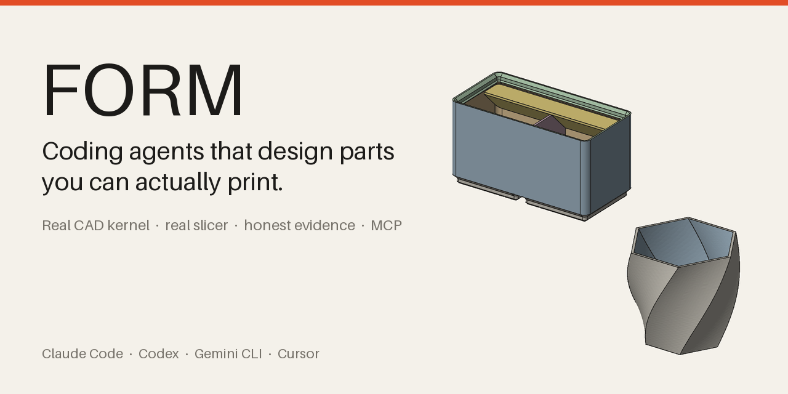
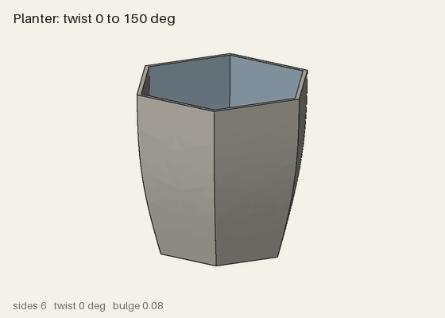
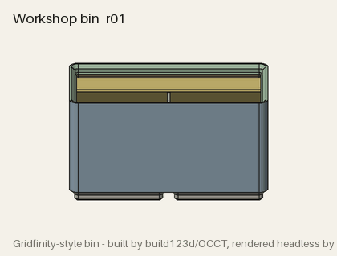
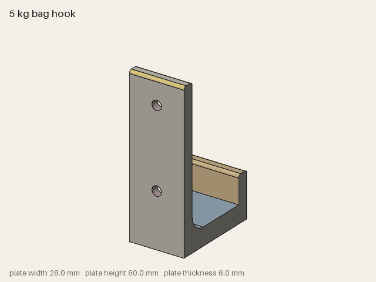
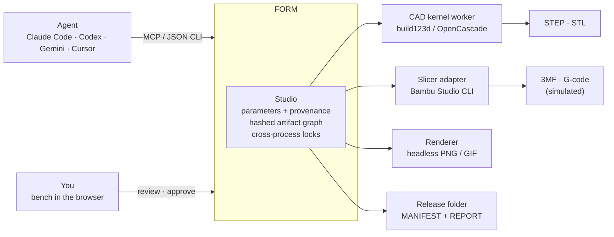

<p align="center">
  
</p>

<p align="center">
  <a href="https://github.com/kaizensx/form-studio/actions"></a>
  
  
  
  
</p>

<p align="center">
  <b>Your coding agent can already write code. FORM lets it design real objects:</b><br>
  build them in a CAD kernel, look at them, check them, slice them, and tell you honestly what is known.
</p>

<p align="center">
  
  
</p>
<p align="center"><sub>Every frame above is a separate build of the real parametric model, not a 3D-modelling trick.</sub></p>

---

## Install in one line

```bash
curl -LsSf https://raw.githubusercontent.com/kaizensx/form-studio/main/install.sh | sh
```

The installer:

1. installs [uv](https://docs.astral.sh/uv/) if it's missing, after asking,
2. installs FORM with its own Python 3.12 (your system Python is never touched),
3. runs **`form setup`**.

`form setup` finds what's missing and lets you choose what to fix. It shows each command before it runs and backs up every config file it edits:

```
FORM setup
 ✔ Python 3.12               Running 3.12.15
 ✔ CAD kernel                build123d 0.13.0 / OCP 8.0.1.1
 ✔ Project folder            ~/FORM
 ✔ Slicer (Bambu Studio)     02.09.01.70 · Bambu Lab A1 mini 0.4 nozzle · Generic PLA
 ✔ Printer size              Bambu Lab A1 mini [180, 180, 180] mm
 ✘ Claude Code               Installed; FORM is not registered   [1]
 ✘ Codex                     Installed; FORM is not registered   [2]
 ✘ Gemini CLI                FORM is not in ~/.gemini/settings.json   [3]

Set up which? [Enter = recommended 1,2,3 · a = all · 1,3 · n = none]
```

Restart your agent, then ask it for a part.

## Watch an agent use it

<p align="center"></p>

This is a trimmed replay of a real session (Claude Code with Opus 5.5: 8 turns, 36 seconds, $0.23). The agent:

- recorded the caliper numbers as **measured**,
- previewed the change before saving it,
- **looked at** a four-view render,
- reported the slice as a *simulation* and the fit as a *model*,
- handed approval back to the human.

Codex ran the same kind of session with no changes to FORM. When it tried thinner walls, FORM refused (the pocket would cut into the rounded corners), and Codex explained why.

## What makes it different

| | |
|---|---|
| 🧱 **Real geometry** | Every change rebuilds a boundary-representation solid in OpenCascade, in 0.1 to 1.5 s depending on the part. You get STEP and STL out, not a picture of a part. |
| 👁️ **Agents can see** | `render` returns a PNG drawn from the kernel's own mesh, coloured by feature, with a scale bar. `animate` makes turntables and morphs. |
| 🎯 **Goal seek** | *"Lightest hook that still holds 3 kg with a 3× safety factor."* FORM builds dozens of real candidates and returns the best one, plus the constraint that blocked the rest. |
| 🧾 **Honest evidence** | Every number says where it came from: *measured, specified, assumed* or *calibrated*, and *computed, model, simulated* or *physical*. Nothing is called validated until you print it. |
| ⛓️ **Stale-proof outputs** | Outputs are keyed by hashes of their inputs. Change one dimension and the old G-code can't be released. |
| 📏 **Fit under uncertainty** | FORM gives the chance a part fits and the cheapest next step to improve it: measure, print a coupon, or print a test ring. It learns your printer from coupons. |
| 🙋 **A human signs off** | Agents can do everything except approve a release. That button exists only on the bench, your local web page. |

## Things you can make today

<p align="center"></p>

| Recipe | What it is | What FORM checks |
|---|---|---|
| `dock` | Leaning phone or tablet dock with a cable path | Pocket fit, tip-over force when you tap the screen |
| `gridfinity` | Gridfinity-style bin with stacking lip, dividers, scoop, label shelf, magnet pockets | Magnet press fit, wall thickness, usable depth |
| `hook` | Two-screw wall hook sized to a load | Bending safety factor, screw pull-out load, screwdriver clearance |
| `planter` | Twisted polygon planter with a drain-plug hole | Overhangs on the real mesh, plug fit |
| `coupon` | Slot comb that calibrates your printer | Feeds measured bias and spread into every later fit |

Each recipe is about 200 lines of [build123d](https://github.com/gumyr/build123d), with typed parameters, named features and constraints that explain themselves. **[Write your own →](docs/RECIPES.md)**

<table><tr>
<td></td>
<td></td>
<td></td>
<td></td>
</tr></table>

## Goal seek

```text
optimize(project="coat-hook",
         vary=[{"key":"arm_t","min":4,"max":20}, {"key":"plate_w","min":14,"max":40}],
         objective={"minimize":"solid_mass_g"},
         constraints=["statics.safety_factor >= 3"])
```

<p align="center"></p>

FORM built 36 candidates in under 3 seconds and halved the material while keeping the safety margin you asked for. Nothing is saved until the agent previews the result, renders it and commits it.

<p align="center"><br>
<sub>Made by Claude Code in a real session: "lightest hook for a 5 kg bag, safety factor ≥ 3, my screws are 4.5 mm". It optimised 4 parameters across 40 builds, committed the result, and animated the change.</sub></p>

The safety factor comes from a beam model with an assumed material strength, and FORM labels it as a model. It isn't a load rating.

## How it works



FORM doesn't compete with your CAD program or your slicer. It sits between the agent and that software, and keeps the record neither of them keeps. More in [ARCHITECTURE.md](docs/ARCHITECTURE.md).

## Tools for agents

| Explore | Design | Check & prove | Ship |
|---|---|---|---|
| `form_overview` | `create_project` | `get_project` | `request_release` → bench link |
| `describe_recipe` | `preview_change` | `run_pipeline` / `get_job` | `verify_release` |
| `setup_status` | `commit_change` | `slice_test_piece` | `open_in` (Bambu Studio, CAD, ...) |
| `render` | `optimize` | `record_physical_result` | `open_bench` |
| `animate` | `explore_alternatives` | `compare_revisions` | `checkout_revision` |
| | `set_print_setup` | | |

Full reference: [docs/MCP.md](docs/MCP.md). With no MCP, every action is also a `form` command that prints JSON.

<details>
<summary><b>Manual MCP configuration</b> (if you skip <code>form setup</code>)</summary>

**Claude Code:**

```bash
claude mcp add --scope user form -- form-mcp
```

**Codex:**

```bash
codex mcp add form -- form-mcp
```

**Gemini CLI** (`~/.gemini/settings.json`), **Cursor** (`~/.cursor/mcp.json`) and **Claude Desktop** use the same shape:

```json
{ "mcpServers": { "form": { "command": "form-mcp" } } }
```

</details>

<details>
<summary><b>The bench</b>: your local review page</summary>

`form-mcp` also serves `http://127.0.0.1:4173`. Run `form serve` to open it on its own. There you can:

- turn the model and click a feature,
- drag a parameter and watch the computed impact,
- compare revisions,
- step through the slice layer by layer,
- approve releases.

While it's open, it follows what agents change, and labels each revision with the agent's name.


</details>

## Honesty and safety

- **Local only.** FORM listens on loopback only. It never uploads files and never starts a print.
- **Agents propose, people release.** Agents are told never to record a physical result you didn't report. A stale `expect_head` is refused rather than overwritten.
- **Evidence classes are never mixed.** A slice is *simulated*, fit yield is *modelled*, and strength is a *model with stated assumptions*.
- **Status of this release.** [docs/VERIFICATION.md](docs/VERIFICATION.md) says exactly what was tested (PASS, NOT RUN or BLOCKED) and on what. Nothing in this repository has been physically printed by the authors as part of verification.

## Status and roadmap

FORM is tested on macOS (Apple Silicon, full pipeline with slicing) and Linux (Ubuntu in CI: all tests, no slicer). On Windows, use WSL (untested).

Wanted next:

- Orca and Prusa slicer adapters
- more recipes: enclosures, brackets, cable management, organisers
- section views in renders
- photo-to-dimensions
- a recipe gallery site

See [CONTRIBUTING.md](CONTRIBUTING.md).

## License

MIT. Third-party licences:

- three.js: MIT
- build123d: Apache-2.0
- OCP/OpenCascade: LGPL-2.1, installed as a dependency and not bundled
- Bambu Studio: AGPL-3.0, invoked as a separate program and not bundled

The Gridfinity system was created by Zack Freedman. FORM's bin follows its published dimensions, but isn't affiliated with Gridfinity or endorsed by its creator.
