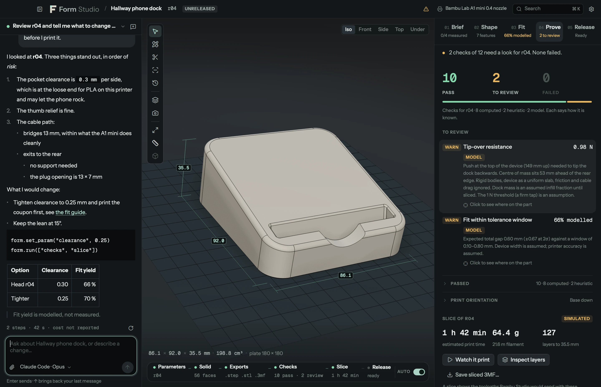
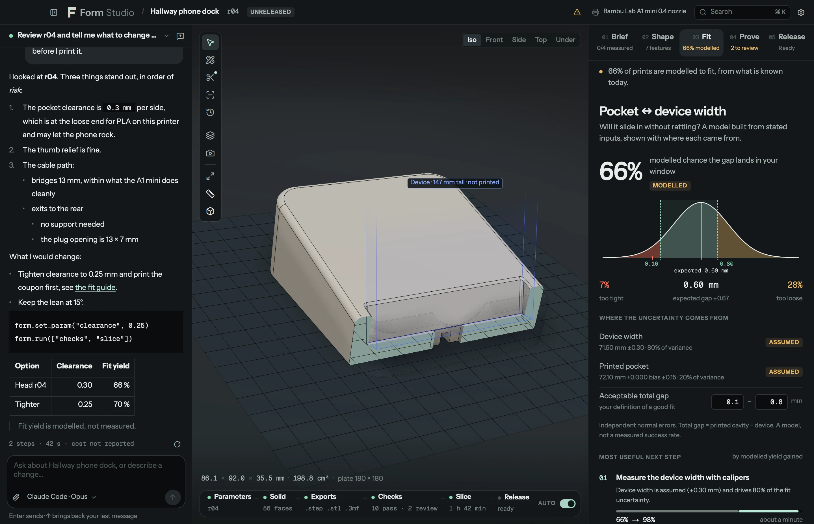
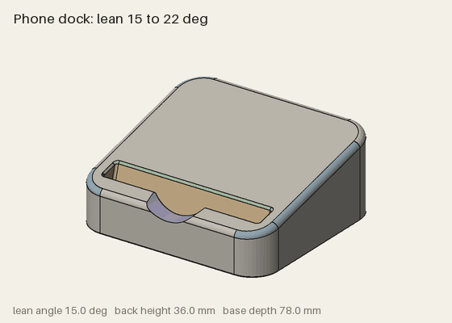
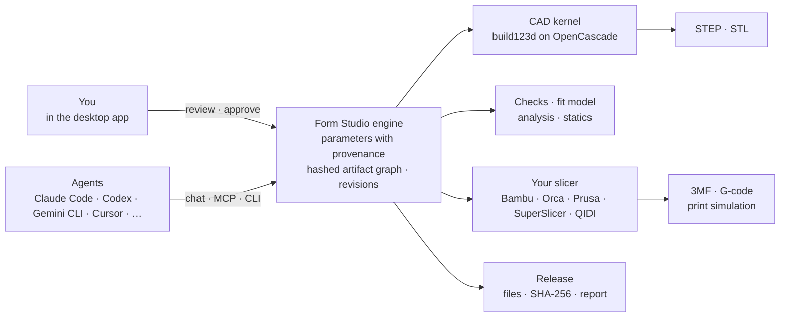

<p align="center">
  <a href="https://kaizensx.github.io/form-studio/">
    <picture>
      <source media="(prefers-color-scheme: dark)" srcset="brand/lockup.svg">
      
    </picture>
  </a>
</p>

<h3 align="center">Describe a part. Get a file you can print.</h3>

<p align="center">
  A native desktop app in which an AI agent designs 3D-printable parts with a real CAD kernel,<br>
  checks them, slices them with your own slicer and simulates the print, layer by layer.
</p>

<p align="center">
  <a href="https://github.com/kaizensx/form-studio/releases/latest"></a>
  <a href="https://github.com/kaizensx/form-studio/actions/workflows/ci.yml"></a>
  <a href="https://github.com/kaizensx/form-studio/actions/workflows/slicers.yml"></a>
  <a href="LICENSE"></a>
  
  <a href="https://github.com/kaizensx/form-studio/discussions"></a>
</p>

<p align="center">
  <a href="https://github.com/kaizensx/form-studio/releases/latest"><b>Download</b></a> ·
  <a href="https://kaizensx.github.io/form-studio/">Website</a> ·
  <a href="docs/FEATURES.md">Features</a> ·
  <a href="https://kaizensx.github.io/form-studio/docs/">Docs</a> ·
  <a href="https://kaizensx.github.io/form-studio/recipes/">Recipes</a> ·
  <a href="https://github.com/kaizensx/form-studio/discussions">Community</a>
</p>

<p align="center">
  
</p>

---

**Form Studio** turns a description into a part you can print, and keeps an honest record on the way. You say what
the part holds, where it goes and what you measured. An agent (Claude Code, Codex, Gemini CLI, Cursor and others)
builds it as a parametric B-rep model in [build123d](https://github.com/gumyr/build123d) on OpenCascade while you
watch. Every revision is checked on the solid, its fit is modelled, it is sliced by **your** slicer with **your**
presets, and the print is played back from the G-code. When you approve, the files are frozen with their hashes.

Everything runs on your computer. Form Studio never uploads a design and never starts a print.

## Highlights

<table>
<tr>
<td width="50%" valign="top">

<h4>Watch it print before you print it</h4>
The slicer's G-code, read back and played in 3D: every line type, a per-layer time chart, and a jump to the next bridge or overhang. Timed by the slicer's own estimate.
</td>
<td width="50%" valign="top">

<h4>Know whether it will fit</h4>
The gap between a pocket and the object it holds, modelled from your measurements and your printer's accuracy: the chance it fits, too tight or too loose, and the cheapest way to raise the odds.
</td>
</tr>
<tr>
<td valign="top">

<h4>Twelve checks, each with its evidence</h4>
A valid solid, closed mesh, build volume, thinnest wall, overhangs, bridges, plate contact, tip-over and fit. Every number is labelled computed, heuristic, model or simulated, and clicking it shows where on the part it was found.
</td>
<td valign="top">

<h4>An agent that shows its work</h4>
Pick the agent, model and effort per conversation. Its tool calls, the renders it looked at and its cost appear as it works. It reads datasheets, asks when it needs a decision, and fixes what the checks find.
</td>
</tr>
<tr>
<td valign="top">

<h4>Assemblies that move</h4>
Assembled, exploded and print layouts. Hinges and slides swept through their range for collisions, screwdriver access to every screw, and a bill of materials.
</td>
<td valign="top">

<h4>Pictures worth sharing</h4>
A share card with every number and how it is known, photoreal Blender renders in your filament colour, turntables and revision morphs.
</td>
</tr>
</table>

<p align="center">
  
  
</p>

## Everything it does

| | |
|---|---|
| **Conversations** | Many per design or free-standing; agent, model and effort per conversation; attachments; streaming steps; questions answered with cards; *Fix with agent* on failed checks; starters that learn from the design. |
| **Start a design** | Blank, from one of nine built-in recipes, from the [community gallery](https://kaizensx.github.io/form-studio/recipes/), from an imported project, or from a brief with measured dimensions and photos. Import STEP or STL reference parts to design around. |
| **Design** | Real B-rep geometry, STEP and STL. Python (build123d) or OpenSCAD. Parameters with units, ranges and provenance. Click a feature on the model to change it; drafts show their computed impact before you commit. |
| **Hardware** | ISO 273 screw clearances, heat-set insert pockets, nut traps, magnet pockets, bearing seats, printable threads, involute gears, lettering and vent patterns, each with its source. |
| **Revisions** | Every change is a revision with its author. A timeline to scrub and play as a morph, branches from any revision, compare any two, named variants. |
| **Checks and analysis** | Twelve checks with evidence classes; wall-thickness, overhang, cross-section and small-feature maps; measure tool; section cuts; an orientation finder; tip-over statics. |
| **Fit** | A statistical fit model for every interface, calibrated by printed coupons, with a thin test ring cut from the real part. |
| **Slice and simulate** | Bambu Studio, OrcaSlicer, PrusaSlicer, SuperSlicer, QIDISlicer and OrcaSlicer forks, with any printer configured in them. Print playback, copies on a plate, cost. |
| **Optimise** | Goal seek over parameters with real kernel builds, and a ranked grid of alternatives. |
| **Release** | One approval by a person freezes STEP, STL, 3MF and G-code with SHA-256 hashes and a report. Verify any time. |
| **Setup** | First start installs what is missing from inside the app; Settings for everything; What's New after each update. |
| **Headless** | Every capability as a `form` command printing JSON, and as one of 44 MCP tools. |

The full list, with screenshots: **[docs/FEATURES.md](docs/FEATURES.md)**.

## Download

| Platform | Download | First launch |
|---|---|---|
| macOS, Apple Silicon | [`FORM-macos-arm64.zip`](https://github.com/kaizensx/form-studio/releases/latest/download/FORM-macos-arm64.zip) | Unzip, right-click **FORM.app** › **Open** |
| macOS, Intel | [`FORM-macos-x64.zip`](https://github.com/kaizensx/form-studio/releases/latest/download/FORM-macos-x64.zip) | The same |
| Windows 10 and 11 | [`FORM-windows-x64.zip`](https://github.com/kaizensx/form-studio/releases/latest/download/FORM-windows-x64.zip) | Unzip, run `FORM.exe`; in SmartScreen, **More info** › **Run anyway** |
| Linux x64 | [`FORM-linux-x64.tar.gz`](https://github.com/kaizensx/form-studio/releases/latest/download/FORM-linux-x64.tar.gz) | Unpack, run `FORM/FORM` |

On first start Form Studio looks at what is on your computer and offers the rest: the standard-parts libraries, a
slicer, an agent and its sign-in. Every command is shown before it runs.

<p align="center"></p>

**From a terminal** (macOS and Linux), with its own Python 3.12:

```bash
curl -LsSf https://raw.githubusercontent.com/kaizensx/form-studio/main/install.sh | sh
form app
```

**With [uv](https://docs.astral.sh/uv/)** (any platform):

```bash
uv tool install --python 3.12 "form-studio[all] @ git+https://github.com/kaizensx/form-studio"
```

## Works with what you already have

| Agent | Chat inside the app | MCP from its own window |
|---|:---:|:---:|
| Claude Code | ✓ | ✓ |
| Codex | ✓ | ✓ |
| Gemini CLI | ✓ | ✓ |
| Cursor (CLI and editor) | ✓ | ✓ |
| OpenCode · Qwen Code · GitHub Copilot CLI | ✓ | ✓ |
| Claude Desktop and any MCP client | | ✓ |

| Slicer | Linux | Windows | macOS |
|---|:---:|:---:|:---:|
| Bambu Studio | CI real slice | CI real slice | ✓ |
| OrcaSlicer (including 2.5 packed profiles) | CI real slice | CI real slice | ✓ |
| PrusaSlicer | CI real slice | CI real slice | ✓ |
| SuperSlicer | CI real slice | CI real slice | ✓ |
| QIDISlicer | CI real slice | CI real slice | ✓ |
| Creality Print · Elegoo Slicer · Anycubic Slicer Next | ✓ | ✓ | ✓ |

Plus **FreeCAD** (open the STEP, a re-import check, a parameter macro), **OpenSCAD** (`.scad` designs with Customizer
parameters), **Blender** (photoreal renders) and **STEP or STL** reference parts. Details:
[Compatibility and testing](docs/VERIFICATION.md).

## Use it from your agent

Form Studio is an MCP server. Add it once and your agent can design, check, slice and prepare a release from its own
window, while the open app follows along.

```bash
claude mcp add --scope user form -- form-mcp      # Claude Code
codex mcp add form -- form-mcp                    # Codex
```

Other clients use `{ "mcpServers": { "form": { "command": "form-mcp" } } }`, and `form setup` writes it for you.
Claude Code can also install thirteen design skills as a plugin:
`claude plugin marketplace add kaizensx/form-studio`, then `claude plugin install form@form-studio`.

Reference: [44 MCP tools](docs/MCP.md) · [agent guide](AGENTS.md)

## Or without a window

```bash
form new "Desk dock" dock device_width=75.6         # a design from a recipe: solid, STEP and STL, checks, slice
form commit desk-dock lean=18 --expect-head 1       # a new revision, rebuilt, checked and sliced
form simulate desk-dock --png print.png --layer 40  # the print at layer 40, from the G-code
form share desk-dock --out card.png                 # the share card
form new "Wall hook" hook
form optimize wall-hook --vary arm_t:4:20 --minimize solid_mass_g --require "statics.safety_factor>=3"
form chat "Make the base 92 mm deep" --project desk-dock --agent codex
```

<p align="center"></p>

Every command: [docs/CLI.md](docs/CLI.md).

## How it works



Form Studio does not replace your CAD program or your slicer. It sits between the agent and that software and keeps
the record of what was designed, checked and released. An output is current only when it exists under the hash of its
inputs, so a changed clearance invalidates exactly what depends on it. More in
[docs/ARCHITECTURE.md](docs/ARCHITECTURE.md).

## Principles

- **Local.** The engine runs on your computer. Designs are never uploaded; prints are never started.
- **A person releases.** Agents propose and build; only you approve a release.
- **Every number says how it is known.** Measured, specified, assumed, computed, heuristic, modelled, simulated or
  physical, in the app and in every report.
- **Headless parity.** No capability exists only in the window.

## Recipes

Nine part families ship with Form Studio: device dock, Gridfinity-style bin, wall hook, twisted planter, fit coupon,
electronics enclosure, spur gear pair, control knob and hinged box. The community adds more in
[`community/recipes`](community/recipes/README.md); browse them in the
[recipe gallery](https://kaizensx.github.io/form-studio/recipes/) or inside the app.

<p align="center"></p>

## Community

- **[Discussions](https://github.com/kaizensx/form-studio/discussions)**: questions, ideas, and Show and tell for the
  parts you made.
- **[Issues](https://github.com/kaizensx/form-studio/issues/new/choose)**: bugs, slicer and printer support, agent
  support, recipes, docs.
- **[Contributing](CONTRIBUTING.md)**: recipes, slicer adapters, agent integrations and measured print results are the
  most valuable contributions. Branch from `dev` and open a pull request against it.
- [Code of Conduct](CODE_OF_CONDUCT.md) · [Support](SUPPORT.md) · [Security](SECURITY.md) · [Changelog](CHANGELOG.md)

<p align="center">
  <a href="https://star-history.com/#kaizensx/form-studio&Date"></a>
</p>

## Licence

MIT. Form Studio calls build123d (Apache-2.0), OpenCascade (LGPL-2.1), your slicer and other programs as separate
programs; none of them is bundled into its code. three.js (MIT) draws the website. The Gridfinity system was created by
Zack Freedman; Form Studio's bin follows its published dimensions and is not affiliated with it.
