<p align="center">
  <picture>
    <source media="(prefers-color-scheme: dark)" srcset="docs/readme/hero-dark.svg">
    
  </picture>
</p>

<p align="center">
  <a href="https://github.com/kaizensx/form-studio/releases/latest/download/FORM-macos-arm64.zip"></a>
  <a href="https://github.com/kaizensx/form-studio/releases/latest/download/FORM-macos-x64.zip"></a>
  <a href="https://github.com/kaizensx/form-studio/releases/latest/download/FORM-windows-x64.zip"></a>
  <a href="https://github.com/kaizensx/form-studio/releases/latest/download/FORM-linux-x64.tar.gz"></a>
</p>

<p align="center">
  <sub><b>Version 1.0.0</b>, the first public release &nbsp;·&nbsp; <a href="CHANGELOG.md">What is in it</a> &nbsp;·&nbsp; <a href="https://kaizensx.github.io/form-studio/#try">Try it in your browser</a> &nbsp;·&nbsp; <a href="https://kaizensx.github.io/form-studio/docs/">Docs</a></sub>
</p>

<br>

**Form Studio is an open-source desktop app that turns a description into a part you can make.** Type what you need, drop a photo or a sketch, or paste a link. An agent of your choice designs it as parametric B-rep geometry in [build123d](https://github.com/gumyr/build123d) on OpenCascade while you watch. Every revision is checked on the solid, sliced by your own slicer with your own presets and played back layer by layer. When you approve, the files are frozen with their hashes.

<p align="center">
  <picture>
    <source media="(prefers-color-scheme: dark)" srcset="docs/readme/numbers-1-dark.svg">
    
  </picture>
  <picture>
    <source media="(prefers-color-scheme: dark)" srcset="docs/readme/numbers-2-dark.svg">
    
  </picture>
</p>

## How it works

<p align="center">
  <picture>
    <source media="(prefers-color-scheme: dark)" srcset="docs/readme/steps-1-dark.svg">
    
  </picture>
  <picture>
    <source media="(prefers-color-scheme: dark)" srcset="docs/readme/steps-2-dark.svg">
    
  </picture>
</p>

Form Studio does not replace your CAD program or your slicer. It sits between your agent and that software and keeps the record of what was designed, checked and released. An output is current only when it exists under the hash of its inputs, so a changed clearance invalidates exactly what depends on it.

```mermaid
flowchart LR
  you(["You: words, a photo,<br/>a sketch, a part, a link"]) --> agent["Your agent<br/>app, model API or local model"]
  agent -- "74 MCP tools · form CLI" --> engine["Form Studio engine<br/>parameters with provenance<br/>revisions · hashed outputs"]
  engine --> kernel["CAD kernel<br/>build123d on OpenCascade"]
  kernel --> checks["Checks<br/>solid · mesh · fits · joints"]
  checks --> slicer["Your slicer<br/>your printer and presets"]
  slicer --> release{{"You approve<br/>files frozen with SHA-256"}}
  classDef datum fill:#b9e8d7,stroke:#0d1a16,color:#0d1a16
  classDef plate fill:#191e22,stroke:#2a3238,color:#e8edeb
  class release datum
  class agent,engine,kernel,checks,slicer plate
```

<details>
<summary><b>What runs where</b></summary>
<br>



| Principle | What it means |
|---|---|
| **Local** | Designs are never uploaded and prints are never started. |
| **A person releases** | Agents propose and build; only you approve the files. |
| **Every number says how it is known** | Computed, heuristic, modelled, simulated, measured or assumed. |
| **Nothing exists only in the window** | Every action is also a `form` command and an MCP tool. |

More in [docs/ARCHITECTURE.md](docs/ARCHITECTURE.md).
</details>

## What it does

<p align="center">
  <picture>
    <source media="(prefers-color-scheme: dark)" srcset="docs/readme/feature-start-dark.svg">
    
  </picture>
  <picture>
    <source media="(prefers-color-scheme: dark)" srcset="docs/readme/feature-talk-dark.svg">
    
  </picture>
  <picture>
    <source media="(prefers-color-scheme: dark)" srcset="docs/readme/feature-proved-dark.svg">
    
  </picture>
  <picture>
    <source media="(prefers-color-scheme: dark)" srcset="docs/readme/feature-move-dark.svg">
    
  </picture>
  <picture>
    <source media="(prefers-color-scheme: dark)" srcset="docs/readme/feature-slicer-dark.svg">
    
  </picture>
  <picture>
    <source media="(prefers-color-scheme: dark)" srcset="docs/readme/feature-compare-dark.svg">
    
  </picture>
  <picture>
    <source media="(prefers-color-scheme: dark)" srcset="docs/readme/feature-release-dark.svg">
    
  </picture>
  <picture>
    <source media="(prefers-color-scheme: dark)" srcset="docs/readme/feature-headless-dark.svg">
    
  </picture>
</p>

> [!NOTE]
> Nothing on this page is mocked up. The parts are the CAD kernel's own meshes and edges; the checks, slicer times, G-code layers, printer comparison, joint sweep and file hashes are what a real run of the engine produced. [`scripts/readme_art.py`](scripts/readme_art.py) draws every picture again from a fresh run.

Also in 1.0.0: concepts that come back as several genuinely different designs, screw bosses and snap-fit hooks placed with a click, text on any flat face, what changed between two revisions on the solids, assembly instructions as a PDF, turntable videos, and **Just a 3D model** for designs you will not print. All of it is in the [changelog](CHANGELOG.md) and [docs/FEATURES.md](docs/FEATURES.md).

## Install

Download the app for your platform and open it. The first start installs what is missing (the standard-parts libraries, a slicer if you print, an agent and its sign-in), one click of consent each, in its own window.

<details>
<summary><b>macOS</b> &nbsp;·&nbsp; Apple silicon and Intel</summary>
<br>

Download [`FORM-macos-arm64.zip`](https://github.com/kaizensx/form-studio/releases/latest/download/FORM-macos-arm64.zip) or [`FORM-macos-x64.zip`](https://github.com/kaizensx/form-studio/releases/latest/download/FORM-macos-x64.zip), unzip it, then right-click **FORM.app** › **Open** the first time. Or from a terminal:

```bash
curl -LsSf https://raw.githubusercontent.com/kaizensx/form-studio/main/install.sh | sh
form app
```
</details>

<details>
<summary><b>Windows</b> &nbsp;·&nbsp; 10 and 11</summary>
<br>

Download [`FORM-windows-x64.zip`](https://github.com/kaizensx/form-studio/releases/latest/download/FORM-windows-x64.zip), unzip it and run `FORM.exe`; in SmartScreen choose **More info** › **Run anyway**. Or with [uv](https://docs.astral.sh/uv/):

```powershell
uv tool install --python 3.12 "form-studio[all] @ git+https://github.com/kaizensx/form-studio"
form app
```
</details>

<details>
<summary><b>Linux</b> &nbsp;·&nbsp; x64</summary>
<br>

Download [`FORM-linux-x64.tar.gz`](https://github.com/kaizensx/form-studio/releases/latest/download/FORM-linux-x64.tar.gz), unpack it and run `FORM/FORM`. Or from a terminal:

```bash
curl -LsSf https://raw.githubusercontent.com/kaizensx/form-studio/main/install.sh | sh
form app
```
</details>

Every release ships with `SHA256SUMS`, signed build provenance and an SBOM.

## Use it from your agent

Form Studio is an MCP server. Add it once and your agent can design, check, slice and prepare a release from its own window while the open app follows along. `form setup` finds the agents on your computer and writes the entry for you.

<details>
<summary><b>Claude Code</b></summary>
<br>

```bash
claude mcp add --scope user form -- form-mcp
```

Thirteen design skills (intake, parametric design, fit calibration, verify print and more) install as a plugin:

```bash
claude plugin marketplace add kaizensx/form-studio
claude plugin install form@form-studio
```
</details>

<details>
<summary><b>Codex</b></summary>
<br>

```bash
codex mcp add form -- form-mcp
```
</details>

<details>
<summary><b>Gemini CLI</b> &nbsp;·&nbsp; <code>~/.gemini/settings.json</code></summary>
<br>

```json
{ "mcpServers": { "form": { "command": "form-mcp" } } }
```
</details>

<details>
<summary><b>Cursor</b> &nbsp;·&nbsp; <code>~/.cursor/mcp.json</code></summary>
<br>

```json
{ "mcpServers": { "form": { "command": "form-mcp" } } }
```
</details>

<details>
<summary><b>Claude Desktop and any other MCP client</b></summary>
<br>

```json
{ "mcpServers": { "form": { "command": "form-mcp" } } }
```
</details>

Agents follow the same rules as the app: units in millimetres, preview before commit, provenance kept honest, and no release without a person. The guide for coding agents is [AGENTS.md](AGENTS.md); every tool is in [docs/MCP.md](docs/MCP.md).

## Headless

Every action is a `form` command that prints JSON, and every MCP tool can be called as `form tool NAME '{json}'`.

```bash
form start --text "a hook for my headphones under the desk" --photo desk.jpg   # start from words and a photo
form new "Desk stand" device_stand device_width=75.6                           # from a building block: solid, checks, slice
form commit desk-stand lean=18 --expect-head 1                                 # a new revision, rebuilt, checked and sliced
form compare-printers desk-stand                                               # sliced on every printer you have set up
form simulate desk-stand --png print.png --layer 40                            # the print at layer 40, from the G-code
form tool get_project '{"project": "desk-stand"}'                              # any MCP tool, from the shell
```

| | |
|---|---|
| **Every command** | [docs/CLI.md](docs/CLI.md) |
| **74 MCP tools** | [docs/MCP.md](docs/MCP.md) |
| **How the engine is built** | [docs/ARCHITECTURE.md](docs/ARCHITECTURE.md) |

## Building blocks

<p align="center"></p>

Agents start from parametric building blocks of the things people print most: Gridfinity bins and baseplates, boxes with sliding, press-on or hinged lids, SKÅDIS pegboard accessories, phone and tablet stands, cable organizers, under-desk hangers, shelf brackets, hose adapters, self-watering planters, faceted vases, battery and card holders and electronics enclosures. Each passes its checks at its defaults and prints without supports. Browse them, and what the community adds, in the **[recipe gallery](https://kaizensx.github.io/form-studio/recipes/)**.

## Community

| | |
|---|---|
| **[Q&A](https://github.com/kaizensx/form-studio/discussions/categories/q-a)** | How to do something, or help with setup. |
| **[Printers and slicers](https://github.com/kaizensx/form-studio/discussions/categories/printers-slicers)** | Presets, filaments and slicer questions, answered by people who print. |
| **[Agents and models](https://github.com/kaizensx/form-studio/discussions/categories/agents-models)** | Which agents and models design well, and how to connect them. |
| **[Ideas](https://github.com/kaizensx/form-studio/discussions/categories/ideas)** | Talk an idea through before it becomes a feature request. |
| **[Show and tell](https://github.com/kaizensx/form-studio/discussions/categories/show-and-tell)** | The parts you made, and how they printed. |

**Contributing.** Recipes, slicer adapters, agent integrations and measured print results are all welcome: see [CONTRIBUTING.md](CONTRIBUTING.md). Branch from `dev` and open the pull request against it. To share a recipe, [open a recipe issue](https://github.com/kaizensx/form-studio/issues/new?template=3-recipe.yml) or run `form recipes submit`; it is built, checked and sliced automatically and answered with pictures.

**Security.** Report a vulnerability privately as described in [SECURITY.md](SECURITY.md). [Code of Conduct](CODE_OF_CONDUCT.md) · [Support](SUPPORT.md) · [Changelog](CHANGELOG.md)

## Licence

MIT. Form Studio calls build123d (Apache-2.0), OpenCascade (LGPL-2.1), your slicer and other programs as separate programs; none of them is bundled into its code. three.js (MIT) draws the website. Instrument Sans and Geist Mono (SIL OFL 1.1) are drawn in the app and in the pictures on this page, and Lucide icons (ISC) in the app. The Gridfinity system was created by Zack Freedman and SKÅDIS is a product of IKEA; Form Studio's building blocks follow their published dimensions and are not affiliated with either.
