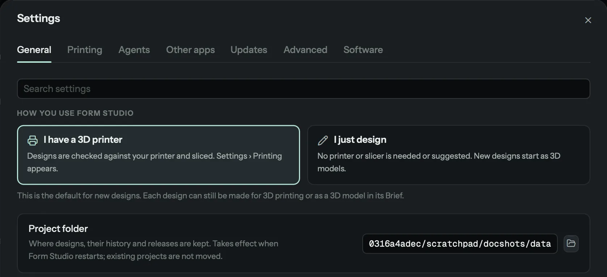
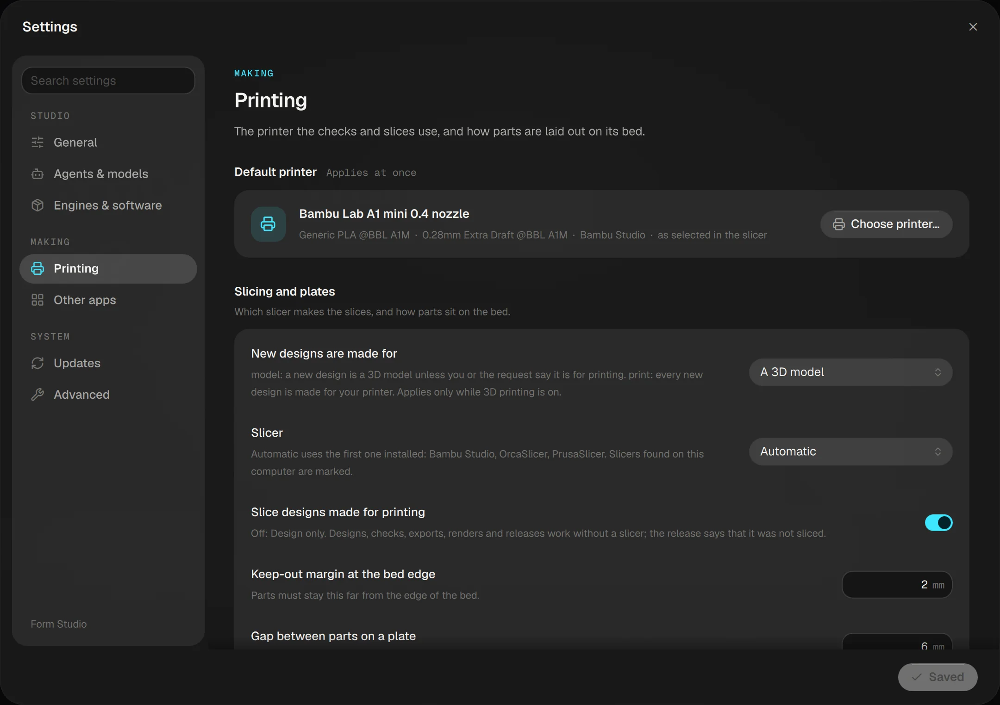

# The desktop app

Form Studio is a native desktop app for macOS, Windows and Linux, written in Qt Quick on PySide6. The interface and
the 3D viewport are drawn on the GPU by Qt; the CAD engine runs in the same process, with the geometry kernel in an
isolated worker. There is no browser and no web view.

## Install

Download the bundle for your system from the [latest release](https://github.com/kaizensx/form-studio/releases/latest):

| System | File | First launch |
|---|---|---|
| macOS, Apple Silicon | `FORM-macos-arm64.zip` | Unzip, then right-click **Form Studio.app** › **Open** |
| macOS, Intel | `FORM-macos-x64.zip` | The same |
| Windows 10 and 11 | `FORM-windows-x64.zip` | Unzip and run `FORM.exe`; in SmartScreen choose **More info** › **Run anyway** |
| Linux x64 | `FORM-linux-x64.tar.gz` | Unpack and run `FORM/FORM` |

On first start a launcher asks three things. **What do you want to make?** shows a card for each thing Form Studio
can be set up for: parametric CAD (always on), mechanical parts, mesh to CAD, photoreal renders (Blender), CAD exchange
(FreeCAD and OpenSCAD) and, last and optional, 3D printing (one slicer). Each card names what it installs, and the total
download updates as you tick. **Your agent** picks who designs with you: an agent app, a model API key or a local model.
**Set up** then installs only what you chose, one item after another, with every command in the log; it pauses only
when you have to sign in or download something, and carries on once that is done. Nothing is downloaded before that
step. Change any of it later in Settings › General › Set up for.

### From Python

```bash
curl -LsSf https://raw.githubusercontent.com/kaizensx/form-studio/main/install.sh | sh    # macOS and Linux
form app
```

The script installs [uv](https://docs.astral.sh/uv/) if it is missing (after asking), then Form Studio with its own
Python 3.12, then runs `form setup`. On Windows, or to manage the install yourself:

```bash
uv tool install --python 3.12 "form-studio[all] @ git+https://github.com/kaizensx/form-studio"
```

## The window

| Area | What it holds |
|---|---|
| **Top** | Three capsules over the view. Left: the design, its revision and release state (the mark goes Home; the arrow opens the menu). Centre: the four modes, Design, Check, Make and Document, each with where it stands: features, checks to review, release readiness, documents made. Right: search (Ctrl/⌘ K) and Settings, and in Make the printer of a design made for printing (click it to choose another). The design's name opens the Overview (Ctrl/⌘ I). Work that takes longer than 300 ms is named beside them with progress |
| **Viewport** (the whole window) | The kernel's geometry, one mesh per feature, with its dimensions, in a pool of light on a studio floor with an origin cross and a scale cue. The printer's build plate appears only in Check and Make of a design made for printing, or from the shading chip in Design and Document |
| **Tool dock** (left) | Select, Measure, Annotate, Section, Analyze, Assembly, History, Simulate the print and Photo render; the active tool's options sit beside it |
| **Size** (bottom left) | Width × depth × height and volume of what is on screen |
| **View cube and shading chip** (top right of the stage) | A face of the cube is a view: top, front, side; its rim is Iso and a double click looks from under. The chip under it switches the build plate of a design made for printing, the floor's 10 mm grid and the overall dimensions |
| **Legend strip** (under the part) | While a map is shown on the part: its scale, how the result is known, and what it does not tell |
| **Pane** (right) | The panel of the mode you are in. In Design it is the features in build order as a numbered listing; click a line for its parameters. While a design builds, the line being built is lit and the built ones are ticked |
| **Pipeline** (the foot of the pane) | One line: a dot for each step (Parameters, Solid, Exports, Checks, Slice, Release), the revision and what its checks found, and Auto. A step is current only when it describes the revision on screen. A 3D model, or a design that is not sliced, has no Slice step |
| **Conversation** (left) | Once something is said, a glass column on the left: the conversation picker, New and Fold at its head, the messages, the agent's steps, the views it looked at and attachments, and the prompt at its foot. Drag its edge to resize it (300 to 480 px, remembered). Ctrl/⌘ J or Fold turns it into one bar under the part: what the agent is doing, numbered suggestions (keys 1 to 4) and the prompt. A click into the 3D view, or Esc, folds it too, and taking up the prompt brings it back; it folds while a build plays. Paste a link to attach the file it points at |
| **Stage** | What the column and the pane leave. The part, its dimension lines, the build's title and the print simulation are framed in it, and the camera returns the part to its middle when a column folds, opens or is resized. **Focus** (Ctrl/⌘ .) steps both side columns away; the tab on the pane's edge folds the pane alone. In a window under 1200 px, opening the conversation folds the panes to one button |

While a design builds, a pane in the lower part of the stage shows the feature being made in large type, its number, a
track with one segment per step and the features before and after. The caret in every text field is a thin lit line
of the accent. Shadows, glows, glass and the room are dithered, so no gradient shows bands.

### The four modes

| Mode | What you do there |
|---|---|
| **Design** | Features in build order and their parameters. Select a feature on the model or in the list and change it; dragging a slider rebuilds the part in place while you drag, and the draft shows its computed impact before you commit |
| **Check** | Every check with its evidence, print orientation, the plates, and the slice: time, filament, layers, Watch it print. A 3D model shows the checks that apply to it and says which do not. **Fit** is a study here, for a design made for 3D printing: a row with its modelled yield that opens the fit model for each interface (a section, the clearance, the chance of fitting and how to raise it) |
| **Make** | The release gate, approval (over failed checks only with a reason for each, on the record), the released files with their hashes, and the revision history. With 3D printing on, a 3D model is marked for printing here in one click |
| **Document** | What can be handed on: the parts list, assembly notes and instructions, the print report, the measurement plan, the four-view sheet, the photo render, the turntable and the share card, each the engine's own entry with its state. The drawing, the robot files and the board's fab files are rows here too |

**The Overview** (click the design's name, or Ctrl/⌘ I) is a sheet over the stage: what the part is for and its
purpose (for 3D printing, or just a 3D model and how it will be made), the dimensions you measured with their
provenance, reference photos and imported parts, and the revisions with who made each. It was the Describe stage.

**The Bench.** The pane on the right is the Bench's chapter for the mode you are in: the tree in Design, the
studies in Check, the routes in Make, the documents in Document. Every row reads the same way: a state mark, the
name, the number, and the word that says how the number is known (COMPUTED, SIMULATED, MODELLED…). A row with no
number says its state in words in the number's place: *not run*, *describes r02* (stale, in amber), *cannot run yet*
(dimmed), *not requested*. Click a row and it opens under the list: what it found, what you get, what it needs, the
exact request Run makes (the same call the CLI and MCP make) and the buttons. The list stays as the way out. The row
that is the mode's own subject opens as that mode's panel: the checks in Check, the release gate in Make. A current
map also goes onto the part.

**Ctrl/⌘ B** (or the button in the top right) opens the Bench as a sheet over the stage: all four chapters as
columns, every entry with its state and one line of what it is, filters (All, Current, Stale, Not run, Needs
something), a find field (`/`), and the selected row at the foot with its request, Run and *Open in Check*. Esc
clears the find, then closes it.

The engine decides every state from keys: an entry is current only when a result exists for the head revision's
inputs, and a stale one names the revision it describes. The agent runs the same entries with `list_studies`,
`run_study` and `get_study`, and the terminal with `form study list|run|show <project> [id]`. The command palette
finds every entry. Studies only the agent can do (the design critique) ask the agent; the release is only ever yours.

**The tree** (Design) lists the features in build order. Each line shows the values the feature is made of and a
mark for who made it (you, or the agent; the tip names the revision). Its gutter carries the rollback bar: drag it
up and the part steps back to how it stood after that feature, from the kernel's checkpoints; the feature the bar
passes lights once on the part; nothing is saved. A selected feature opens under the tree with its parameters.
**Values | Source** at the head of the tree switches what is under it: *Source* shows the design's code with the
open feature's lines lit.

Ctrl/⌘ 1 to 4 go to Design, Check, Make and Document. The CLI, MCP and `--stage` keep the engine's ids (`shape`,
`prove`, `release`, `document`; `brief` opens the Overview and `fit` the Fit study), and the names the places had
before (Describe, Review, Brief, Shape, Prove, Release) still find them in the command palette.

| Key | Does |
|---|---|
| Ctrl/⌘ K | Search and commands: every action and every design |
| Ctrl/⌘ B | The Bench: every study, route and document on one sheet |
| Ctrl/⌘ N | New design: Home, with the composer ready |
| Ctrl/⌘ Shift O | New conversation |
| Ctrl/⌘ J | Show or hide the conversation |
| Ctrl/⌘ . | Focus: the part alone, both side columns away |
| Ctrl/⌘ [ | Back to all designs |
| Ctrl/⌘ Shift H | All designs (Home) |
| Ctrl/⌘ , | Settings |
| Ctrl/⌘ 1 to 4 | Design, Check, Make, Document |
| Ctrl/⌘ I | The Overview of the design |
| Ctrl/⌘ Return | Commit the draft |
| ? | All keys |

In the viewport:

| Key | Does |
|---|---|
| V | Select: click a feature, drag to orbit |
| M | Measure distances, faces and diameters |
| X | Section cut on or off |
| N | Annotate: pick, paint or lasso, keep, ask the agent |
| A | Analyze: thickness, overhang and other maps |
| E | Assembly views and joints |
| T | History: the revision timeline |
| F | Frame the selected feature, or the whole part |
| 1 to 5 | Iso, front, side, top and underside views |
| . | Reset the view |
| H / Shift H | Hide the selected feature / show all |
| Esc | Leave the tool or clear the selection |

Drag to orbit, right-drag or Shift-drag to pan, scroll or pinch to zoom. Right-click a feature for quick actions.

**Drag a face to change it.** ⌘-drag (Ctrl-drag on Windows and Linux) on a face: Form Studio finds the parameter that
moves that face (it rebuilds the design once per parameter and measures how far the face travels along its normal, and
how much else changes) and the drag sets it. A readout beside the pointer names the parameter, from and to, how many
millimetres the face moves per unit and the draft's volume change; the part rebuilds as you pull. Releasing keeps the
change as a draft: commit or discard it like any other. Pull the top of a box and its height changes, its side and
its width does, a helmet's brow and the brow handle moves.

While measuring or annotating: D distance, G face, O diameter, R edge, P point, B brush, L lasso, [ and ] brush size,
Shift-click adds to the selection, Alt-drag orbits while painting.

In the conversation: Return sends, Shift Return adds a line, Up brings back your last message.

## Settings

Settings (Ctrl/⌘ ,) edits `studio.toml` for you, with a backup of the file. The pages are listed in a rail on the
left (General, Agents & models, Engines & software, Printing, Other apps, Updates, Advanced) and each page is a set of
titled cards. The search box in the rail finds a setting on any page, numbers
are checked as you type, every value can be reset to its default, and changes apply at once: choosing the default
printer updates the printer chip, the plate and the open design's checks without a restart.



| Page | Holds |
|---|---|
| General | Appearance: Dark, Light or Match system, applied at once. Set up for: the same cards as the launcher. Turning one on installs only what it needs; turning one off hides it and never uninstalls anything. And the project folder |
| Printing | The default printer, filament and process, from every printer set up in your slicers; the slicer, and whether designs made for printing are sliced; the keep-out margin and the gap between parts on a plate; which program "Open in slicer" uses. Shown only when 3D printing is on |
| Agents & models | Agent apps, model API keys, local models and providers you added, in one list; Add a provider…; the agent, model and effort for new conversations; web lookups; a spending limit per message; opening Form Studio when an outside agent starts working. Keys are stored privately and never shown again |
| Other apps | Blender, OpenSCAD and FreeCAD: whether and where each was found, Browse as a fallback, and what each one unlocks; which programs "Open in CAD" and "Open in viewer" use |
| Updates | The daily check for a newer Form Studio, and the Stable or Preview channel |
| Advanced | The slice time limit, how long the agent waits for your answers, the Claude Code command, and the printer name used when none is chosen |
| Engines & software | Everything Form Studio uses: installed or not, its size and licence, an Install button, and for each optional engine or app that is installed a **Use in Form Studio** switch with one line on what it changes. Installed and used are separate: switched off, an engine stays on the computer and is never called. The switch applies at once |




## Rules the app keeps

- It never starts a print and never uploads a design.
- A slice is labelled **simulated**, a fit yield **modelled**, a strength figure a **model** with its assumptions.
- Only a person approves a release, with a deliberate action in the Release stage.
- The app, the CLI and the MCP server can work on the same project folder at the same time.

## Build from source

```bash
uv venv --python 3.12 .venv
uv pip install --python .venv -e ".[all]" pyinstaller
.venv/bin/python -m form.app                          # run from source
.venv/bin/pyinstaller packaging/form.spec --noconfirm # build the bundle into dist/
```

The bundle is about 800 MB unpacked, because it carries the OpenCascade kernel and Qt. Notes for working on the
interface: [form/app/qml/CONTRIBUTING-UI.md](../form/app/qml/CONTRIBUTING-UI.md).
