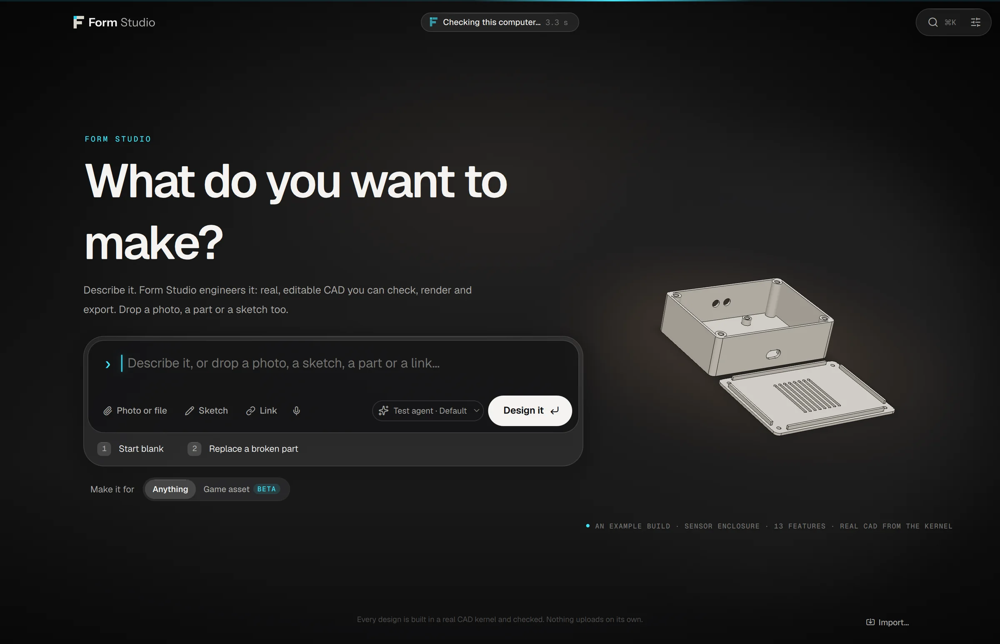
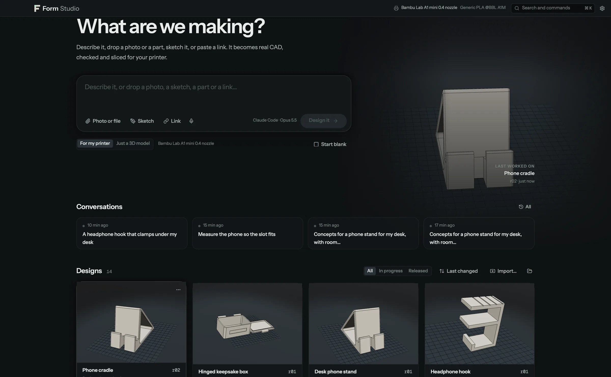
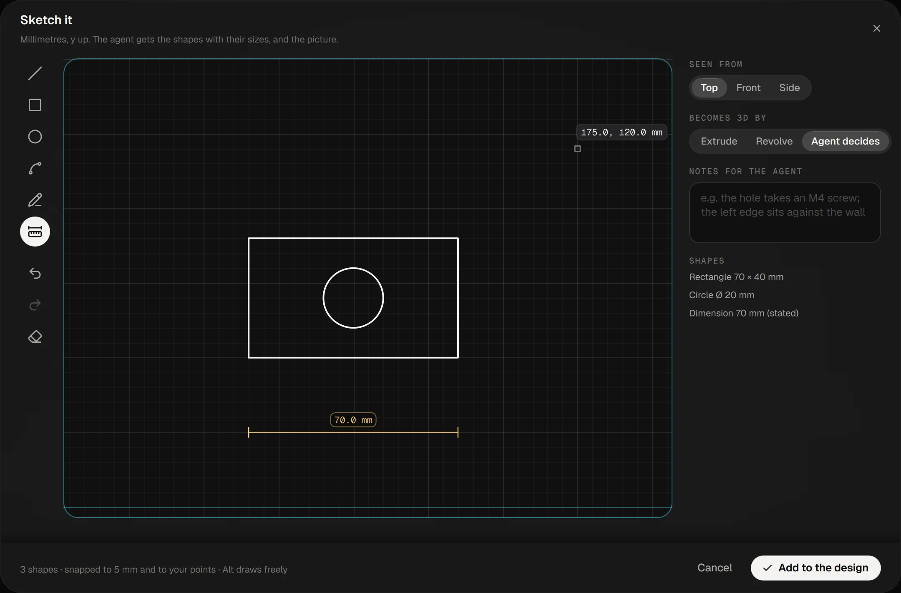
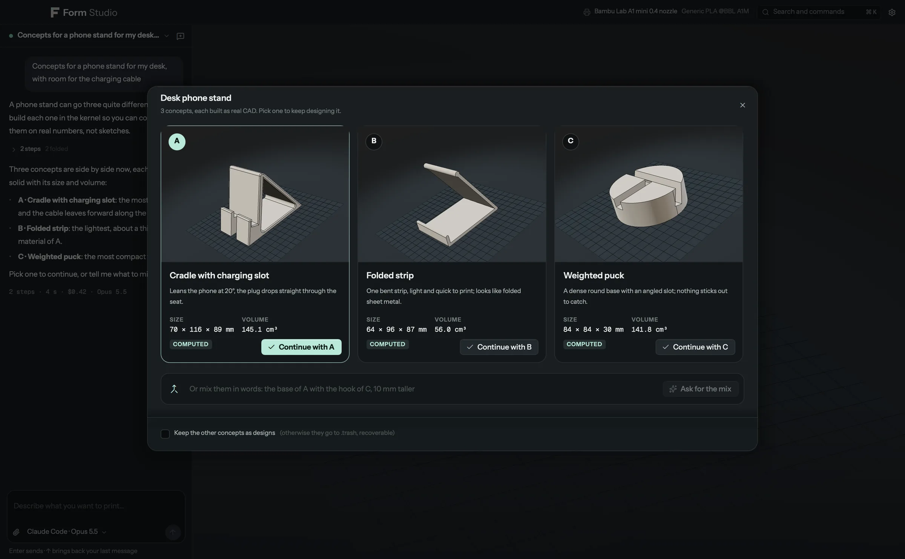
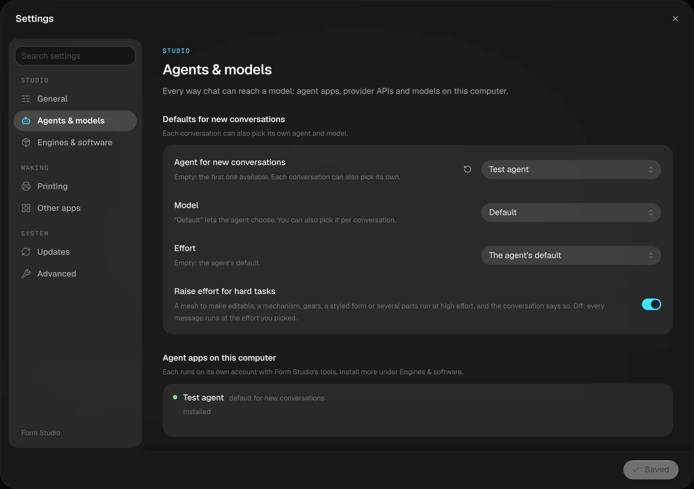

# The desktop app

Form Studio is a native desktop app for macOS, Windows and Linux, written in Qt Quick on PySide6. The interface and
the 3D viewport are drawn on the GPU by Qt; the CAD engine runs in the same process, with the geometry kernel in an
isolated worker. There is no browser and no web view.

## Install

Download the bundle for your system from the [latest release](https://github.com/kaizensx/form-studio/releases/latest):

| System | File | First launch |
|---|---|---|
| macOS, Apple Silicon | `FORM-macos-arm64.zip` | Unzip, then right-click **Form Studio.app** › **Open** |
| macOS, Intel | `FORM-macos-x64.zip` | The same |
| Windows 10 and 11 | `FORM-windows-x64.zip` | Unzip and run `FORM.exe`; in SmartScreen choose **More info** › **Run anyway** |
| Linux x64 | `FORM-linux-x64.tar.gz` | Unpack and run `FORM/FORM` |

On first start a launcher asks three things. **What do you want to make?** shows a card for each thing Form Studio
can be set up for: parametric CAD (always on), mechanical parts, mesh to CAD, photoreal renders (Blender), CAD exchange
(FreeCAD and OpenSCAD) and, last and optional, 3D printing (one slicer). Each card names what it installs, and the total
download updates as you tick. **Your agent** picks who designs with you: an agent app, a model API key or a local model.
**Set up** then installs only what you chose, one item after another, with every command in the log; it pauses only
when you have to sign in or download something, and carries on once that is done. Nothing is downloaded before that
step. Change any of it later in Settings › General › Set up for.

### From Python

```bash
curl -LsSf https://raw.githubusercontent.com/kaizensx/form-studio/main/install.sh | sh    # macOS and Linux
form app
```

The script installs [uv](https://docs.astral.sh/uv/) if it is missing (after asking), then Form Studio with its own
Python 3.12, then runs `form setup`. On Windows, or to manage the install yourself:

```bash
uv tool install --python 3.12 "form-studio[all] @ git+https://github.com/kaizensx/form-studio"
```

## The window

| Area | What it holds |
|---|---|
| **Top** | Three capsules over the view. Left: the design, its revision and release state (the mark goes Home; the arrow opens the menu). Centre: the stages, Describe, Design, Fit, Review and Make, each with where it stands: measured values, features, fit yield, checks to review, release readiness. Right: the printer of a design made for printing (click it to choose another), search (Ctrl/⌘ K) and Settings. Work that takes longer than 300 ms is named beside them with progress |
| **Viewport** (the whole window) | The kernel's geometry, one mesh per feature, with its dimensions, in a pool of light on a studio floor with an origin cross and a scale cue. The printer's build plate appears only in Fit, Review and Make of a design made for printing, or with the grid button in Describe and Design; elsewhere that button shows the floor's 10 mm grid |
| **Tool dock** (left) | Select, Measure, Annotate, Section, Analyze, Assembly, History, Simulate the print and Photo render; the active tool's options sit beside it |
| **Size and views** (bottom left) | Width × depth × height and volume of what is on screen, then Iso, Front, Side, Top and Under |
| **Program** (right) | The panel of the stage you are in. In Design it is the features in build order as a numbered listing; click a line for its parameters. While a design builds, the line being built is lit and the built ones are ticked |
| **Pipeline** (the foot of the pane) | One line: a dot for each step (Parameters, Solid, Exports, Checks, Slice, Release), the revision and what its checks found, and Auto. A step is current only when it describes the revision on screen. A 3D model, or a design that is not sliced, has no Slice step |
| **Conversation** (left) | Once something is said, a glass column on the left: the conversation picker, New and Fold at its head, the messages, the agent's steps, the views it looked at and attachments, and the prompt at its foot. Drag its edge to resize it (300 to 480 px, remembered). Ctrl/⌘ J or Fold turns it into one bar under the part: what the agent is doing, numbered suggestions (keys 1 to 4) and the prompt. A click into the 3D view, or Esc, folds it too, and taking up the prompt brings it back; it folds while a build plays. Paste a link to attach the file it points at |
| **Stage** | What the column and the pane leave. The part, its dimension lines, the build's title and the print simulation are framed in it, and the camera returns the part to its middle when a column folds, opens or is resized. **Focus** (Ctrl/⌘ .) steps both side columns away; the tab on the pane's edge folds the pane alone. In a window under 1200 px, opening the conversation folds the panes to one button |

While a design builds, a pane in the lower part of the stage shows the feature being made in large type, its number, a
track with one segment per step and the features before and after. The caret in every text field is a thin lit line
of the accent. Shadows, glows, glass and the room are dithered, so no gradient shows bands.

### The five stages

| Stage | What you do there |
|---|---|
| **Describe** | What the part is for and its purpose (for 3D printing, or just a 3D model and how it will be made), the dimensions you measured with their provenance, reference photos and imported parts |
| **Design** | Features in build order and their parameters. Select a feature on the model or in the list and change it; dragging a slider rebuilds the part in place while you drag, and the draft shows its computed impact before you commit |
| **Fit** | The fit model for each interface: a section, the clearance, the chance of fitting and how to raise it. Hidden for a 3D model |
| **Review** | Every check with its evidence, print orientation, the plates, and the slice: time, filament, layers, Watch it print. A 3D model shows the checks that apply to it and says which do not |
| **Make** | The release gate, approval (over failed checks only with a reason for each, on the record), the released files with their hashes, and the revision history. With 3D printing on, a 3D model is marked for printing here in one click |

**The Bench.** The top of the Review pane lists every study of the design, and the top of the Make pane every
route out of Form Studio and every document, in the Program's style: a state mark on the gutter, the name, the
headline number in mono with the evidence it rests on, and the state on the right (current · r03, stale · r02,
never run, failed, running, needs, n/a). A line that is not current runs on click (or from its run mark, on the
activity bar); a current one opens what it made (the map on the part, the simulation, the sheet, or its file). The
engine decides every state from keys: an entry is current only when a result exists for the head revision's inputs,
and a stale one names the revision it describes. The agent runs the same entries with `list_studies`, `run_study`
and `get_study`, and the terminal with `form study list|run|show <project> [id]`. The command palette finds every
entry. Studies only the agent can do (the design critique) ask the agent; the release is only ever yours.

The stages follow the work: describe it, design it, review it, make it. Fit sits between Design and Review for a
design made for 3D printing. They were called Brief, Shape, Prove and Release; the CLI, MCP and `--stage` keep those
ids (`brief`, `shape`, `fit`, `prove`, `release`), and the old names still find each stage in the command palette.

**Starting.** The opening screen shows while the engine starts: the logo is drawn on its origin, and the line under
it says what is happening (starting the engine, starting the CAD kernel, loading your designs and setup). Then the
logo travels to the top bar and stays there while Home appears behind it.

### Home

Home is where a design starts. One composer takes whatever you have: words (typed, or spoken with your system's
dictation), a photo (with a bank card, a coin or a ruler in it, the agent estimates sizes from it and labels them
"estimated from the photo"), a sketch drawn on the sketch pad, a STEP, STL or 3MF part, a PDF drawing, or a link (a
model page is passed to the agent as a link; a direct STL, STEP, 3MF, PDF or picture link is downloaded and shown on
the composer). Drop files anywhere on Home or paste them. Under the composer: **Start blank** (an empty design in the
workspace, no agent) and, only when 3D printing is on, **Make it for: Anything / My printer**. A new design is a 3D
model unless you pick My printer or say so in the request ("for my A1 mini"); Settings › Printing › **New designs are
made for** can make every new design a print. A chip beside **Design it** names the agent, the model and the effort the
next design is made with and opens the same picker as a conversation; with no agent connected it opens Settings ›
Agents & models.

Sending opens the workspace at once in a "being designed" state with what the agent is doing written in the middle of
the stage (a conversation that grows moves to the left column); the design is attached
the moment it exists and builds up feature by feature in the viewport, in build order, each feature fading and rising
into place as it is named; a later revision grows in only the features whose geometry changed. For a new idea
the agent proposes three or four concepts as real CAD, side by side and turning, with a line on each and their computed
size and volume: continue with one, or ask in words for a mix ("the base of A with the hook of C"). When it needs a
real number, a **Measure this** card shows where to measure on a picture or a diagram, the tolerance that matters and
what the design assumes now; the number you type is committed with how you measured it, and the part updates.

**The conversation is a record of the design.** A step that changes the design is a compact card: an icon, one
sentence and a small picture of the render the agent took, which opens large. Each new revision posts a card with
its number, the features it changed, the values from → to, and **Compare** and go back.

**Conversations lead to their designs.** Opening a conversation opens the design in front of it; one that made several
shows a strip of them under its title, and one that made none says "No design yet" with **Continue the conversation**
(never the Home question). A design moved to the trash is named as such. While you work on a design, an agent working
on another one never takes the view away: a line names it, with **Show**. A usage limit is a calm card that says
which agent, when it can work again and what is saved, with **Use another agent**.

Below: concepts waiting for a pick, then your designs as live 3D cards, then recent conversations, each with the
designs it made. Designs are grouped by **family**: a design with its copies, saved variants, the concept you picked
and the other designs made by the same request is one card, showing the member
changed last, with a count on it. Click the count to open the family under its row (the first design first, each
member saying whether it is a copy or a variant); click the card to open the design. Families are filtered by released
and in progress and sorted by name or date. Right-click a card to rename, duplicate, export or move it to the trash.
**Import** (from Home or the command palette) opens a `.formstudio` or `.formproj` design, a conversation exported as
JSON.

**Sketch pad.** Lines, rectangles, circles, arcs (centre, start, end), freehand strokes and dimensions, snapped to a
5 mm grid and to the points already drawn (Alt draws freely), with undo and redo. A typed dimension is "stated" and
overrides the drawn length. The agent receives the shapes as structured geometry in millimetres and the picture.

On the first day, before there is a design, the question and the composer sit on the left and a real build turns
slowly beside them: a sensor enclosure of 13 features, kernel geometry kept with the app and labelled as an example.
It is not a project and nothing is created.









## Keys

| Key | Does |
|---|---|
| Ctrl/⌘ K | Search and commands: every action and every design |
| Ctrl/⌘ N | New design: Home, with the composer ready |
| Ctrl/⌘ Shift O | New conversation |
| Ctrl/⌘ J | Show or hide the conversation |
| Ctrl/⌘ . | Focus: the part alone, both side columns away |
| Ctrl/⌘ [ | Back to all designs |
| Ctrl/⌘ Shift H | All designs (Home) |
| Ctrl/⌘ , | Settings |
| Ctrl/⌘ 1 to 5 | Brief, Shape, Fit, Prove, Release |
| Ctrl/⌘ Return | Commit the draft |
| ? | All keys |

In the viewport:

| Key | Does |
|---|---|
| V | Select: click a feature, drag to orbit |
| M | Measure distances, faces and diameters |
| X | Section cut on or off |
| N | Annotate: pick, paint or lasso, keep, ask the agent |
| A | Analyze: thickness, overhang and other maps |
| E | Assembly views and joints |
| T | History: the revision timeline |
| F | Frame the selected feature, or the whole part |
| 1 to 5 | Iso, front, side, top and underside views |
| . | Reset the view |
| H / Shift H | Hide the selected feature / show all |
| Esc | Leave the tool or clear the selection |

Drag to orbit, right-drag or Shift-drag to pan, scroll or pinch to zoom. Right-click a feature for quick actions.

**Drag a face to change it.** ⌘-drag (Ctrl-drag on Windows and Linux) on a face: Form Studio finds the parameter that
moves that face (it rebuilds the design once per parameter and measures how far the face travels along its normal, and
how much else changes) and the drag sets it. A readout beside the pointer names the parameter, from and to, how many
millimetres the face moves per unit and the draft's volume change; the part rebuilds as you pull. Releasing keeps the
change as a draft: commit or discard it like any other. Pull the top of a box and its height changes, its side and
its width does, a helmet's brow and the brow handle moves.

While measuring or annotating: D distance, G face, O diameter, R edge, P point, B brush, L lasso, [ and ] brush size,
Shift-click adds to the selection, Alt-drag orbits while painting.

In the conversation: Return sends, Shift Return adds a line, Up brings back your last message.

## Settings

Settings (Ctrl/⌘ ,) edits `studio.toml` for you, with a backup of the file. The pages are listed in a rail on the
left (General, Agents & models, Engines & software, Printing, Other apps, Backups, Updates, Advanced) and each page is a set of
titled cards. The search box in the rail finds a setting on any page, numbers
are checked as you type, every value can be reset to its default, and changes apply at once: choosing the default
printer updates the printer chip, the plate and the open design's checks without a restart.


| Page | Holds |
|---|---|
| General | Appearance: Dark, Light or Match system, applied at once. Set up for: the same cards as the launcher. Turning one on installs only what it needs; turning one off hides it and never uninstalls anything. And the project folder |
| Printing | The default printer, filament and process, from every printer set up in your slicers; the slicer, and whether designs made for printing are sliced; the keep-out margin and the gap between parts on a plate; which program "Open in slicer" uses. Shown only when 3D printing is on |
| Agents & models | Agent apps, model API keys, local models and providers you added, in one list; Add a provider…; the agent, model and effort for new conversations; web lookups; a spending limit per message; opening Form Studio when an outside agent starts working. Keys are stored privately and never shown again |
| Other apps | Blender, OpenSCAD and FreeCAD: whether and where each was found, Browse as a fallback, and what each one unlocks; which programs "Open in CAD" and "Open in viewer" use |
| Backups | Back up now, the last backup and when the next one runs; on a schedule (hourly, daily, weekly) to a folder you choose, how many to keep, with or without conversations and built outputs; optionally a Git repository you created, pushed with your own sign-in; the backups in the folder with Verify and Restore; Recently deleted, 30 days, with Put back |
| Updates | The daily check for a newer Form Studio, and the Stable or Preview channel |
| Advanced | The slice time limit, how long the agent waits for your answers, the Claude Code command, and the printer name used when none is chosen |
| Engines & software | Everything Form Studio uses: installed or not, its size and licence, an Install button, and for each optional engine or app that is installed a **Use in Form Studio** switch with one line on what it changes. Installed and used are separate: switched off, an engine stays on the computer and is never called. The switch applies at once |




## Rules the app keeps

- It never starts a print and never uploads a design.
- A slice is labelled **simulated**, a fit yield **modelled**, a strength figure a **model** with its assumptions.
- Only a person approves a release, with a deliberate action in the Release stage.
- The app, the CLI and the MCP server can work on the same project folder at the same time.

## Build from source

```bash
uv venv --python 3.12 .venv
uv pip install --python .venv -e ".[all]" pyinstaller
.venv/bin/python -m form.app                          # run from source
.venv/bin/pyinstaller packaging/form.spec --noconfirm # build the bundle into dist/
```

The bundle is about 800 MB unpacked, because it carries the OpenCascade kernel and Qt. Notes for working on the
interface: [form/app/qml/CONTRIBUTING-UI.md](../form/app/qml/CONTRIBUTING-UI.md).
