# Features

Everything Form Studio does, from the first idea to the released files. Each capability is available in the desktop
app, as a `form` command ([CLI reference](CLI.md)) and as an MCP tool ([MCP reference](MCP.md)), unless noted.

- [Start from anything](#start-from-anything)
- [Concepts and measurements](#concepts-and-measurements)
- [Conversations and agents](#conversations-and-agents)
- [Any model, any provider](#any-model-any-provider)
- [Designing](#designing)
- [For a printer, or just a 3D model](#for-a-printer-or-just-a-3d-model)
- [Revisions, branches and variants](#revisions-branches-and-variants)
- [Checks and evidence](#checks-and-evidence)
- [Fit](#fit)
- [Analysis, measurement and annotations](#analysis-measurement-and-annotations)
- [Colours and materials](#colours-and-materials)
- [Printers, slicing and print simulation](#printers-slicing-and-print-simulation)
- [Assemblies](#assemblies)
- [Optimisation and alternatives](#optimisation-and-alternatives)
- [Pictures: renders, share cards, animations](#pictures-renders-share-cards-animations)
- [Release](#release)
- [Moving and sharing designs](#moving-and-sharing-designs)
- [Recipes: building blocks and the community gallery](#recipes-building-blocks-and-the-community-gallery)
- [Working with other software](#working-with-other-software)
- [Setup, settings and updates](#setup-settings-and-updates)
- [On GitHub](#on-github)

---

## Start from anything

Home is one composer for whatever you have.

| Start with | What happens |
|---|---|
| **Words** | Describe the part, typed or dictated. |
| **A photo** | Drop or paste it. With a bank card, a coin or a ruler in the picture, the agent estimates sizes from it, labels them "estimated from the photo" and keeps them *assumed* until you measure. |
| **A sketch** | Draw it on the sketch pad. The agent receives the shapes as structured geometry in millimetres, and the picture. |
| **A part** | A STEP, STL or 3MF file to design around or start from. |
| **A drawing** | A PDF datasheet or mechanical drawing, read as images so its dimensions survive. |
| **A link** | A model page is passed to the agent as a link; a direct file link (STL, STEP, 3MF, PDF, PNG, JPEG, WebP) is downloaded once and shown on the composer. |

Drop or paste files anywhere on Home. Under the composer, choose **For my printer** or **Just a 3D model** for what
starts next, or **Start blank** for an empty design in the workspace with no agent. From a terminal:
`form start --text … --photo … --sketch … --file … --link …` or `form start --blank`.

**The sketch pad.** Lines, rectangles, circles, arcs, freehand strokes and dimensions in millimetres, snapped to a
5 mm grid and to the points already drawn (Alt draws freely), with undo and redo. A typed dimension is *stated* and
overrides the drawn length. The agent extrudes or revolves the shapes faithfully.

**The workspace opens at once.** Sending from Home shows the design being made, with what the agent is doing, and
attaches the design the moment it exists. Each new build grows into the viewport feature by feature, in build order,
each one named as it arrives.

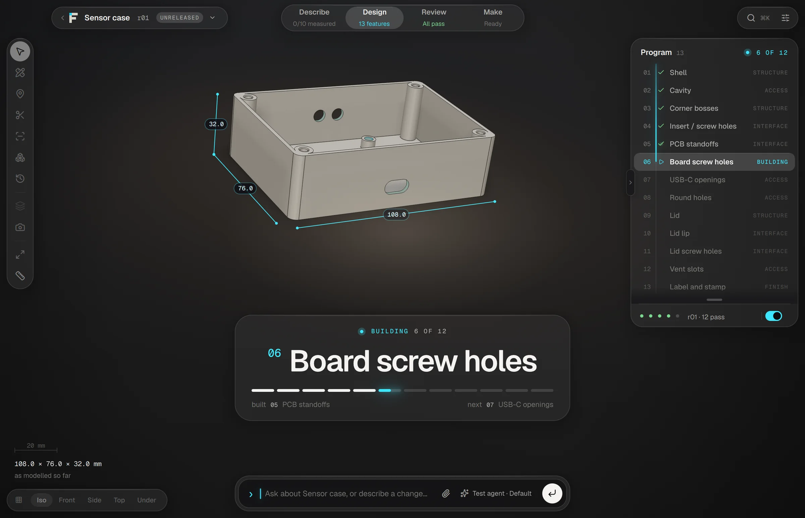

## Concepts and measurements

- **Concepts first.** For a new idea the agent proposes three or four genuinely different concepts, each a real CAD
  model, side by side and turning, with a line on each and its computed size and volume. Continue with one, or ask in
  words for a mix ("the base of A with the hook of C"). The others move to the trash. MCP `propose_concepts`,
  `pick_concept`, `list_concepts`; `form concepts`.
- **Measure this.** When the agent needs a real number it shows where to measure on a picture or a diagram, the unit,
  the tolerance that matters and what the design assumes now. The number you enter is committed as a new revision
  with how you measured it (calipers, ruler, tape, or an estimate kept as *assumed*), and the part updates. MCP
  `ask_measurement`.

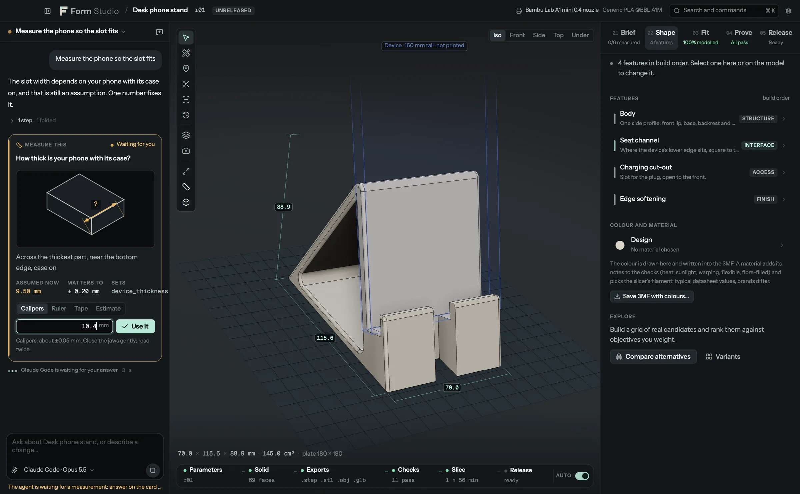

## Conversations and agents

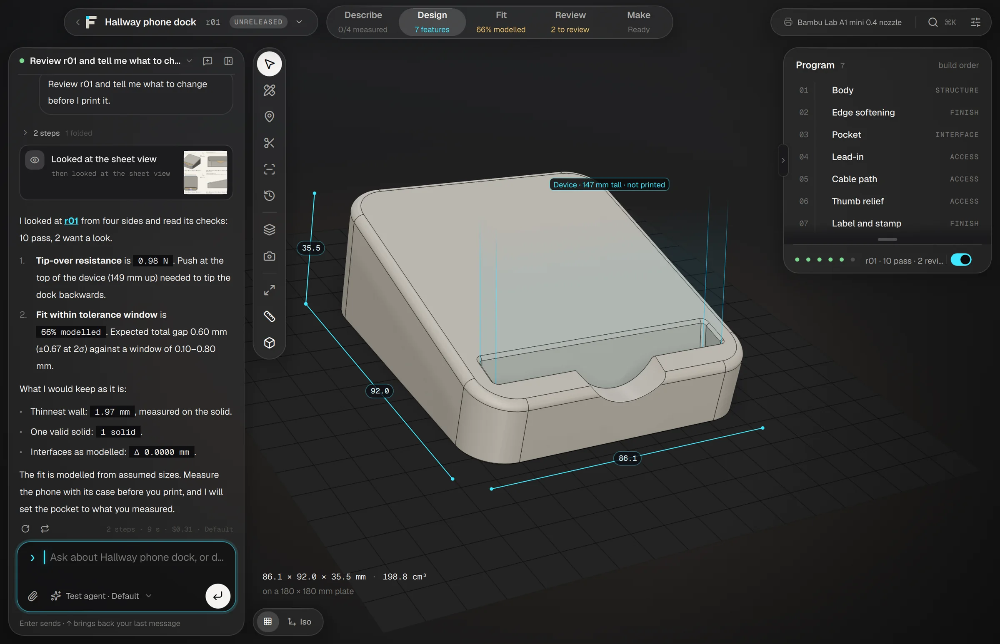

- **An agent per conversation.** Each conversation picks its agent, model and reasoning effort: Claude Code, Codex,
  Gemini CLI, Cursor CLI, OpenCode, Qwen Code or GitHub Copilot CLI, a model API, a local model, or a provider you
  added. Model names carry their version ("Opus 5.5"), taken from what the agent reports, in the picker and on every
  reply.
- **Many conversations.** Tied to a design or free-standing; searchable, pinnable, renamable. Opening a conversation
  opens its design. The conversation column is resizable and hides with Ctrl/⌘ J.
- **Visible work.** The agent's tool calls fold into a group of steps, the views it rendered appear inline, and time,
  tokens and cost are shown per reply. Retry any reply with another model.
- **Questions as cards.** When the agent needs a decision it asks in the conversation with choices, several choices,
  your own words or an approval, and waits for your answer. `form chat` asks in the terminal.
- **Suggested replies, change cards and revision links.** A reply can end with suggested next messages. A reply that
  changed the design shows r01 → r02 with Compare and Go back. A revision name like r04 opens it.
- **Fix with your agent.** Failed checks, pipeline steps, slices, drafts that do not build and Blender renders have a
  Fix button that sends the failure, with its evidence, to the design's conversation.
- **Suggestions for the open design**, in an empty conversation, from its real state: what fails, what to review,
  which numbers are still assumed.
- **Live follow.** When an agent in another window (Claude Code in a terminal, Cursor) changes a design over MCP, the
  open app shows the new revision, labelled with the agent that made it.
- **Agents know what you make.** The in-app agent and MCP clients are told whether you print and what each design is
  for, so a designer is never asked about a printer.
- **Design skills.** Thirteen skills carry the practice of designing for manufacture: intake, parametric design,
  industrial design, design review, variants, FDM engineering, fit calibration, hardware, assemblies, modular storage,
  print verification, print feedback and release. Claude Code installs them as a plugin
  (`claude plugin marketplace add kaizensx/form-studio`); other agents read the same `SKILL.md` files.

## Any model, any provider

- **Model APIs:** Anthropic, OpenAI, Gemini, OpenRouter, Mistral, xAI, DeepSeek and Groq, found from your keys. No
  agent app is needed; Form Studio runs the conversation and gives the model its tools.
- **Local models:** Ollama, LM Studio and llama.cpp, found from their running servers.
- **Add any provider by its address.** Settings › Agents › Add a provider… (or `form providers add URL`) takes a base
  URL and an optional key, finds the format (OpenAI-, Anthropic- or Gemini-compatible, with or without `/v1`, or
  Ollama), reads the models and which of them call tools, and shows what it found, for example "Connected:
  OpenAI-compatible, 374 models, tools supported by 323 of 374", before you save. The key is kept in Form Studio's private secrets file and never shown again. Saved
  providers can be edited, tested on one model or removed.
- **A model menu for hundreds of models.** Search, vendor sections, ↑ ↓ and Return, free models marked, the models you
  used pinned under Recent. Batch-only variants and models without tool calls are left out.
- **No surprise default.** A provider's Default is the model you last used with it; until then the menu asks you to
  pick one. Switching agents brings back the model you last used with that agent. When an agent states its own
  default (Codex's config, Gemini CLI's and OpenCode's settings, or the version it reported on its last run), the
  menu names it: "Default · GPT-6.1-Sol".

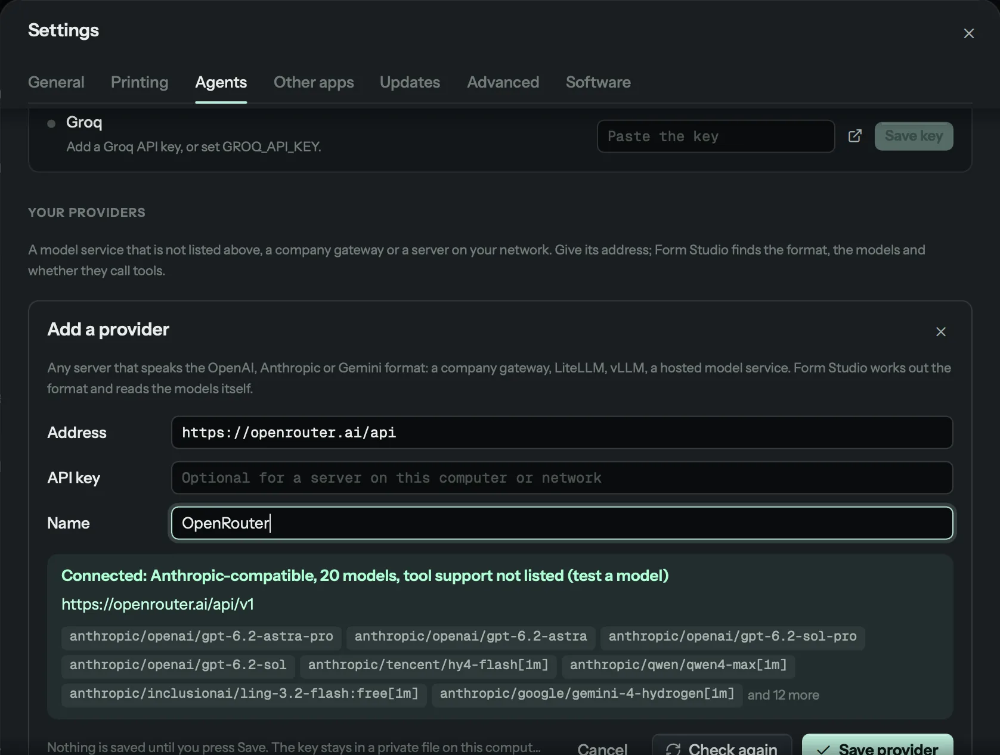

## Designing

- **A real CAD kernel.** Every design is B-rep geometry built by [build123d](https://github.com/gumyr/build123d) on
  OpenCascade, exported as STEP, STL, OBJ and GLB. Designs are Python (build123d) or OpenSCAD.
- **Parameters with provenance.** Every value has a unit, a range, a group (brief, interface, form, process) and a
  source: measured, specified, assumed, estimated from a photo, computed.
- **Features you can click.** Each face of the solid is attributed to the feature that made it, so you can select a
  feature on the model, change it, hide it, and see which features a change touched.
- **Drafts with computed impact.** A change is built for real before it is saved: the features and interface
  dimensions it moves, the change in stability and fit, and which outputs it would invalidate.
- **Constraints that explain themselves.** An impossible combination is refused with the feature, the parameters
  involved and a way forward.
- **Hardware with sources.** `form.parts` provides screw clearances (ISO 273), heat-set insert pockets, nut traps,
  magnet pockets, bearing seats, printable threads and involute gears, each dimension with its source.
- **Text and patterns.** Embossed or debossed lettering with a shipped font, revision stamps on the underside, hex
  vents, perforations, slots, knurls and grip ribs, with web-thickness checks.
- **Reference parts.** Import a STEP or STL of the thing your part must fit (a circuit board, a phone, a motor). It is
  drawn as a blueprint companion, and a design can cut clearance from it with `self.reference("pi5.step")`.
- **Datasheets and drawings.** The agent reads PDFs and images, from a file or an https link, as pictures, so the
  dimensions in a mechanical drawing survive (`read_document`).
- **Every design on Home**, each a live 3D card, filtered by released and in progress; rename, duplicate, export or
  move to the trash.

## For a printer, or just a 3D model

Every design has a **purpose**: *For 3D printing*, or *Just a 3D model* for rendering, CAD exchange, CNC, laser
cutting, moulding or visualisation. New designs start from your answer on Home; change it any time in the Brief or
from the top bar. `form new … --purpose model --process cnc`, `form purpose <project> model`.

- **A 3D model is checked as a model.** Size, a valid solid, a closed mesh, the STEP round trip, loads and assembly
  checks run; overhangs, bridges, plate contact, the build volume, nozzle walls, the printer-accuracy fit model and the
  slice do not, and Prove says so. The thinnest feature is compared with the process you name (about 0.8 mm for CNC
  or injection moulding, 2 mm for casting). The pipeline has no Slice step and the Fit stage is hidden.
- **Its release** holds STEP, STL, 3MF, OBJ and GLB, a four-view sheet and an iso render, with no G-code and no print
  report.
- **Design without a 3D printer.** The first run and Settings › General ask once: "I have a 3D printer" or "I just
  design". If you only design, there is no printer chip, no slicer install, no slicer in setup and no Printing tab;
  the top bar reads "No printer · Just designing".
- **Design only.** Slicing is optional per design, for every design, or when no slicer is installed. Checks, exports,
  renders and releases work without it, and the release says what it does not cover.

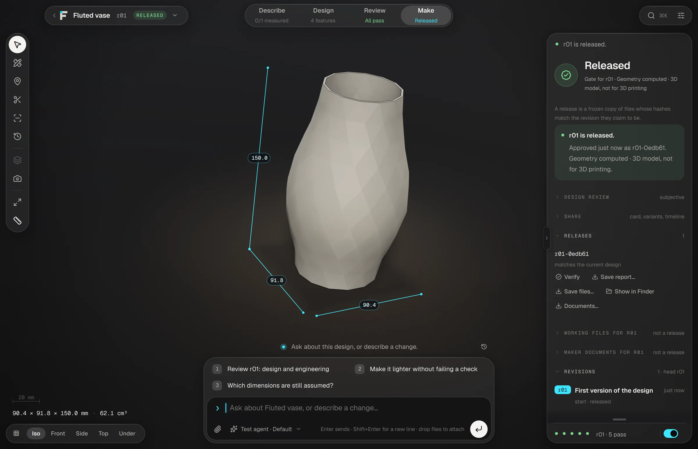

## Revisions, branches and variants

- **Every commit is a revision.** Revisions record their origin (you, the CLI, or the agent by name) and never
  overwrite each other: an agent that commits against an older head is refused.
- **Timeline.** Scrub through revisions in the viewport, play them as a morph, and export the morph as GIF or WebP.
- **Branches.** Check out any earlier revision and continue from it; nothing is deleted.
- **Compare.** Parameters, features, interface dimensions, stability and fit between any two revisions.
- **What changed, on the solids.** Comparing with head also compares the two solids in the kernel: material added in
  green and removed in red, with the volume and number of regions of each, computed with booleans on the B-rep.
  `form diff`; MCP `geometry_diff`.
- **Variants.** Named sets of values kept next to the revisions ("Travel version", "Thick walls"), compared side by
  side on a variants board and promoted to a revision when you choose.

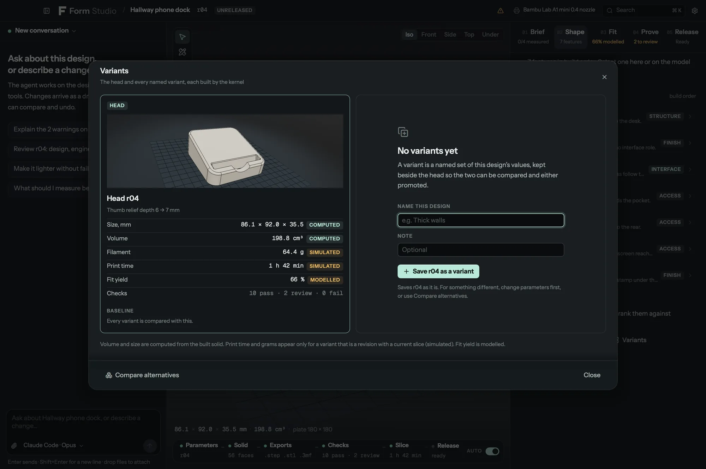

## Checks and evidence

Each revision is rebuilt and checked on the solid. The standard checks for a printed part:

| Check | Evidence |
|---|---|
| One valid solid | computed |
| Interfaces as modelled (intended vs measured on the solid) | computed |
| Export mesh is closed | computed |
| STL matches the CAD solid | computed |
| Fits the build volume | computed |
| Thinnest wall | computed |
| Unsupported overhangs | computed |
| Bridged ceilings | heuristic |
| Plate contact | heuristic |
| Tip-over resistance (statics) | model |
| Fit within the tolerance window | model |
| Re-imported in FreeCAD (when installed) | computed |

Recipes and assemblies add their own: a bracket's bending safety factor, a box's lid swing, the clearance of a pin in
its hole. **Every result says how it is known** (computed, heuristic, model, simulated, measured, physical) and
clicking a result shows where on the part it was found.

**Thinnest wall measures walls.** In a design of several parts each wall is measured inside its own part, so a bolt
resting in its nut is not a 0 mm wall, and only faces within 30° of parallel count, so a tapered edge is not a wall
either. A real thin fin still fails.

## Fit

The gap between a printed cavity and the object it holds is modelled from three uncertainties: the object's
dimension (measured, specified or assumed), the printer's bias and spread for this filament, and the tolerance window
you accept. Form Studio reports:

- the **chance the gap lands in the window**, with the chance of too tight and too loose;
- a **section** through the interface with the clearance per side;
- the **recommended clearance** for a centred gap;
- the **cheapest way to raise the odds**: measure the object, print the fit coupon, or print a thin test ring cut from
  the real interface (`slice_test_piece`).

Measurements from a printed coupon calibrate the printer profile and are reused by every later design.

## Analysis, measurement and annotations

| | |
|---|---|
| 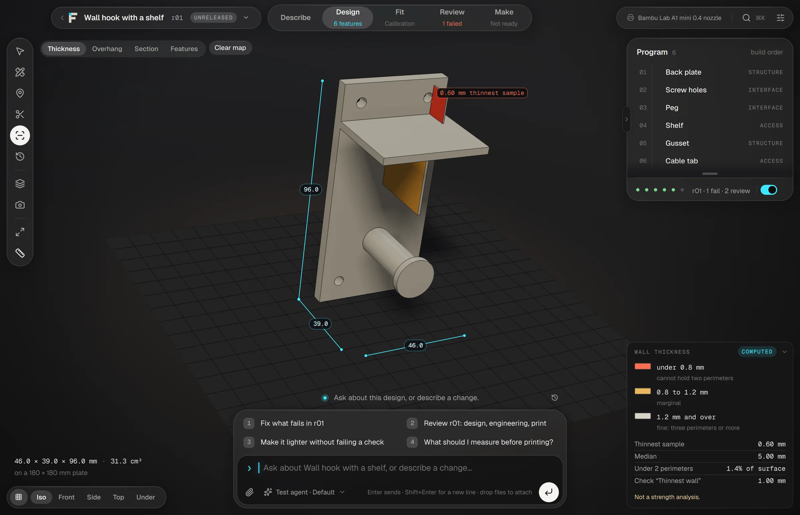 |  |
| **Wall thickness**, from thousands of surface samples, with the thinnest spot marked. | **Overhangs** by angle, flat ceilings, bridges and plate contact. |

- **Maps on the model:** wall thickness, overhang, layer cross-section and small features, computed from the real
  geometry. Each legend says what the map does not tell you.
- **Measure (M):** point-to-point distance with snapping, face area and tilt, and exact hole diameters from the solid.
  It works on every multi-part design and in every view (print layout, assembled, exploded); clicks answer at once and
  measurements follow the parts.
- **Annotate (N):** pick faces, edges and points, or brush and lasso regions on the part, and see area, tilt,
  overhang, wall thickness, curvature and height above the bed computed on the solid. Keep a selection with a name and
  a note as a pin on its revision, ask the agent about it with the exact numbers, or cut a section through it.
  `form select`, `form annotations`; MCP `analyze_selection`, `annotate`, `list_annotations`.
- **Text on any flat face.** In Annotate, pick a point on a flat face and choose **Text here…**: raised or sunk,
  cap height and depth, with stroke width and cap height checked against your nozzle as you type. **Add to design**
  writes the lettering into the design's own code as a feature and builds a new revision. `form engrave`; MCP
  `add_text`, `remove_text`.
- **Screw bosses and snap-fit hooks where you click.** In Annotate, **Feature here…** on a flat face adds a screw
  boss (M2 to M5, with the ISO tap drill, a heat-set insert hole or the ISO 273 clearance) or a cantilever snap-fit
  hook, checked against your nozzle and written into the design's code. `form feature`; MCP `add_feature`,
  `remove_feature`.
- **Section (X):** a clipping plane through the solid with filled cut faces.
- **Orientation finder:** ranks print orientations by overhang area, support, contact and height, with the numbers
  behind the ranking, and applies the one you choose.
- **Tip-over and statics:** where the centre of mass sits, and the push that tips the part, from the solid and the
  slicer's mass.

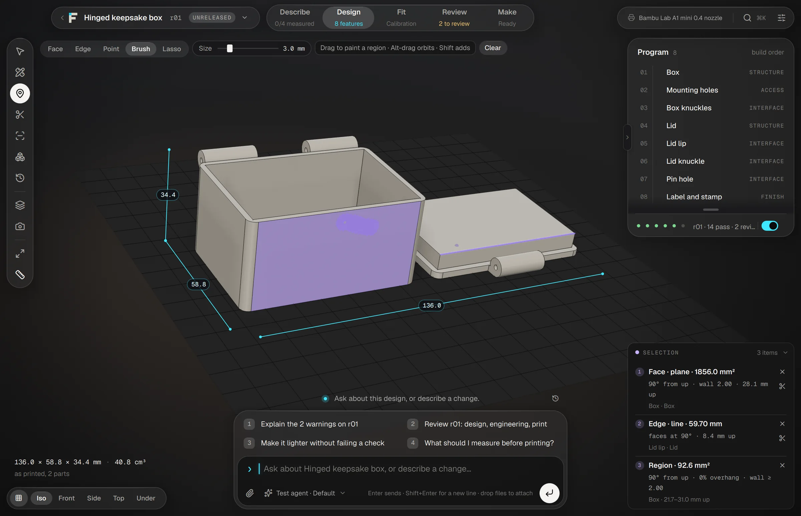

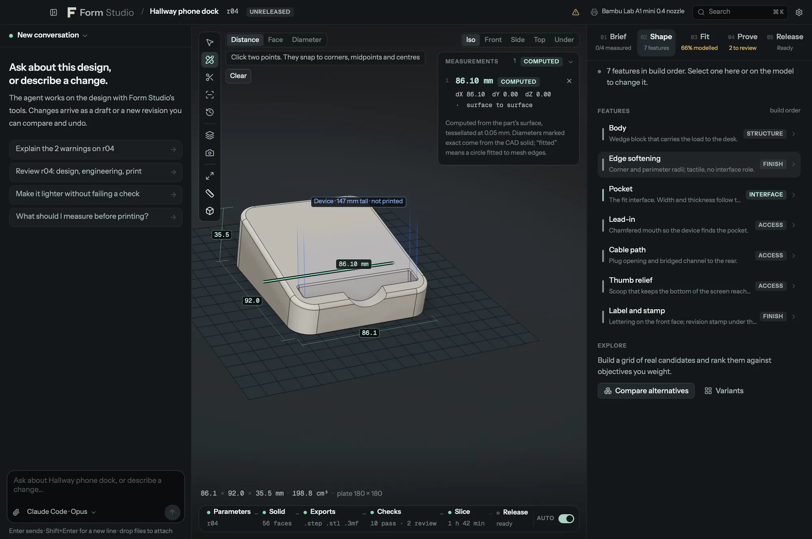

## Colours and materials

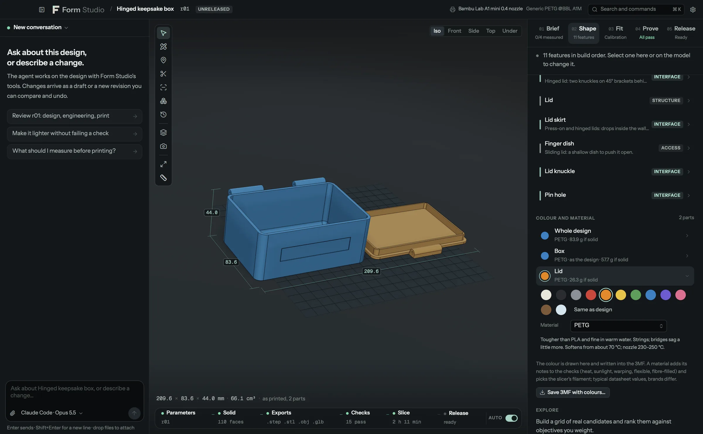

- **Per design or per part**, drawn in the viewport and exported as a 3MF with colours.
- **Used in the checks:** heat, sunlight, warping, and flexible or fibre-filled filament.
- **Picks the filament.** A material selects the printer's matching filament preset, one material per plate.
  `form appearance`, `form material`; MCP `set_appearance`.

## Printers, slicing and print simulation

- **Your slicer, your presets.** Bambu Studio, OrcaSlicer, PrusaSlicer, SuperSlicer, QIDISlicer, ElegooSlicer and
  Snapmaker Orca. OrcaSlicer 2.5 packed profiles (`.opc`) are read directly; a profile never has to be exported by
  hand.
- **Every printer you have.** Form Studio finds every printer set up in every installed slicer and lets you choose
  printer, filament and process per design or as the default. Slicing, the bed size and the nozzle checks follow the
  choice, at once: Settings, the top bar, the plate and the open design's checks update without a restart.
  `form printers`; MCP `list_printers`, `choose_printer`.
- **Several plates.** A design whose parts do not fit one plate is laid out part by part on as many plates as needed,
  each in its own orientation and sliced, with time, filament and cost added up. Prove and the print simulation switch
  between plates. `form plates`; MCP `plate_plan`, `set_part_print`.
- **Watch it print.** The G-code is read back and played in 3D with a nozzle marker, line-type filters, a per-layer time
  chart and the slicer's own time and filament estimate. Jump to the next bridge or overhang wall.
- **Copies on a plate:** does N fit, and how they pack.
- **Cost:** filament, electricity and machine time from the slice and your prices. Form Studio never guesses a price.

- **Every printer you have, compared.** Prove › Every printer slices the design for real on each printer set up in
  each installed slicer, with its own process and filament, and shows time, filament and cost side by side with the
  fastest, least filament and cheapest marked. `form compare-printers`; MCP `compare_printers`.

## Assemblies

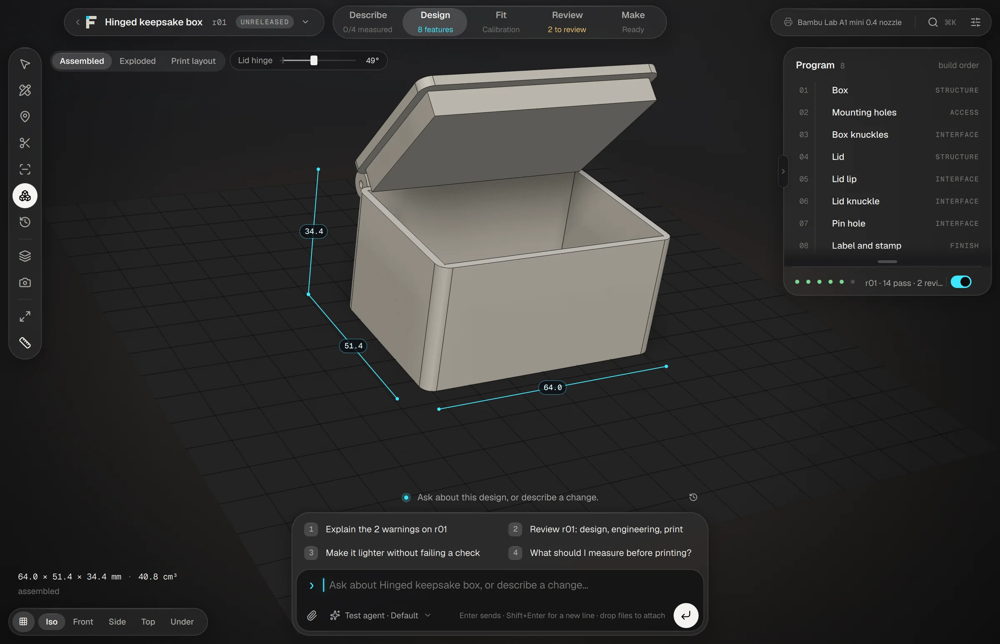

- **Assembled, Exploded and Print layout** for every design that says how its parts go together. Designs with separate
  bodies that do not say show Assembled as unavailable, explain why and offer to ask the agent to add it.
- **Joints that form chains.** A part can be fixed to another (`Part(attach="arm")`) or move on a joint mounted on
  another part (`hinge(..., parent="arm")`), so turning an arm swings the cup on it and the bolt in the cup, in the
  viewport sliders, the views and the checks. Exploded offsets are relative to the parent. Ratchet joints (`step=15`)
  are checked at the positions they click to.
- **Joined parts are fits.** `Mate(a, b, "pin" | "thread" | ...)` declares a pin in its hole or a thread in its thread;
  the pair is measured against its clearance instead of being reported as a collision, and a thread's phase is
  searched.
- **Checks from the solids:** overlap when assembled, the smallest gap, every declared fit, each joint swept through
  its range with everything it carries (the first contact angle when there is one), and whether a screwdriver reaches
  every screw.
- **Seconds, within a budget.** Parts are compared on their meshes and booleaned only where they meet; sweeps refine
  near contact and prove motion free between positions where the clearance allows. The checks run in their own time
  budget (`[assembly].budget_s`, 45 s) with progress, and a partial result says which range was checked.
- **Declarations are checked** when a design is created or updated: an unknown part, a loop or a part with two parents
  is refused with the reason.
- **A bill of materials** for the bought hardware; a release adds `BOM.csv` and `ASSEMBLY.md`.
- **Assembly instructions as a PDF.** A parts page with each part's computed volume, then one page per part in the
  order the assembly attaches them, at its exploded offset with an arrow to where it seats. `form instructions`; MCP
  `assembly_instructions`.

| | |
|---|---|
| 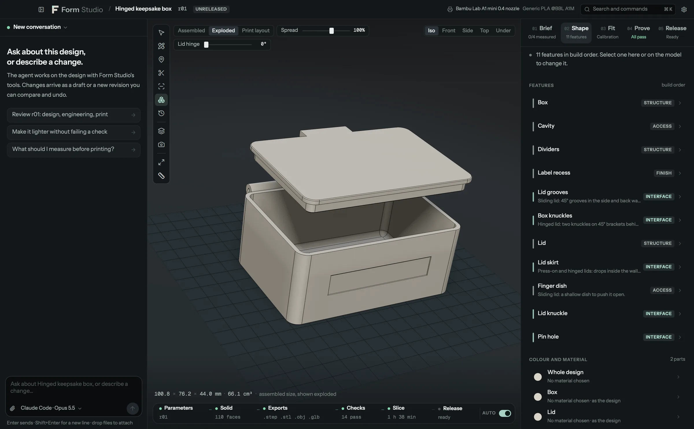 | 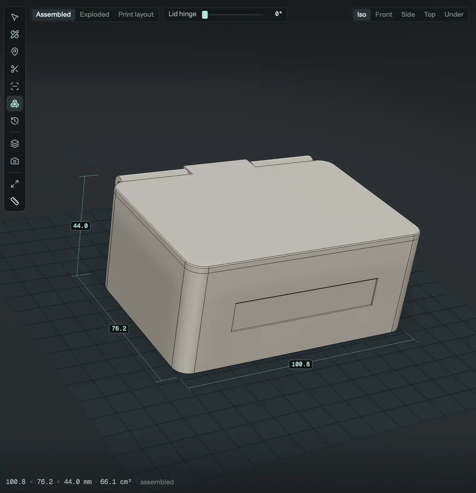 |

## Optimisation and alternatives

- **Goal seek** (`optimize`): search parameter ranges for the lightest, smallest or strongest design that still passes
  its constraints, for example the lightest bracket with a safety factor of at least 3. Every candidate is a real
  kernel build.
- **Alternatives:** a grid of real variants over one or two parameters, ranked by objectives you weight (less
  material, harder to tip, fit yield, smaller footprint).

## Pictures: renders, share cards, animations

| | |
|---|---|
|  | 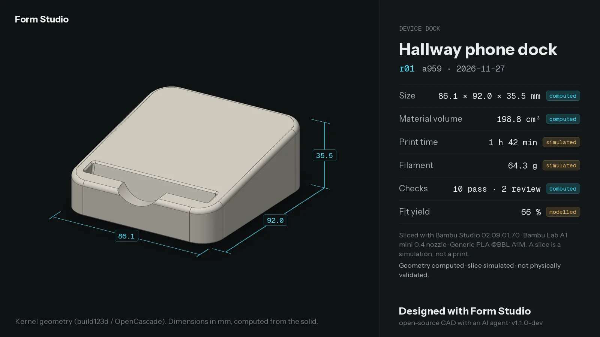 |
| **Photoreal render** with Blender: studio, desk or dark scenes, matte, PETG or silk finishes, any colour, layer lines at the slicer's layer height. | **Share card**: the part with its dimensions, print time, filament, checks and fit, each labelled with its evidence. |

- **Engine renders** in any view or as a four-view sheet, coloured by feature, for agents to look at their work.
- **Turntable videos:** Release › Share › **Turntable…** renders the part turning once as MP4, PNG frames, WebP or GIF. `form turntable`; MCP `turntable`.
- **Turntables and revision morphs** as GIF or WebP (`form animate`, `form history --gif`).
- Renders are illustrations and are labelled as such; they are never evidence.

## Release

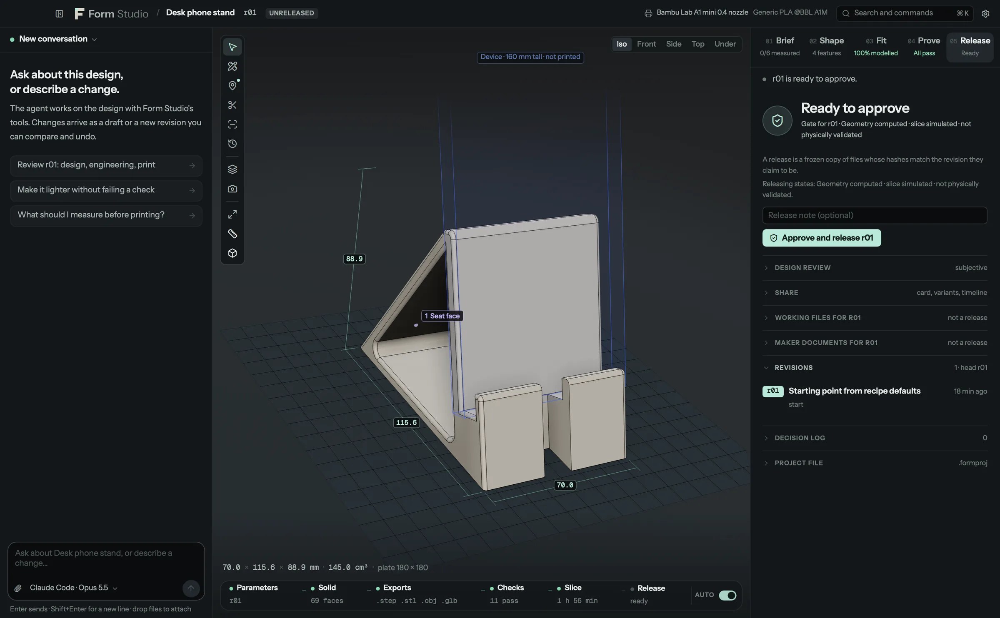

- **A release gate** lists what is current, what is stale and what needs acknowledgement.
- **One approval, by a person**, freezes STEP, STL, OBJ, GLB, 3MF and G-code with SHA-256 hashes and a report of every
  check and its evidence. No agent can approve.
- **Released over failed checks, on the record.** Tick each failed check and write why; the release, its manifest and
  its report say it was released with failed checks. Missing or stale files still block.
- **Verify at any time** that a release still matches its hashes; a later commit marks it superseded.
- **Save files…** puts every file of a release in one .zip (STEP, STL, the sliced 3MF, G-code, report, documents and
  manifest); **Show in Finder** opens its folder. `form release-files`.

## Moving and sharing designs

- **One file per design.** Export a design with its revisions, conversations and the code it was built from as one
  `.formstudio` file, and import it on another computer. Clashing ids get new ones and nothing is overwritten; older
  `.formproj` files still import. `form export`, `form import`; MCP `export_project`, `import_project`.
- **Conversations** export alone as Markdown (to read) or JSON (to import again). `form export-conversation`.

## Recipes: building blocks and the community gallery

Recipes are parametric families written as code, with their own engineering checks. Agents use them as starting
points and change anything; people browse them in the [website gallery](https://kaizensx.github.io/form-studio/recipes/)
with categories and tags.

- **Built in**, made of the things people print most: Gridfinity bin and baseplate, a box with a sliding, press-on or
  hinged lid, SKÅDIS pegboard accessories, a phone and tablet stand, a cable organizer, an under-desk hanger, a shelf
  bracket, a hose and pipe adapter, a self-watering planter, a faceted vase and lamp shade, a battery and card holder,
  an electronics enclosure and the fit coupon. Each passes its checks at its defaults and prints without supports.
- **Community recipes** install from a file or from the gallery, after you read the source and its SHA-256. Downloads
  are verified against the index, nothing runs until a design is created, and uninstalling is one command.
  `form recipes list|inspect|install|uninstall|community`.
- **Share a recipe** as one `.formrecipe` file (code, `meta.json` with its SHA-256, and a preview from a real build),
  prepare a community submission with a pre-filled GitHub issue (nothing is posted from Form Studio), or turn a design
  into a recipe. `form recipes export|import|submit|derive`.

Writing one: [Writing a recipe](RECIPES.md) and [community recipes](../community/recipes/README.md).

## Working with other software

| Program | What Form Studio does with it |
|---|---|
| FreeCAD | Opens the STEP, runs a re-import check, and writes a macro with every parameter in a spreadsheet |
| OpenSCAD | Builds `.scad` designs; Customizer ranges become parameters |
| Blender | Photoreal renders; its 3D-Print Toolbox checks when the add-on is installed |
| Your slicer | Slices, and opens the 3MF or G-code in it |
| Any MCP client | The full engine over 74 tools ([MCP reference](MCP.md)) |

When a program's version outside the supported range is why something failed, the error names the supported versions
and what to do.

## Setup, settings and updates

- **Setup by itself.** First start installs what Form Studio needs (the standard-parts libraries, a slicer if you
  print, an agent and its sign-in) and pauses only when you have to sign in or download something, then carries on.
  Every command is shown before it runs. `form setup --auto` does the same headless.
- **Settings** (Ctrl/⌘ ,), with search: General, Printing, Agents, Other apps, Updates, Advanced and Software. Agent,
  model and effort are picked from what is set up; slicers and programs (Blender, OpenSCAD, FreeCAD, Claude Code) show
  whether and where they were found, with Browse as a fallback and what each one unlocks; numbers are checked as you
  type; every value can be reset to its default. Changes apply at once.
- **Feedback on every click.** Buttons show a spinner and a working label while the engine works; a bar under the top
  bar names any work over 300 ms with progress, and a toast says when it finished or failed.
- **What's New** after every update, once, and any time from About and Help. Choose the Stable channel (releases) or
  Preview (pre-releases from the `dev` branch).
- **Command palette** (Ctrl/⌘ K) for every action and every design.

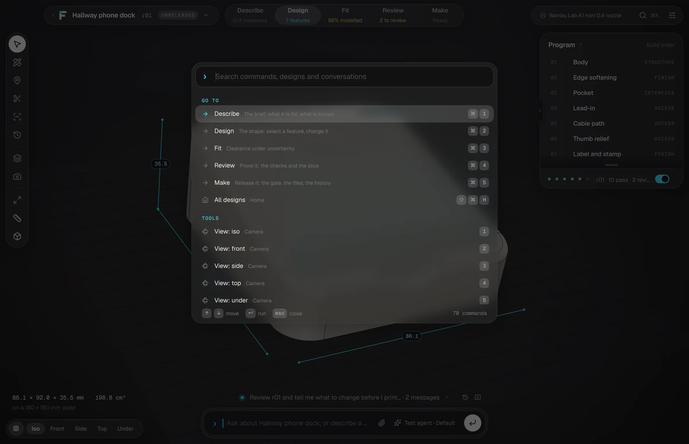

## On GitHub

- **Recipes submitted in an issue** are built, checked and sliced, and the issue is answered with pictures; a
  maintainer's label turns an accepted one into a pull request credited to its author.
- **Pull requests** that touch recipes or the interface get before and after pictures.
- **A nightly slicer compatibility matrix** (every recipe through every slicer CI installs) and **benchmarks** are
  published on the website: [compatibility](https://kaizensx.github.io/form-studio/compat/) and
  [benchmarks](https://kaizensx.github.io/form-studio/bench/).
- **Releases** ship with `SHA256SUMS`, build provenance and an SBOM.
