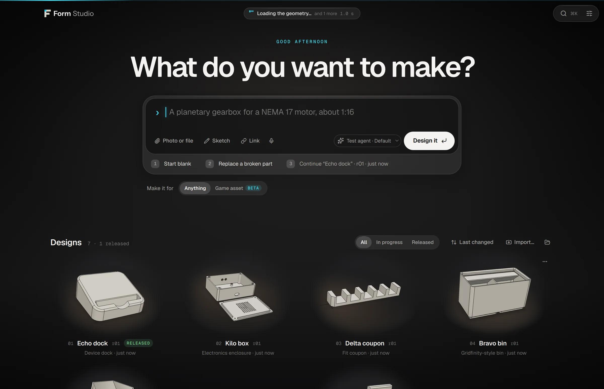
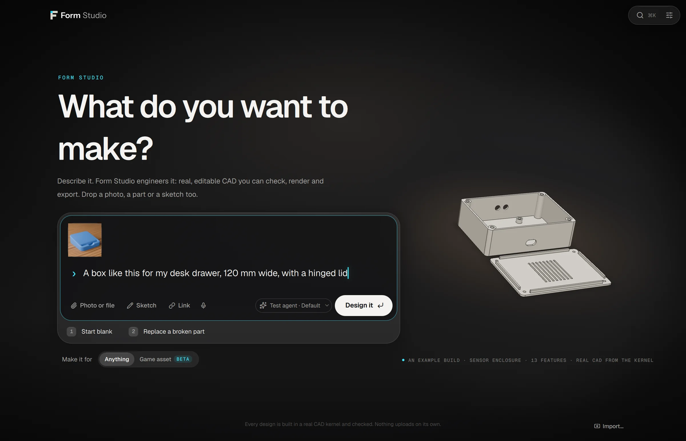
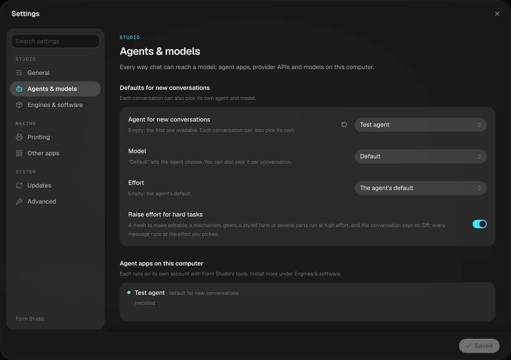
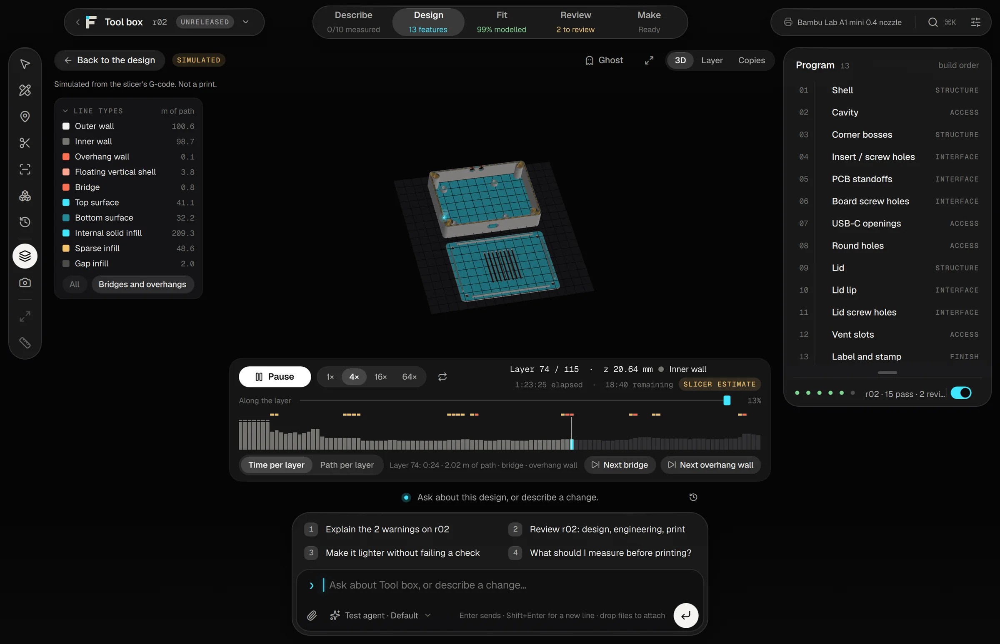

# Features

Everything Form Studio does, from the first idea to the released files: describe anything, and an agent builds it as
real, editable CAD. Each capability is available in the desktop app, as a `form` command ([CLI reference](CLI.md)) and
as an MCP tool ([MCP reference](MCP.md)), unless noted. 3D printing is optional and has its own section near the end.

- [Start from anything](#start-from-anything)
- [Concepts and measurements](#concepts-and-measurements)
- [Designing](#designing)
- [Assemblies](#assemblies)
- [Optimisation and alternatives](#optimisation-and-alternatives)
- [Parts you already have](#parts-you-already-have)
- [Checks and evidence](#checks-and-evidence)
- [Strength studies](#strength-studies)
- [Engineering calculators](#engineering-calculators)
- [Analysis, measurement and annotations](#analysis-measurement-and-annotations)
- [Revisions, branches and variants](#revisions-branches-and-variants)
- [Colours and materials](#colours-and-materials)
- [Working with other software](#working-with-other-software)
- [Conversations and agents](#conversations-and-agents)
- [Any model, any provider](#any-model-any-provider)
- [Moving and sharing designs](#moving-and-sharing-designs)
- [Building blocks for agents](#building-blocks-for-agents)
- [3D printing (optional)](#3d-printing-optional)
  - [For a printer, or just a 3D model](#for-a-printer-or-just-a-3d-model)
  - [Fit](#fit)
  - [Printers, slicing and print simulation](#printers-slicing-and-print-simulation)
- [Setup, settings and updates](#setup-settings-and-updates)
- [On GitHub](#on-github)

---

## Start from anything

Home is one composer for whatever you have.

| Start with | What happens |
|---|---|
| **Words** | Describe the part, typed or dictated. |
| **A photo** | Drop or paste it. With a bank card, a coin or a ruler in the picture, the agent estimates sizes from it, labels them "estimated from the photo" and keeps them *assumed* until you measure. |
| **A sketch** | Draw it on the sketch pad. The agent receives the shapes as structured geometry in millimetres, and the picture. |
| **A part** | A file to design around or start from, up to 2 GB: meshes (STL, OBJ, 3MF, PLY, OFF, AMF, glTF and GLB, Collada DAE, X3D, VRML, VTK, VTP and VTU), scans as point clouds (XYZ, PTS, LAS, E57, or a PLY of vertices), CAD (STEP, IGES, OpenCASCADE BREP), drawings (DXF, SVG) and zip archives of any of these. `form formats` lists them with their units. A file from your disk is cloned into the conversation, never read whole, so a 500 MB scan attaches at once. |
| **A drawing** | A PDF datasheet or mechanical drawing, read as images so its dimensions survive. |
| **A link** | Pasted on Home or in a chat, the engine fetches it: a file link (any part, scan, drawing or zip Form Studio reads, a PDF or a picture) is downloaded, streamed to disk with its progress. A Printables model page has its part files downloaded with the title, author and licence, kept with each file. A MakerWorld or Thingiverse page says why its files cannot be fetched and how to get them; a signed MakerWorld download link copied from your browser is fetched at once, before it expires. Any other page is passed to the agent as a link. |

Drop or paste files anywhere on Home. Under the composer, choose **For my printer** or **Just a 3D model** for what
starts next, or **Start blank** for an empty design in the workspace with no agent. From a terminal:
`form start --text … --photo … --sketch … --file … --link …` or `form start --blank`.

**The sketch pad.** Lines, rectangles, circles, arcs, freehand strokes and dimensions in millimetres, snapped to a
5 mm grid and to the points already drawn (Alt draws freely), with undo and redo. A typed dimension is *stated* and
overrides the drawn length. The agent extrudes or revolves the shapes faithfully.

**The workspace opens at once.** Sending from Home shows the design being made, with what the agent is doing, and
attaches the design the moment it exists. Each new build grows into the viewport feature by feature, in build order,
each one named as it arrives.

- **Replace a broken part.** On Home, **Replace a broken part** takes a photo of the part with a card, coin or ruler
  beside it, what it is and where it broke; the agent estimates sizes from the photo, asks for the ones that decide the
  fit and designs the replacement. `form replace`; MCP `replace_part_guide`.

## Concepts and measurements

- **Concepts first.** For a new idea the agent proposes three or four genuinely different concepts, each a real CAD
  model, side by side and turning, with a line on each and its computed size and volume. Continue with one, or ask in
  words for a mix ("the base of A with the hook of C"). The others move to the trash. MCP `propose_concepts`,
  `pick_concept`, `list_concepts`; `form concepts`.
- **Measure this.** When the agent needs a real number it shows where to measure on a picture or a diagram, the unit,
  the tolerance that matters and what the design assumes now. The number you enter is committed as a new revision
  with how you measured it (calipers, ruler, tape, or an estimate kept as *assumed*), and the part updates. MCP
  `ask_measurement`.

## Designing

- **A real CAD kernel.** Every design is B-rep geometry built by [build123d](https://github.com/gumyr/build123d) on
  OpenCascade, exported as STEP, STL, OBJ and GLB. Designs are Python (build123d) or OpenSCAD.
- **Parameters with provenance.** Every value has a unit, a range, a group (brief, interface, form, process) and a
  source: measured, specified, assumed, estimated from a photo, computed.
- **Features you can click.** Each face of the solid is attributed to the feature that made it, so you can select a
  feature on the model, change it, hide it, and see which features a change touched.
- **Edits that name what changes.** An agent changes one feature, one helper or one parameter by name (`edit_design`),
  not by sending the file again. A design written as one build function is first rewritten as one method per
  feature, and kept only when the kernel finds the same volume, faces and bounding box; then only the changed feature
  and those after it are built.
- **Mistakes found before the kernel runs.** A design's code is checked without building anything, and every problem
  comes back at once: a constraint its own values break, a name or argument the CAD library does not have, a
  parameter that is read but not declared, a polygon wound the wrong way for its extrusion, a bolt and a threaded
  hole that barely engage.
- **Drafts with computed impact.** A change is built for real before it is saved: the features and interface
  dimensions it moves, the change in stability and fit, and which outputs it would invalidate.
- **Constraints that explain themselves.** An impossible combination is refused with the feature, the parameters
  involved and a way forward.
- **Drag a face, change the parameter behind it.** ⌘-drag (Ctrl-drag) a face in the viewport: the parameter that
  moves that face (measured by rebuilding, one parameter at a time) follows the pointer, the part rebuilds live and
  the draft shows its impact. Top of a box: its height; its side: its width; a sculpted brow: the brow handle.
- **Constrained sketches.** `form.sketch2d` places lines, arcs and circles from constraints (coincident, horizontal,
  vertical, parallel, perpendicular, tangent, equal, symmetric, midpoint, on) and named dimensions (length,
  distance, radius, diameter, angle). Every named dimension is a parameter, so changing one re-solves the profile and
  keeps its intent: arcs stay tangent, slots stay centred. A 30-entity, 40-constraint sketch solves in about a
  millisecond, in plain Python.
- **Sculpted bodies, exactly.** Organic shapes (helmets, masks, cowls, character props) are subdivision cages turned
  into exact NURBS solids (`form.craft.subd`): a skin is one bicubic B-spline surface, C2 inside, trimmed by a circle
  of its parameters; a shell is its skin, its inside and a ruled rim, three faces. Named handles on the cage (a brow,
  cheekbones, a jaw, a crown) are parameters. Closed props are Catmull-Clark cages made into bicubic patches, G1 at
  the extraordinary points and within a measured angle along their borders.
- **Sculpted meshes as surfaces or as mesh bodies.** `form.meshbody` turns a sculpted mesh (a 200,000-triangle
  helmet in about a minute) into a closed, three-face NURBS solid within a stated tolerance, measured both ways, with
  its cage to edit; or keeps fine sculpted detail as a mesh and cuts exact features into it (manifold3d, optional).
  Each body says its tier: surface body, mesh body or parametric CAD.
- **Hybrid designs.** Exact CAD on a sculpted skin: magnet pockets on bosses grown from the inside, a split plane held
  by magnets, openings from a constrained sketch. The character-mask exemplar shows the whole route.
- **Hardware with sources.** `form.parts` provides screw clearances (ISO 273), heat-set insert pockets, nut traps,
  magnet pockets, bearing seats, printable threads and involute gears, each dimension with its source.
- **Text and patterns.** Embossed or debossed lettering with a shipped font, revision stamps on the underside, hex
  vents, perforations, slots, knurls and grip ribs, with web-thickness checks.
- **Reference parts.** Import a STEP, IGES or BREP, a mesh or a scan of the thing your part must fit (a circuit board, a
  phone, a motor); a zip imports every part in it. It is drawn as a blueprint companion, and a design can cut
  clearance from it with `self.reference("pi5.step")`.
- **Files from any program.** One table (`form/formats.py`, `form formats`) says what is read, and every way a file
  comes in uses it. Meshes: STL, OBJ, 3MF, PLY (ASCII or binary; vertex colours noted, not used), OFF, AMF (plain or
  zipped), glTF and GLB (node transforms applied; Draco-compressed files are refused by name), Collada DAE, X3D, VRML
  (2.0), VTK legacy, VTP and VTU (solid cells give their outer surface). Point clouds from scanners: XYZ, PTS, LAS
  (uncompressed) and E57 (every scan placed by its pose), and a PLY of vertices: a surface is made from the points
  first (normals from the neighbours, a signed distance, marching tetrahedra; a few seconds, the grid size reported)
  and then routed like a mesh; where the scan has no points the surface stays open. CAD: STEP, IGES, OpenCASCADE
  BREP. Drawings: DXF and SVG, read for their outlines and sizes (route profile). Zip archives of any of these are
  unpacked safely (no file outside its folder, sizes bounded) and each file triaged. Units: converted where the file
  states them (3MF, AMF, Collada, STEP, IGES, DXF, SVG) or the format fixes them (glTF, LAS, E57: metres; glTF and
  Collada Y-up turned to Z-up); STL, OBJ, PLY, OFF, X3D, VRML and VTK carry none, so millimetres are assumed and a
  size that makes no sense is asked about. Not read: FBX (no reader with a licence that can ship), USD and USDZ
  (Pixar's usd-core is about 100 MB), LAZ, IFC and native SolidWorks, Inventor, Fusion or Creo parts.
- **3MF from any slicer.** 3MF files are read with lib3mf, including the production-extension layout Bambu Studio,
  Orca Slicer and MakerWorld write (meshes in `3D/Objects/*.model`). Each object is a named part where the slicer
  placed it, with its plate and filament colour; modifier volumes are left out of the shape. OBJ files keep their
  named objects apart.
- **Big meshes, checked first.** `form mesh-preflight FILE` and MCP `mesh_preflight` give a mesh's triangles, size,
  whether it is closed, its class (light to very heavy) and estimated seconds to read and analyse it, in about a
  second for 1.2 million triangles and instantly the second time. A heavy mesh also gets a lighter copy of about
  200,000 triangles for the 3D view; it is for display only, and every analysis and import uses the file itself.
- **Model links for agents.** MCP `fetch_link` downloads what a link points to from the engine, so an agent whose
  sandbox has no network still gets the file; `resolve_model_page` says what a model page is (title, author,
  licence, files) without downloading. Requests carry a generic Form Studio user agent and nothing about you, no
  cookies and no sign-in.
- **Datasheets and drawings.** The agent reads PDFs and images, from a file or an https link, as pictures, so the
  dimensions in a mechanical drawing survive (`read_document`).
- **Every design on Home**, each a live 3D card, filtered by released and in progress; rename, duplicate, export or
  move to the trash.

<!-- optional: design helpers (WP mechanisms, surfacing, texture). Drop this item if the helper library is not in the release. -->
- **Design helpers.** Proven building blocks for mechanisms (hinges, snap fits, bayonets, ratchets, cams, gear trains
  and planetary sets), surfaces (lofts, sweeps, shells and variable fillets) and texture (knurls and embossed patterns
  on the solid; finer texture as a mesh for renders, labelled as such), each with typed fallbacks and a clear error.
<!-- /optional -->

## Design intelligence

- **Complex designs are staged.** For a mechanism, an organic or styled form, a texture or several parts, the agent
  first writes a structured brief (requirements, key dimensions with their source, and the unknowns it could not
  settle, listed rather than guessed), then a feature plan (every feature with how it will be built, mechanisms with
  their clearances, textures with their tier, and the risks). Form Studio refuses to build a complex design without
  a plan (`design_brief`, `plan_design`, `create_design(plan=...)`).
- **The agent looks at every revision.** Creating or changing a design returns a six-view sheet and a section cut
  through its centre, so walls, voids and clearances are seen, not assumed.
- **Critique before release.** `critique` renders a close-up of every feature and computes metrics from the solid:
  the smallest fillet, the share of sharp edges, mirror symmetry, proportions against classic
  ratios, the mix of planar and free-form surface, sliver faces and planned features that are missing, with a
  checklist to answer by looking. It also checks every lofted skin for folds, measures wall thickness by rays (thin
  spots and walls the inner surface breaks through are shown where they are) and lists sharp turns in the
  silhouettes. When the brief names a product class (a full-face or cycling helmet, a computer mouse, a bottle), the
  side, front and top silhouettes are compared with the class outline, the proportions with the range of real
  products (with sources) and its signature is checked (an eye port and a visor, a neck opening, a palm hump, a
  scroll wheel); the agent must then say whether it reads as one after looking (`reads_as`). All of it is labelled
  heuristic. A briefed design cannot be released until its revision has a recorded critique.
- **A helper library for real design work.** `form.craft` gives designs lofts through superellipse and spline
  sections, sweeps, revolves, shells (including section-inset shells for lofted domes), safe and variable fillets;
  mechanisms with their numbers (print-in-place pin and living hinges, cantilever and annular snaps with their
  strain, bayonets, dovetails, detents, ratchets, cams with their pressure angle, four-bar linkages with their
  Grashof class and transmission angle, gear trains and planetary sets with their assembly conditions); ISO 286
  limits and fits and bearing seat tolerances; ribs, gussets, boss arrays and lattices; and section-loft bodies for
  helmets, grips and handles. Organic products are drawn as guide curves in three views and turned into sections
  (`profile_sections`), with product families sized from named proportions: full-face and cycling helmets from an
  EN 960 headform and ANSUR II head data, a palm-grip mouse from the hand, power grips, and drinks bottles with a
  PCO 1881 neck. Pads, trim, scoops, spoilers and panels follow the surface (`surface_band`), openings are drawn in
  two views (`two_view_cutter`), vent grilles are real geometry (`slot_grille`), and booleans on free-form shells
  fall back to fuzzy ones. Every helper checks its numbers and names the fix; fallbacks are reported.
- **Texture in two honest tiers.** B-rep texture is real geometry in the CAD solid (an exact diamond or straight
  knurl, spiral ribs as one smooth skin, wrapped ribs, embossed cells), capped at about 2,000 elements. Fine texture
  (leather grain, a carbon-like twill, stone-like cells, noise, hexagons, a heightmap image) is a mesh texture: the
  STL, OBJ, GLB and the renders carry it, labelled "mesh texture; STEP carries the smooth body". The six-view sheet
  of a textured design includes a zoomed tile of the texture, where it can be seen.
- **Guides by topic and worked examples.** `design_guide(topic=...)` covers surfacing, mechanisms, organic forms,
  texture, aesthetics, and design for printing (only for designs that are printed). `design_examples` serves 43
  complete exemplar designs to the agent only (they never appear as projects), in seven categories: mechanical (a
  linear slide, a shaft coupler, a pillow block, a cam follower, a gusseted bracket, a 2020 corner bracket, a belt
  idler, a quick-release clamp, a camera plate, a drone arm, a cable-chain link, an action-camera mount), consumer
  products (an ergonomic mouse, an earbud case, a game controller, a headphone hook, a desk organiser, a soap dish, a
  wall hook, a lens cap, a table lamp), organic forms (a character cowl, a prop mask, a creature horn, an ergonomic
  handle), textured parts (a knurled knob, a hex-relief planter, a perforated lampshade, a woven basket, a fluted cup,
  a bike grip, a spiral-ribbed vase), assemblies (a planetary gearbox, a hinged case, a ratchet wrench, a bottle and
  cap, a robot head), helmets (carbon full-face, open-face, sci-fi prop) and enclosures (an electronics box with
  insert bosses and a seal lip, a sliding battery box, a handheld shell). Search is ranked (BM25 over names, tags,
  techniques and lessons), filters by category, and `technique="..."` returns just the block of build() that does
  one thing well.
- **Robust kernel operations.** `craft.safe_union`, `safe_cut`, `safe_intersect`, `safe_loft`, `safe_fillet`,
  `safe_chamfer`, `safe_shell` and `safe_sweep` retry the way OCCT needs (fuzzy booleans, shapes repaired with
  ShapeFix and face merging, loft sections re-seamed and resampled, ruled and pairwise lofts, smaller fillets,
  thinner walls) and note what they gave up; `craft.repair` and `craft.inspect` fix and report a shape. They never
  hide a real problem: a gap is closed only under 0.05 mm, a cut that removes nothing fails, a section with a hole is
  never filled.
- **Build diagnosis.** A design that does not build comes back with the operation that failed, the feature and the
  line, the likely cause read from the shapes on that line (an invalid operand and its faults, how far apart two
  parts are, how many edges each loft section has, a fillet wider than the shortest edge, the solids per stage) and
  ranked fixes, in plain words; the kernel's own text is kept for reference (evidence: heuristic).
- **Candidates in parallel.** `build_candidates` builds two to six versions of a risky design or step at once, one
  kernel worker each, scores them (valid with the declared solids, brief targets, critique quality and the product
  class silhouette, robustness, and editability: the share of parameters that build at both ends of their range)
  and keeps the best as the design. Concepts (`propose_concepts`) are built in parallel too, and the ones that build
  are kept when others fail. The kernel runs as a pool of workers (`[kernel] workers`, default one per performance
  core up to 4).
- **A design bench.** `tests/design_bench` holds 40 briefs scored automatically (staging, builds, planned features
  present, craft and form metrics, integrity and, for product classes, the silhouette); a design that does not read
  as its class, or has a folded skin or a broken-through wall, cannot pass. The exemplars are built and checked
  against it in the test suite. `scripts/design_eval.py` runs the evaluation briefs through a real agent and records
  first-build and final-build rates and scores; `scripts/bench_timing.py` times the bench on one worker and on the
  pool.

## Assemblies

- **Assembled, Exploded and Print layout** for every design that says how its parts go together. Designs with separate
  bodies that do not say show Assembled as unavailable, explain why and offer to ask the agent to add it.
- **Joints that form chains.** A part can be fixed to another (`Part(attach="arm")`) or move on a joint mounted on
  another part (`hinge(..., parent="arm")`), so turning an arm swings the cup on it and the bolt in the cup, in the
  viewport sliders, the views and the checks. Exploded offsets are relative to the parent. Ratchet joints (`step=15`)
  are checked at the positions they click to.
- **Joined parts are fits.** `Mate(a, b, "pin" | "thread" | ...)` declares a pin in its hole or a thread in its thread;
  the pair is measured against its clearance instead of being reported as a collision, and a thread's phase is
  searched.
- **Checks from the solids:** overlap when assembled, the smallest gap, every declared fit, each joint swept through
  its range with everything it carries (the first contact angle when there is one), and whether a screwdriver reaches
  every screw.
- **Seconds, within a budget.** Parts are compared on their meshes and booleaned only where they meet; sweeps refine
  near contact and prove motion free between positions where the clearance allows. The checks run in their own time
  budget (`[assembly].budget_s`, 45 s) with progress, and a partial result says which range was checked.
- **Declarations are checked** when a design is created or updated: an unknown part, a loop or a part with two parents
  is refused with the reason.
- **A bill of materials** for the bought hardware; a release adds `BOM.csv` and `ASSEMBLY.md`.
- **Assembly instructions as a PDF.** A parts page with each part's computed volume, then one page per part in the
  order the assembly attaches them, at its exploded offset with an arrow to where it seats. `form instructions`; MCP
  `assembly_instructions`.

| | |
|---|---|
|  |  |

## Optimisation and alternatives

- **Make it lighter.** Tools › Make it lighter tries thinner walls and floors, larger lightening pockets and lighter
  slicer settings, and shows only candidates that keep every passing check passing, each with its computed mass and the
  slicer's grams before and after. **Apply** commits the one you choose. `form lighter`; MCP `make_lighter`,
  `apply_lighter`.

- **Goal seek** (`optimize`): search parameter ranges for the lightest, smallest or strongest design that still passes
  its constraints, for example the lightest bracket with a safety factor of at least 3. Every candidate is a real
  kernel build.
- **Alternatives:** a grid of real variants over one or two parameters, ranked by objectives you weight (less
  material, harder to tip, fit yield, smaller footprint).

## Parts you already have

- **Design around a real part.** Import a STEP or STL of the thing your part must fit (a circuit board, a phone, a
  motor). It is drawn as a blueprint companion, and the design cuts clearance from its real geometry with
  `self.reference("pi5.step")`. Its dimensions are *computed* from the file. MCP `import_reference`. A mesh has
  **Make editable** next to it (below).
- **Replace a broken part.** A photo with a card, coin or ruler beside it gives the scale; sizes read from it stay
  *assumed* until you measure the ones that decide the fit, and the agent designs the replacement and strengthens it
  where it broke. `form replace`; MCP `replace_part_guide`.
- **Meshes stay honest.** An STL, 3MF or OpenSCAD mesh brought into the kernel keeps every triangle as a face. Volume,
  wall thickness and exports work on it; it is never written to STEP or called a CAD solid.

## Meshes rebuilt as clean CAD by the agent

When you bring meshes to make editable or to understand, the agent rebuilds them as CAD that reads like a part
designed from scratch: named features, Params for the dimensions that matter, and edges only where the part has
edges. The meshes stay in the design as blueprint references and are never used as the design itself. The staged
workflow is `design_guide(topic="reference_parts")`; **Rebuild as editable CAD** in Describe › Reference parts starts it.

- **Read the mesh.** `analyze_reference` (`form analyze-reference <project> <mesh> [--levels JSON]`) cuts sections in
  the three principal planes at the levels where the part changes and returns them as pictures with dimensions and
  as vector outlines (loops described as circles, slots, rectangles with their corner radius, or outlines, and each
  as lines and arcs with centres and radii). It lists the features with their sizes: holes and bosses (diameter,
  depth, through or blind), openings (pockets, slots, cutouts; repeated ones with count and pitch), plates, walls,
  ribs, rails and grooves (opposite parallel faces with material or air between them, checked inside the solid),
  levels of the flat faces (steps), ramps with their angle, rise and run, draft, fillets and round edges with radii,
  chamfers with width and angles, detail areas (text, embossing, knurls), symmetry with the largest deviation from
  the mirror image, and wall thicknesses. Results are kept with the project and returned instantly the next time.
- **Understand how parts move.** `analyze_assembly` (`form analyze-assembly <project> FIXED OTHER...`) takes several
  meshes in the positions they were given: mating surfaces with their area and gap, the smallest clearance per pair,
  and for every part against the fixed one the distance it can slide along each axis and turn about the round faces
  they share, the bumps on the way (detents, snaps or flexing arms, with how deep they press) and where it stops. It
  names the joints (a slide along an axis with its range, a hinge with its axis and range) and couplings between
  moving parts: a slide meeting a part that turns is a rack on a gear (or a cam) with its ratio, a slide on a leaning
  face is a ramp with how far it pushes. Parts are rigid; springs and gravity are not simulated.
- **Check the rebuild.** `compare_to_reference` (`form compare-reference <project> <mesh> [--part P] [--png FILE]`)
  measures the design, or one part of its assembly, against the mesh: two-sided Hausdorff, mean and 99th percentile,
  a picture of both coloured by deviation, the worst regions by where they are (in words and coordinates, with the
  nearest feature) and whether the design has extra or missing material there, and per feature the largest
  deviation and, for holes, bosses and fillets, the design's own diameter or radius next to the mesh's. The default
  limit for a remodel is 0.1 mm.

## Mesh to editable CAD

Bring a mesh or a scan (any format above) and Form Studio rebuilds it as CAD, then measures how close the result is to the mesh.
**Triage first.** Whatever is brought is assessed before anything is built: `form triage FILE` (MCP `triage`) reads a
mesh, repairs a copy and measures it (triangles, size, a guess at the units, open and non-manifold edges before and
after the safe repairs, bodies, genus, and how much of the surface is the flat and ruled geometry CAD makes), classes
it mechanical, organic or mixed, and chooses the route. A point cloud is made a surface first. It also routes STEP,
IGES and BREP (CAD reference), DXF and SVG (profile), a zip (each file inside), a photo, a PDF, a link and plain words.

| The mesh is | Route | Result |
|---|---|---|
| a mechanical or mixed part that closes | parametric | the reconstruction below, verified against the mesh |
| a smooth sculpt, one body, no handles | surface body | NURBS faces over a cage to edit; STEP; taken only within 0.1 % of its size |
| a scan or sculpt with detail, handles or many triangles | mesh body | the repaired mesh (a lighter working copy when heavy, its distance from the file measured) with Scale and Flat base; exact cuts; STL and 3MF |
| several separate closed bodies | assembly | one design, one part per body |
| a surface that does not close | reference only | kept to design around; nothing is guessed |

Safe repairs run first and are listed: sliver triangles hanging off an edge, wrong-way triangles, small holes, flat
openings, loose debris. Vertices are never moved. A file whose size makes no sense in millimetres is asked about once
(`--units m`) before anything is built. `reconstruct` runs the triage itself; `--route` forces one.

**Make editable** on an imported mesh (Describe › Reference parts), `form reconstruct FILE [--name] [--tolerance MM]
[--layer 0|1|2]`, or the MCP tool `reconstruct`. The result is a new design; the original mesh stays beside it in
blueprint, and the report, the deviation map and every solid are kept in the design's `reconstruction` folder.
Several meshes of one product (`form reconstruct A.stl B.stl C.stl`, MCP `reconstruct(files=[...])`) become **one
design with one part per mesh**, in the positions the files give; each part keeps its own parameters, named after the
part (`base__fillet1_r`), and a part that cannot be reconstructed is reported while the others are kept.

Every result leads with **editable**: the share of its surface that its Params make (sketches, extrusions, holes,
fillets), then its distance to the mesh (two-sided Hausdorff) and whether that is within the tolerance you asked
for. A result outside the tolerance is still offered when it is the best verified one, and says so. The share of
the area on planes, cylinders and other analytic surfaces is in the report too, but a solid can be all analytic and
still not editable.

- **Sketches and extrusions first (beta).** The part is read the way it was modelled: along its main direction it
  is cut at every height a mesh vertex sits at, each section's loops become sketches of lines, arcs and rounded
  corners (corners where the neighbouring lines and arcs meet, line directions snapped to 15° steps), and a loop that
  does not change between two levels becomes an extrusion, one that changes linearly between two faces (a chamfer, a
  draft) a ruled loft between two sketches. Coordinates, levels, radii and diameters are pooled across the whole part:
  values within a quarter of the tolerance become one Param, snapped to a round number when that is within reach,
  mirrored about the centre plane when both sides agree, diameters snapped to standard hole sizes, each Param saying
  where its value came from. Holes and pockets are cuts, bosses and steps are additions, in the order the levels nest.
  What does not read as a sketch (a rounded top, a curved or freeform band) is kept as the mesh's own slices and
  booleaned in: the rest stays parametric, and editable says how much. Blocks of levels that hold a cross hole or a
  rounding seen from the side are carved by the sketches seen along the other axes when that verifies better. When this
  verifies with most of the surface editable, it is the result in seconds; otherwise the layers below run and the
  verified result with the most editable surface wins. Several parts of one mechanism can have their meeting
  dimensions tied (walls facing across a gap, a pin in a hole) as one Param plus a clearance
  (`form.recon.assembly`).
- **What is recognised is editable at once (beta).** Right after the exact solid, a floor is built on it: teeth
  repeated round an axis are found first and become one tooth sketch, extruded and repeated as a polar pattern (its
  pitch, first angle and levels are Params, its band cut from the solid), and the planes the solid has become
  dimensions, largest first: a thickness to the opposite face, a width between two mirrored faces, or a level, each
  kept only when moving it 0.5 mm still builds one valid solid. Everything else stays the solid's own faces, exactly.
  So a part whose surfaces were recognised is never 0 % editable because one route failed somewhere else. Every later
  route is a candidate against this floor and gets time in proportion to what it can still add (budget by predicted
  gain); a sketch program that cannot beat it is not built. Details and measurements: `docs/RECON_EDITABILITY.md`.
- **Layer 0: the mesh as an exact solid.** Vertices are welded, every triangle becomes a planar face, the faces
  are sewn into a solid and coplanar facets are merged. The two-sided Hausdorff distance to the mesh is at float
  precision. Open boundaries and non-manifold edges are reported; holes are closed only as a listed repair.
- **Layer 1 (beta): analytic and freeform faces.** Regions are grown over the mesh and fitted with planes,
  cylinders, cones, spheres and tori. A region is accepted only when every vertex on it is within the tolerance
  (default 0.02 mm) and its facets are no farther from the surface than the mesh's own chord error. Smooth regions
  that no simple surface explains (a sculpted handle, a scan, a blob) are fitted with bicubic B-spline patches
  instead, each through its vertices within a third of the tolerance, and reported as "freeform (B-spline fitted)".
  Faces are trimmed along lines, circles and arcs through the mesh's boundary points where the boundary is one; as
  an option (`brep.EXACT_EDGES`) the edge where two fitted planes meet is their exact intersection line, trimmed at
  corners moved onto every plane round them, with the mesh's own boundaries wherever that does not close into a valid
  solid. The faces are sewn, with frozen facets for whatever is left, into one solid. The report gives the share of
  area that is parametric
  (analytic), freeform and frozen.
- **Layer 2 (beta): a feature tree.** The features of the Layer 1 solid are found and taken off it: holes (plain,
  counterbored, countersunk, blind or through, on any axis), constant-radius fillets and equal-distance chamfers. What
  is left becomes the base of a build123d design: an extrusion stack (the base, steps and bosses, pockets and
  cutouts, with heights, depths and rectangle and circle sizes as Params), a revolution (diameters and heights as
  Params, turned fillets and chamfers rounded in the profile), or, when the base is neither, the reconstructed solid
  itself, kept exactly (with its analytic, freeform and frozen faces) under parametric features. The features go back
  on as real operations: fillets and chamfers on the edges nearest where they were (radius and distance are Params),
  holes with their diameters snapped to standard sizes (ISO 273 clearances, tap drills, drill sizes), counterbore and
  countersink sizes and depths, and holes of one kind on a grid, a line or a circle as one pattern with pitch Params.
  A spur gear is recognised from its outline (tooth count, module and pressure angle from involute flanks) and
  becomes a parametric gear: the gear Form Studio makes (`form.parts.spur_gear`) when that is it, otherwise an
  involute outline with its tip and root as the mesh has them. Every value has provenance "computed from mesh";
  mirror planes and rotational symmetry are reported. The design is rebuilt and compared with the mesh; a feature that
  does not verify is left in the base and named in the report, and the recipe is used only when it is within the
  limit. The report also gives the share of the area the Params drive.
- **Drawn like a part.** A mesh or a faceted solid is shaded smooth, and only creases sharper than 25° and
  boundaries are drawn as edges (the 3D view, card thumbnails and render sheets).
- **Verification, every time.** Editable share (the share of the design's Params that are real dimensions, such as
  lengths, diameters, radii, angles and levels rather than the positions of sketch corners, and that move 0.5 mm with
  the design still building; a design is titled "(editable)" only from 50%, "(partly editable)" below that and
  "(exact copy)" at 0%), the share of the surface parametric features make, two-sided Hausdorff distance (samples of a tessellation triangle
  laid outside its own face are checked against the solid and left out), volume difference, parametric, freeform and
  frozen area, and a deviation map coloured against the tolerance. Progress is reported about every second while it
  runs. `scripts/recon_bench.py` measures editable share, deviation, time and a sweep of every Param (does it change
  the part, does the part rebuild over its range) and writes `docs/RECON_BENCH.md`.

What it does not do (yet): a part whose surfaces curve across every axis (a casting, a scan, a rounded top)
keeps those parts as the mesh's own slices, exact but not editable; the sketches route reads one main direction plus
the three axes, not tilted ones. A large part takes longer than 30 s. In the feature tree, a base that is neither an
extrusion stack nor a revolution stays an embedded solid under its parametric features: exact to the mesh, but its
outline is not a set of Params. Fillets of varying radius, fillets whose sharp edge cannot be
rebuilt, and holes that cannot be taken off the solid stay in the base and are listed. Outline coordinates of an
extrusion stack are numbers read off the mesh (only rectangles and circles get size Params), and a fillet or chamfer
finds its edge near where it was, so a large change of a height can leave it without an edge (the rebuild then
says which). Freeform patches meet along the mesh's edges between them, so their boundaries follow the triangles; a
freeform patch is smooth CAD within the tolerance but not a dimension you can change. Gears: spur gears only (no
helical, bevel or internal gears), and the module and pressure angle assume no profile shift. Accuracy is measured
against the mesh, not the original object: a mesh's own chord error and scan noise are in the input, and a coarse
mesh of a curved surface can be farther from any smooth surface than the tolerance (the gear flanks of a default STL
export are 0.03 to 0.04 mm from the gear they came from). Units are millimetres unless the file says otherwise (3MF
does). Nothing is decimated: a mesh over 200,000 triangles shows progress and takes minutes.

## The Bench: every study, route and document, as a record

One registry (`form/studies.py`) lists everything that can be asked of a design, in three groups: **Studies**
(Review: checks, assembly and joint sweep, the brief's requirements, wall thickness, overhangs, layer cross-section,
small features, fit, design critique, slice, print simulation, print orientation, every printer, cost, make it
lighter), **Routes** (Make: STEP/STL/OBJ/GLB, 3MF with colours, slicer project, FreeCAD macro, project archive, game
asset, release) and **Documents** (Make: parts list, assembly notes, motion checks, print report, measurement plan,
assembly instructions, four-view sheet, photoreal render, turntable, share card). Each entry has a state (never run,
current, stale, failed, running, unavailable with why, n/a with why), the revision it describes, its headline number
with its evidence class, and a run action wired to the same code as its own tool. Results are stored beside the
revision under a key of its inputs, so a new revision makes them stale by construction and nothing is ever marked
current by hand. The same listing is `list_studies` / `run_study` / `get_study` over MCP and `form study` in the
terminal; later studies register into it (`studies.PROVIDERS`) and appear everywhere at once. Mass and inertia, the
materials with the document each value comes from (`form/massprops.py`) and the feature tree's state (`Features`:
built, suppressed by hand, left out with the reason; `form/modelling.py`) are registered this way. A change made by
hand is one revision of the design's code, so the studies of the revision before it show stale.

## Checks and evidence

Each revision is rebuilt and checked on the solid. The standard checks for a printed part:

| Check | Evidence |
|---|---|
| One valid solid | computed |
| Interfaces as modelled (intended vs measured on the solid) | computed |
| Export mesh is closed | computed |
| STL matches the CAD solid | computed |
| Fits the build volume | computed |
| Thinnest wall | computed |
| Unsupported overhangs | computed |
| Bridged ceilings | heuristic |
| Plate contact | heuristic |
| Tip-over resistance (statics) | model |
| Fit within the tolerance window | model |
| Re-imported in FreeCAD (when installed) | computed |

Building blocks and assemblies add their own: a bracket's bending safety factor, a box's lid swing, the clearance of a pin in
its hole. **Every result says how it is known** (computed, heuristic, model, simulated, measured, physical) and
clicking a result shows where on the part it was found.

**The brief as a contract, proved on the solid.** A brief's requirements become assertions the kernel checks: sizes,
volume, the number of parts, holes of a diameter, a cylinder's diameter and axis, a bolt circle or a row of holes,
the thinnest wall, the presence of a thread. Each carries its tolerance and where it came from (the brief's own
words, a named dimension, the design's code). Before any code, the numbers themselves are audited: what is missing,
what conflicts and what cannot be built is reported once. Every assertion is owed by one feature; a feature can
promise its own (`expects=`), and a miss stops at that feature with what was measured against what was wanted.
Each revision then has a proof sheet: one row per requirement with the measurement, the tolerance, the evidence
class and PASS, FAIL or UNPROVEN. A failed requirement blocks release; a row that could not be measured is never
shown as a pass.

**Thinnest wall measures walls.** In a design of several parts each wall is measured inside its own part, so a bolt
resting in its nut is not a 0 mm wall, and only faces within 30° of parallel count, so a tapered edge is not a wall
either. A real thin fin still fails.

## Strength studies

"Will it hold?" on any design, with the error stated. Pick the faces that are held and the faces that are loaded;
the solid is meshed into quadratic tetrahedra, finer on fillets and holes, and solved again and again until the
answer stops changing. The full method and the verification table are in [STRENGTH.md](STRENGTH.md).

| Study | Result |
|---|---|
| Linear static | Safety factor against the material's yield, peak von Mises stress ± its error, largest displacement |
| Modal | Natural frequencies and mode shapes, held or as a free body |
| Linear buckling | The factor on the loads at which the perfect elastic part buckles |
| Steady heat | Temperature range, the heat through each condition, the heat balance |
| Thermal stress | The static result of a temperature field, with any loads |

- **Supports and loads on picked faces:** fixed, roller, pin and hold; force, pressure, a bolt's preload and gravity;
  temperature, convection and heat for thermal studies. A
  design of several parts is solved assembled, bonded where the parts touch, with a material for each.
- **Evidence:** `simulated (FEA, linear static, converged to 1.1 %)`. The convergence of every refinement is kept,
  the reactions are balanced against the loads, and a study that does not converge says so and gives no safety
  factor.
- **Singularities are named.** Stress at a sharp inside corner, or at the edge of a rigid support where it keeps
  growing, is listed with its location and growth and left out of the verdict.
- **Sourced materials.** Young's modulus, Poisson's ratio, yield and density come with their documents; nothing is
  defaulted.
- **Verified.** Sixteen cases, each quantity within its tolerance: beams, a plate with a hole, a thick cylinder,
  NAFEMS LE1 and LE10, frequencies, Euler buckling, heat through a wall and a pipe, thermal stress.
- **Curved elements.** Mid-side nodes lie on the geometry, so fillets and bores are curved in the model.
- **A hand estimate** from beam theory sits beside the result where the part is a bar fixed at one end.
- **As a constraint:** `optimize` and `make_lighter` keep `fea.safety_factor >= 2` on candidates they solve, and say
  which ones those were.
- **Stored with the revision.** A result goes stale after any change to the geometry, the loads, the material or
  the engine, and says which revision it describes.
- **Headless:** `strength_study`, `get_strength_study`; `form strength
  static|modal|buckling|thermal|thermal_stress|run|list|show|verify`. Runs in the background with progress and
  cancel; a typical bracket converges in about 10 s.
- **Optional engine:** Netgen, scikit-fem, SciPy and PyAMG in a Python of their own (about 190 MB), installed from
  Settings.

## Engineering calculators

A part sized from what it has to do, by a named standard's equations, and written as a design with parameters. The
equations, the sources and the verification table are in [CALCULATORS.md](CALCULATORS.md).

| Calculator | Sizes | Follows |
|---|---|---|
| Snap joint | Cantilever hooks (three arm designs) and annular snaps by permissible strain; deflection, mating and separation force | Bayer, *Snap-Fit Joints for Plastics* |
| Living hinge | Elastic by strain for printed parts; moulded polypropylene and polyethylene from cited practice | Pure bending; Protolabs and moulders' guides |
| Spring | Compression, extension and torsion: rate, corrected stress, solid length, buckling, natural frequency; a printed-spring mode | EN 13906-1, -2, -3 |
| Bolted joint | Screw size from the load, preload, tightening torque, working stress, thread stripping; a boss with a heat-set insert | VDI 2230 Part 1 (simplified), ISO 898-1 |
| Gears | Spur and helical pairs with profile shift, internal pairs, rack and pinion: contact ratio, undercut, backlash, bending | ISO 21771; Lewis bending |
| Cam | A plate cam from a motion law: velocity and acceleration peaks, pressure angle, undercut | Norton, *Design of Machinery* |
| Fit at temperature | An ISO 286 fit's clearance or interference over a temperature span | ISO 286, ISO 1, sourced expansion |

- **Every number says how it is known:** computed (with its equation), specified (with its source) or assumed (with
  why). A material value with no source is not guessed: the result that needs it is left out, and the sheet says what
  to give.
- **It writes the part.** One parameter per sized dimension, one feature per solid step. A snap hook or an insert
  boss can also go onto a face of another design.
- **The calculation stays with the design.** Every revision runs it again on its own values, so a dragged dimension
  changes the verdict. The Bench entry *Engineering calculation* shows it.
- **Verified.** 72 quantities from published worked examples and reference tables, each within its accepted error;
  the solids are measured against their sheets, a gear's tooth against the exact involute to 0.002 mm, and meshed pairs share no volume.
- **Simplifications are stated on the sheet:** the VDI 2230 core, Lewis bending with no ISO 6336 factors, printed
  springs and hinges with their caveats.
- **Headless:** `calculate`; `form calc <calculator> key=value ... [--build]`, `form calc list|show|verify`.

## Tolerance stack-up

Pick the two faces of a gap in an assembly, and Form Studio finds the loop of dimensions that sets it, then says how
far the gap moves. The method, the rules and the verification table are in [TOLERANCES.md](TOLERANCES.md).

- **The loop is found, not drawn by hand.** A graph search over the declared mates keeps the ones that hold the parts
  along the gap: a seat (a lid on a rim, a screw head on a lid) or a radial fit (a pin in a hole, which floats by its
  clearance). Each part on the path contributes the distance between the faces the loop enters and leaves by. The
  links add up to the measured gap exactly, and the result says so.
- **Sensitivities from the real rebuild.** Every length and angle parameter is nudged both ways and the design is
  rebuilt, so an angle counts as it should. A parameter that only places a part is named as not moving the gap.
- **Tolerances with their source:** the request; the drawing's ISO 286 fits; a measured parameter's sigma; the
  drawing's ISO 2768 class; for a printed part, the printer's calibration or FDM ±0.2 mm, assumed; else ISO 2768-m,
  assumed. Declared position and profile tolerances on the loop's faces are converted by a stated rule.
- **Worst case, RSS and Monte Carlo** (seeded, with a histogram), Cpk and the share out of spec, and a contribution
  chart with each tolerance's share of the variance.
- **Over a temperature span**, from each part's sourced expansion. A part with no sourced coefficient leaves the
  result out and says what to give.
- **What to tighten first**, with the effect computed and a cost hint labelled assumed.
- **Kept with the design.** The Bench entry *Tolerance stack-up* is stale after any change and says which revision
  it describes. The result carries the loop's faces and segments for the viewport to light on the parts.
- **Headless:** `tolerance_stack`, `get_tolerance_stack`; `form stack run|add|list|show|rerun|rm`.

## Analysis, measurement and annotations

| | |
|---|---|
|  |  |
| **Wall thickness**, from thousands of surface samples, with the thinnest spot marked. | **Overhangs** by angle, flat ceilings, bridges and plate contact. |

- **Maps on the model:** wall thickness, overhang, layer cross-section and small features, computed from the real
  geometry. Each legend says what the map does not tell you.
- **Measure (M):** point-to-point distance with snapping, face area and tilt, and exact hole diameters from the solid.
  It works on every multi-part design and in every view (print layout, assembled, exploded); clicks answer at once and
  measurements follow the parts.
- **Annotate (N):** pick faces, edges and points, or brush and lasso regions on the part, and see area, tilt,
  overhang, wall thickness, curvature and height above the bed computed on the solid. Keep a selection with a name and
  a note as a pin on its revision, ask the agent about it with the exact numbers, or cut a section through it.
  `form select`, `form annotations`; MCP `analyze_selection`, `annotate`, `list_annotations`.
- **Text on any flat face.** In Annotate, pick a point on a flat face and choose **Text here…**: raised or sunk,
  cap height and depth, with stroke width and cap height checked against your nozzle as you type. **Add to design**
  writes the lettering into the design's own code as a feature and builds a new revision. `form engrave`; MCP
  `add_text`, `remove_text`.
- **Screw bosses and snap-fit hooks where you click.** In Annotate, **Feature here…** on a flat face adds a screw
  boss (M2 to M5, with the ISO tap drill, a heat-set insert hole or the ISO 273 clearance) or a cantilever snap-fit
  hook, checked against your nozzle and written into the design's code. `form feature`; MCP `add_feature`,
  `remove_feature`.
- **Fillet, chamfer, hole, pattern and shell by picking.** In Annotate, **Fillet or chamfer…** on picked edges, or
  **Hole or shell…** on a flat face (hole sizes from ISO 273, the tap drill table or an ISO 286 fit; plain,
  counterbore or countersink); in the Program, a line's **Pattern…** repeats it in a line or around an axis.
  **Preview** builds the draft in the kernel with its change in volume; **Add to design** writes one feature method
  and its parameters into the design's code, so the agent, `optimize` and `geometry_diff` work on it like any other.
  Picked edges and faces are stable queries (the features that made them, their kind, direction and place), not
  indexes. `form model`; MCP `add_feature` (kinds `fillet`, `chamfer`, `hole`, `pattern`, `shell`).
- **Sketch on a plane or a face, then extrude, cut or revolve.** **Model it by hand** on the blank canvas, **Sketch
  here…** on a picked flat face, or the dock's **Sketch**: lines, rectangles and circles that snap horizontal and
  vertical, dimensions solved live by form.sketch2d with the degrees of freedom left, each dimension a parameter of
  the design. The sketch is data inside its feature's method, so `get_sketch` and `edit_sketch` (MCP) and `form
  sketch` read and change exactly what the editor shows.
- **The feature tree by hand.** The Program's rollback bar shows the part as it stood after any feature, from the
  checkpoints and without saving; each line's menu suppresses, restores, renames and moves it and says what it
  depends on; a line dragged by its number moves it. A move that empties a feature, or puts one before a feature it
  reads, is refused with the reason. `form tree`, `form render --upto`; MCP `edit_design` ops `suppress`, `restore`,
  `move`, `rename`, `render(upto=)`, `get_design_source` (`tree`).
- **Section (X):** a clipping plane through the solid with filled cut faces.
- **Orientation finder:** ranks print orientations by overhang area, support, contact and height, with the numbers
  behind the ranking, and applies the one you choose.
- **Tip-over and statics:** where the centre of mass sits, and the push that tips the part, from the solid and the
  slicer's mass.

## Revisions, branches and variants

- **Every commit is a revision.** Revisions record their origin (you, the CLI, or the agent by name) and never
  overwrite each other: an agent that commits against an older head is refused.
- **Timeline.** Scrub through revisions in the viewport, play them as a morph, and export the morph as GIF or WebP.
- **Branches.** Check out any earlier revision and continue from it; nothing is deleted.
- **Compare.** Parameters, features, interface dimensions, stability and fit between any two revisions.
- **What changed, on the solids.** Comparing with head also compares the two solids in the kernel: material added in
  green and removed in red, with the volume and number of regions of each, computed with booleans on the B-rep.
  `form diff`; MCP `geometry_diff`.
- **Variants.** Named sets of values kept next to the revisions ("Travel version", "Thick walls"), compared side by
  side on a variants board and promoted to a revision when you choose.

## Colours and materials

- **Per design or per part**, drawn in the viewport and exported as a 3MF with colours.
- **Used in the checks:** heat, sunlight, warping, and flexible or fibre-filled filament.
- **Picks the filament.** A material selects the printer's matching filament preset, one material per plate.
  `form appearance`, `form material`; MCP `set_appearance`.

## Mass properties and engineering materials

- **Mass, centre of mass, inertia tensor and principal axes, computed on the B-rep** (OCCT `BRepGProp`), per part
  and for the whole design. An assembly is reported assembled, at any pose of its joints (`pose={"lid_hinge": 90}`);
  each part's tensor is rotated with it and the parts are combined with the parallel-axis theorem. Units mm, g,
  g·mm² (also kg·m²). Verified against closed-form solids (box, cylinder, hollow tube, hollow sphere, two offset
  bodies, a hinged arm in three poses) to 1e-6 relative in `tests/test_massprops.py`.
- **Every density says where it comes from.** A part's mass is its B-rep volume times its material's density, and the
  result names the document the density was read from. A part without a material has no mass: the volume centroid
  is given instead, never a default. A what-if material is computed without saving anything.
- **A sourced materials library** (`form/material_data.py`, read through `form/material_library.py`): density,
  Young's modulus, Poisson's ratio, yield and ultimate strength, elongation, thermal expansion and conductivity, heat
  deflection, for 10 printing filaments and 18 engineering metals, plastics and woods. Every value carries its source
  document, URL, the line it was read from and the date it was read (2026-11-28). Printed filaments carry the
  manufacturer's X-Y and Z specimen values and the Z knock-down that follows from them (labelled modelled). A value no
  source gave is reported as unsourced (PLA's Poisson's ratio, PTFE's tensile modulus, ...), never filled in.
- **In the window:** the grams on the size line, pressed, show the centre of mass and the principal axes on the
  part and a glass readout with the mass, its material and density source, the centre, the principal moments and one
  line per part; the same toggle is in Analyze. Concept cards show each concept's mass and material.
- MCP `mass_properties`; `form mass <project> [--part P] [--pose JSON] [--material M] [--frame as_built|assembled]`,
  `form materials [ID]`.

## Pictures: renders, share cards, animations

| | |
|---|---|
|  |  |
| **Photoreal render** with Blender: studio, desk or dark scenes, matte, PETG, silk, gloss paint, carbon twill, smoked polycarbonate, rubber or metal, any colour, from any angle, layer lines at the slicer's layer height. A design that declares material zones gets each its own material (a smoked visor, rubber trim, a carbon shell). | **Share card**: the part with its dimensions, print time, filament, checks and fit, each labelled with its evidence. |

- **Engine renders** in any view or as a four-view sheet, coloured by feature, for agents to look at their work.
- **Turntable videos:** Release › Share › **Turntable…** renders the part turning once as MP4, PNG frames, WebP or GIF. `form turntable`; MCP `turntable`.
- **Turntables and revision morphs** as GIF or WebP (`form animate`, `form history --gif`).
- Renders are illustrations and are labelled as such; they are never evidence.

## Game assets

- **Make it for: Game asset.** On Home, in the brief, or by saying so: a design whose purpose is "game" is never sliced
  or checked against a printer. It stays real CAD (STEP exports as always).
- **The Game asset sheet** builds the asset in Blender: LOD0 to LOD3 at triangle budgets (subdivision cage levels
  first; decimated LODs are automatic retopology and say so), UVs, baked base colour, normal, ORM and AO maps at 1k,
  2k or 4k, and convex-hull collision (CoACD as an optional one-click engine). The viewport switches LODs with each
  one's triangle count against its budget, and shows the asset shaded with its maps, as a UV checker, one map as it
  is stored, or as a wireframe.
- **Engine presets**: glTF and Godot (GLB, metres, +Y up), Unity (FBX, metres) and Unreal (FBX, centimetres, Z up,
  collision hulls `UCX_<asset>_LOD0_NN` named after the LOD0 mesh). Export saves every file as one zip.
- **Checked from the written files**: budgets, closed and manifold, flipped faces, UVs inside 0..1, UV overlap,
  texel density, scale, the baked normal map facing out of the surface, and FBX/USD read back at the design's size.
  Agents use `model_mesh` (a cage modelled in Blender by declarative ops, streamed into the app) and `game_asset`.
  Measured on six original briefs: [Game bench](GAME_BENCH.md).

## Release

- **A release gate** lists what is current, what is stale and what needs acknowledgement.
- **One approval, by a person**, freezes STEP, STL, OBJ, GLB, 3MF and G-code with SHA-256 hashes and a report of every
  check and its evidence. No agent can approve.
- **Released over failed checks, on the record.** Tick each failed check and write why; the release, its manifest and
  its report say it was released with failed checks. Missing or stale files still block.
- **Verify at any time** that a release still matches its hashes; a later commit marks it superseded.
- **Save files…** puts every file of a release in one .zip (STEP, STL, the sliced 3MF, G-code, report, documents and
  manifest); **Show in Finder** opens its folder. `form release-files`.

## Engineering drawings, GD&T and PMI

- **Views from the B-rep.** OCCT hidden-line removal draws the front, top and right views in first or third angle
  (ISO 5456-2) and an isometric; visible edges wide, tangent edges narrow, hidden edges dashed and left out where a
  visible edge covers them (ISO 128-2). A full section through the bores with 45° hatching and its cutting plane; a
  detail view, circled and lettered, of a chamfer too small to read at the sheet's scale.
- **The sheet.** A4 to A0 and ANSI A to E, the largest ISO 5455 scale at which the views and their dimensions fit,
  an ISO 5457 border with centring marks and an ISO 7200 title block: title, number, revision, date, material and
  computed mass when the design has a material, the general tolerance, the projection symbol and the geometry hash
  (the release hash once released). A field Form Studio does not know stays empty.
- **Dimensions are the parameters.** Sizes are measured on the solid (plane levels, hole and boss diameters, radii,
  pitches) and each size parameter is bound to the size it equals; with `prove` (the default) the design is built
  again with the parameter nudged to prove which size moves. The report states "N of N size parameters dimensioned,
  0 twice", lists the parameters with no size of their own and what each drives, and `form drawing set` (or the
  app) changes a dimension by committing its parameter.
- **Placement without overlaps.** Linear dimensions are packed into tiers per view side, shortest nearest the part;
  text never sits on an extension line; baseline dimensions nest and chain dimensions share a line (ISO 129-1,
  `"holes": "baseline" | "chain"`); leaders, frames and symbols search for free space. Every sheet reports its
  overlaps (none on a good sheet).
- **Tolerances.** ISO 286 fits computed from the standard's formulas (IT5 to IT11, shaft deviations d to u and their
  holes with the delta rule), checked against the published tables; ISO 2768 general tolerances by class.
- **GD&T and surface texture, only where declared.** Feature control frames (ISO 1101 / ASME Y14.5), datum
  features (ISO 5459) and surface symbols (ISO 21920-1) from the design's `drawing(v)` method or the person's
  `drawing(spec=...)`; a declaration that breaks the standard is refused with the reason.
- **Files.** Vector PDF by Qt with the fonts embedded, SVG, DXF (one layer per line type), paper and night PNGs, and
  the sheet as a scene graph (`sheet.json`) for the app's sheet pane.
- **STEP AP242 with semantic PMI.** The drawing's dimensions with their limits, datums and geometric tolerances on
  the solid's faces through OCCT's XCAF document; the file is read back and each annotation compared with what was
  written. `export_pmi`, `form drawing pmi`.
- **Check against a drawing.** `check_drawing` / `form drawing check` reads a person's drawing (a PDF's text layer
  or DXF entities exactly; an image through the agent's rows, each with its place on the sheet), and gives one row
  per dimension: expected and measured, the tolerance used, PASS, FAIL or UNSURE, a crop of the sheet and a render
  with the measured feature lit. Form Studio runs no OCR, so nothing it was not sure of is reported as read.

## Working with other software

| Program | What Form Studio does with it |
|---|---|
| FreeCAD | Opens the STEP, runs a re-import check, and writes a macro with every parameter in a spreadsheet |
| OpenSCAD | Builds `.scad` designs; Customizer ranges become parameters |
| Blender | Photoreal renders; its 3D-Print Toolbox checks when the add-on is installed |
| Your slicer | Slices, and opens the 3MF or G-code in it |
| Any MCP client | The full engine over 111 tools ([MCP reference](MCP.md)) |

When a program's version outside the supported range is why something failed, the error names the supported versions
and what to do.

## Conversations and agents

- **An agent per conversation.** Each conversation picks its agent, model and reasoning effort: Claude Code, Codex,
  Gemini CLI, Cursor CLI, OpenCode, Qwen Code or GitHub Copilot CLI, a model API, a local model, or a provider you
  added. Model names carry their version ("Opus 5.5"), taken from what the agent reports, in the picker and on every
  reply. Effort follows the task: a mesh to make editable, a mechanism, a styled form, a texture or several parts
  runs at high effort, a new design at least medium; it is never lowered (`[chat] auto_effort`).
- **Agents told their sandbox.** Each agent's instructions say what it cannot do in a Form Studio run (Codex: a
  read-only shell with no network; Claude: no shell) and which Form Studio tools to use instead, so no steps are spent
  on `python`, `curl` or `cat`.
- **Usage limits, calmly.** An agent that reaches its plan's limit is named with when it can work again and what is
  kept; the CLI's upgrade and purchase links are never shown.
- **Many conversations.** Tied to a design or free-standing; searchable, pinnable, renamable. Opening a conversation
  opens its design. The conversation is a glass column on the left of the stage: drag its edge to resize it (the width
  is remembered), fold it to one bar under the part with Ctrl/⌘ J, or click into the 3D view. **Focus** (Ctrl/⌘ .)
  steps both side columns away and leaves the part alone.
- **Chosen on Home too.** A chip beside Design it in Home's composer names the agent, the model and the effort the
  next design is made with, and opens the same picker.
- **One request, one design.** A conversation keeps every design it made or touched, in order, with its role (made,
  concept, continued) and whether it is still there or in the trash; each design records the conversation and request
  that made it. Designs one request makes share one family, so Home shows them as one card. In a conversation that
  already has a design, the agent says what new code is for: a new revision, a part of it, an alternative or something
  new. A design brief serves every design of its request. Attaching a file before writing makes a draft that becomes a
  conversation when you send; one never sent is cleared.
- **Visible work.** The agent's tool calls fold into a group of steps, the views it rendered appear inline, and time,
  tokens and cost are shown per reply. Retry any reply with another model.
- **Questions as cards.** When the agent needs a decision it asks in the conversation with choices, several choices,
  your own words or an approval, and waits for your answer. `form chat` asks in the terminal.
- **Suggested replies, change cards and revision links.** A reply can end with suggested next messages. A reply that
  changed the design shows r01 → r02 with Compare and Go back. A revision name like r04 opens it.
- **Fix with your agent.** Failed checks, pipeline steps, slices, drafts that do not build and Blender renders have a
  Fix button that sends the failure, with its evidence, to the design's conversation.
- **Suggestions for the open design**, in an empty conversation, from its real state: what fails, what to review,
  which numbers are still assumed.
- **Live follow.** When an agent in another window (Claude Code in a terminal, Cursor) changes a design over MCP, the
  open app shows the new revision, labelled with the agent that made it.
- **Agents know what you make.** The in-app agent and MCP clients are told whether you print and what each design is
  for, so a designer is never asked about a printer.
- **Design skills.** Thirteen skills carry the practice of designing for manufacture: intake, parametric design,
  industrial design, design review, variants, FDM engineering, fit calibration, hardware, assemblies, modular storage,
  print verification, print feedback and release. Claude Code installs them as a plugin
  (`claude plugin marketplace add kaizensx/form-studio`); other agents read the same `SKILL.md` files.

## Any model, any provider

- **Model APIs:** Anthropic, OpenAI, Gemini, OpenRouter, Mistral, xAI, DeepSeek and Groq, found from your keys. No
  agent app is needed; Form Studio runs the conversation and gives the model its tools.
- **Local models:** Ollama, LM Studio and llama.cpp, found from their running servers.
- **Add any provider by its address.** Settings › Agents & models › Add a provider… (or `form providers add URL`) takes a base
  URL and an optional key, finds the format (OpenAI-, Anthropic- or Gemini-compatible, with or without `/v1`, or
  Ollama), reads the models and which of them call tools, and shows what it found, for example "Connected:
  OpenAI-compatible, 374 models, tools supported by 323 of 374", before you save. The key is kept in Form Studio's private secrets file and never shown again. Saved
  providers can be edited, tested on one model or removed.
- **A model menu for hundreds of models.** Search, vendor sections, ↑ ↓ and Return, free models marked, the models you
  used pinned under Recent. Batch-only variants and models without tool calls are left out.
- **No surprise default.** A provider's Default is the model you last used with it; until then the menu asks you to
  pick one. Switching agents brings back the model you last used with that agent. When an agent states its own
  default (Codex's config, Gemini CLI's and OpenCode's settings, or the version it reported on its last run), the
  menu names it: "Default · GPT-6.1-Sol".

## Moving and sharing designs

- **One file per design.** Export a design with its revisions, conversations and the code it was built from as one
  `.formstudio` file, and import it on another computer. Clashing ids get new ones and nothing is overwritten; older
  `.formproj` files still import. `form export`, `form import`; MCP `export_project`, `import_project`.
- **Conversations** export alone as Markdown (to read) or JSON (to import again). `form export-conversation`.

## Building blocks for agents

Inside the engine, recipes are parametric building blocks written as code, each with its own engineering checks. An
agent may start a design from one when it fits (`describe_recipe`, then `create_project`) and change anything after
that. They are internal: Form Studio does not offer them to people as a library, and every design starts from what the
person describes. Designs made from one open, build and release like any other.

For developers: `form recipes list|inspect|install|uninstall|source`, `form recipes export|import|derive` (a recipe
as one `.formrecipe` file, or a design turned into a recipe), and [Writing a recipe](RECIPES.md).

## 3D printing (optional)

Printing is one way out among several. Turn it on when you print and every design can be checked for your printer,
sliced by your own slicer and played back; leave it off and none of it gets in the way.

### For a printer, or just a 3D model

Every design has a **purpose**: *For 3D printing*, or *Just a 3D model* for rendering, CAD exchange, CNC, laser
cutting, moulding or visualisation. New designs start from your answer on Home; change it any time in Describe or
from the top bar. `form new … --purpose model --process cnc`, `form purpose <project> model`.

- **A 3D model is checked as a model.** Size, a valid solid, a closed mesh, the STEP round trip, loads and assembly
  checks run; overhangs, bridges, plate contact, the build volume, nozzle walls, the printer-accuracy fit model and the
  slice do not, and Review says so. The thinnest feature is compared with the process you name (about 0.8 mm for CNC
  or injection moulding, 2 mm for casting). The pipeline has no Slice step and the Fit stage is hidden.
- **Its release** holds STEP, STL, 3MF, OBJ and GLB, a four-view sheet and an iso render, with no G-code and no print
  report.
- **3D printing is optional.** It is off until you turn it on in the launcher or in Settings › General › Set up
  for. While it is off there is no printer chip, no Fit stage, no slicer install, no print rows in Review, no Printing
  tab and no print tools for agents (they answer "printing is off; enable it in Settings"). New designs are 3D models.
  People who already printed before this change keep printing: a configured slicer or printer, or designs made for
  printing, turn it on once at the first start.
- **Design only.** Slicing is optional per design, for every design, or when no slicer is installed. Checks, exports,
  renders and releases work without it, and the release says what it does not cover.

### Fit

The gap between a printed cavity and the object it holds is modelled from three uncertainties: the object's
dimension (measured, specified or assumed), the printer's bias and spread for this filament, and the tolerance window
you accept. Form Studio reports:

- the **chance the gap lands in the window**, with the chance of too tight and too loose;
- a **section** through the interface with the clearance per side;
- the **recommended clearance** for a centred gap;
- the **cheapest way to raise the odds**: measure the object, print the fit coupon, or print a thin test ring cut from
  the real interface (`slice_test_piece`).

Measurements from a printed coupon calibrate the printer profile and are reused by every later design.

### Printers, slicing and print simulation

- **Your slicer, your presets.** Bambu Studio, OrcaSlicer, PrusaSlicer, SuperSlicer, QIDISlicer, ElegooSlicer and
  Snapmaker Orca. OrcaSlicer 2.5 packed profiles (`.opc`) are read directly; a profile never has to be exported by
  hand.
- **Every printer you have.** Form Studio finds every printer set up in every installed slicer and lets you choose
  printer, filament and process per design or as the default. Slicing, the bed size and the nozzle checks follow the
  choice, at once: Settings, the top bar, the plate and the open design's checks update without a restart.
  `form printers`; MCP `list_printers`, `choose_printer`.
- **Several plates.** A design whose parts do not fit one plate is laid out part by part on as many plates as needed,
  each in its own orientation and sliced, with time, filament and cost added up, never off a plate: the packer turns
  parts about Z and keeps the gap, the brim's room and the bed's excluded zones clear. The 3D view shows every plate.
  The 3MF carries every plate the way the slicer reads plates (Bambu Studio and OrcaSlicer plate entries, PrusaSlicer
  2.9's bed grid), and Open in slicer opens them all. A part too big for any plate is named, with what would fit it.
  Review and the print simulation switch between plates. `form plates`, `form pack --3mf DIR`; MCP `plate_plan`,
  `set_part_print`, `open_in_slicer(copies=N)`.
- **Watch it print.** The G-code is read back and played in 3D with a nozzle marker, line-type filters, a per-layer time
  chart and the slicer's own time and filament estimate. Jump to the next bridge or overhang wall.
- **Copies on a plate:** does N fit, how they pack, and how many plates they take.
- **Cost:** filament, electricity and machine time from the slice and your prices. Form Studio never guesses a price.

- **Open in your slicer, ready to print.** Review › **Open in Bambu Studio** (or OrcaSlicer, PrusaSlicer and the other
  slicers) chooses the settings for this part on this printer and says why, one line each, labelled computed or
  heuristic: the orientation finder's first choice, layer height from the nozzle and the part's slopes and size, walls
  and top and bottom layers from its load and thinnest wall, infill and pattern, supports only where overhangs need
  them (tree or normal), a brim for tall, narrow or warping parts, the seam, the filament for its material and the
  speed profile (one of the printer's own process presets). It starts from the slicer's preset and overrides only
  those keys, slices for real so time and grams show first, writes a project 3MF with the plate, the oriented part,
  the settings and the filament, reads the settings back from it and opens it in the slicer. `form slicer-open`;
  MCP `open_in_slicer`.
- **Every printer you have, compared.** Review › Every printer slices the design for real on each printer set up in
  each installed slicer, with its own process and filament, and shows time, filament and cost side by side with the
  fastest, least filament and cheapest marked. `form compare-printers`; MCP `compare_printers`.

## Setup, settings and updates

- **Setup by itself.** First start installs what Form Studio needs (the standard-parts libraries, a slicer if you
  print, an agent and its sign-in) and pauses only when you have to sign in or download something, then carries on.
  Every command is shown before it runs. `form setup --auto` does the same headless.
- **Settings** (Ctrl/⌘ ,), with search: a rail of pages (General, Agents & models, Engines & software, Printing, Other
  apps, Updates, Advanced), each a set of titled cards. Every optional engine or app that is installed has a **Use in
  Form Studio** switch: off, it stays installed and Form Studio never calls it. Agent,
  model and effort are picked from what is set up; slicers and programs (Blender, OpenSCAD, FreeCAD, Claude Code) show
  whether and where they were found, with Browse as a fallback and what each one unlocks; numbers are checked as you
  type; every value can be reset to its default. Changes apply at once.
- **Feedback on every click.** Buttons show a spinner and a working label while the engine works; a bar under the top
  bar names any work over 300 ms with progress, and a toast says when it finished or failed.
- **What's New** after every update, once, and any time from About and Help. Choose the Stable channel (releases) or
  Preview (pre-releases from the `dev` branch).
- **Command palette** (Ctrl/⌘ K) for every action and every design.

## On GitHub

- **Pull requests** that touch the engine's building blocks or the interface get before and after pictures.
- **A nightly slicer compatibility matrix** (every sample design through every slicer CI installs) and **benchmarks** are
  published on the website: [compatibility](https://kaizensx.github.io/form-studio/compat/) and
  [benchmarks](https://kaizensx.github.io/form-studio/bench/).
- **Releases** ship with `SHA256SUMS`, build provenance and an SBOM.
