# Features

Everything Form Studio does, grouped by the stage of a design. Each capability is available in the desktop app, as a
`form` command ([CLI reference](CLI.md)) and as an MCP tool ([MCP reference](MCP.md)), unless noted.

- [Conversations and agents](#conversations-and-agents)
- [Starting a design](#starting-a-design)
- [Designing](#designing)
- [Revisions, branches and variants](#revisions-branches-and-variants)
- [Checks and evidence](#checks-and-evidence)
- [Fit](#fit)
- [Analysis and measurement](#analysis-and-measurement)
- [Slicing and print simulation](#slicing-and-print-simulation)
- [Assemblies](#assemblies)
- [Optimisation and alternatives](#optimisation-and-alternatives)
- [Pictures: renders, share cards, animations](#pictures-renders-share-cards-animations)
- [Release](#release)
- [Working with other software](#working-with-other-software)
- [Setup, settings and updates](#setup-settings-and-updates)

---

## Conversations and agents

- **An agent per conversation.** Each conversation picks its agent, model and reasoning effort. Supported in the
  app: Claude Code, Codex and Gemini CLI, with Cursor CLI, OpenCode, Qwen Code and GitHub Copilot CLI joining them.
  Models come from the agent's own list.
- **Many conversations.** Tied to a design or free-standing; searchable, pinnable, renamable. The conversation column
  is resizable and hides with Ctrl/⌘ J.
- **Streaming replies with visible work.** The agent's tool calls fold into a group of steps; the views it rendered to
  look at the part appear inline; cost and time are shown per reply and per conversation.
- **Attachments.** Drop photos, drawings, PDFs, STEP and STL files on the composer.
- **Questions with answer cards.** When the agent needs a decision (a dimension, a material, which of two
  approaches), it asks in an interactive card you answer with one click or a value.
- **Fix with agent.** A failed check or pipeline step has a button that hands the problem, with its evidence, to the
  agent in the current conversation.
- **Starters that learn.** The suggestions in an empty conversation come from the design in front of you and from what
  you asked before: its warnings, its unmeasured dimensions, the next step it needs.
- **Live follow.** When an agent in another window (Claude Code in a terminal, Cursor) changes a design over MCP, the
  open app shows the new revision, labelled with the agent that made it.
- **Import and export conversations** together with their design.
- **Design skills for agents.** Thirteen skills carry the practice of designing for FDM: intake, parametric design,
  industrial design, design review, variants, FDM engineering, fit calibration, hardware, assemblies, modular storage,
  print verification, print feedback and release. Claude Code installs them as a plugin
  (`claude plugin marketplace add kaizensx/form-studio`); other agents read the same `SKILL.md` files.
- **Brief presets.** Starting points for common requests (desk accessory, remote holder, bathroom mount, organiser,
  enclosure, car accessory) give the agent the questions to ask and the dimensions to measure.

## Starting a design

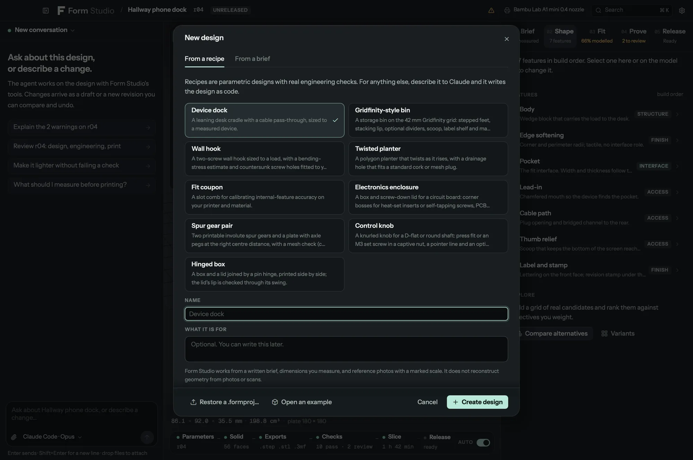

| Start | What happens |
|---|---|
| **Blank** | An empty plate. Describe the part to the agent; it writes the design as code in the CAD kernel. |
| **From a recipe** | A parametric family with real engineering checks: device dock, Gridfinity bin, wall hook, twisted planter, fit coupon, electronics enclosure, spur gear pair, control knob, hinged box. |
| **Community recipes** | Browse the [community gallery](https://kaizensx.github.io/form-studio/recipes/) inside the app and start from any recipe in one click. |
| **Import project** | Open a `.formproj` archive exported from Form Studio, with its revisions and conversations. |
| **A brief** | A written description, dimensions you measured and reference photos with a marked scale. |

**Reference parts.** Import a STEP or STL of the thing your part must fit (a circuit board, a phone, a motor). It is
drawn as a blueprint companion, and a design can cut clearance from it with `self.reference("pi5.step")`.

**Datasheets and drawings.** The agent reads PDFs and images, from a file or an https link, as pictures, so the
dimensions in a mechanical drawing survive (`read_document`).

## Designing

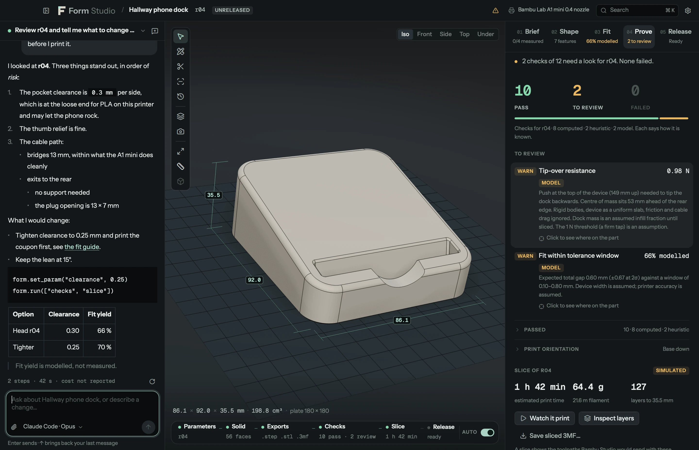

- **A real CAD kernel.** Every design is B-rep geometry built by [build123d](https://github.com/gumyr/build123d) on
  OpenCascade, exported as STEP and STL. Designs are Python (build123d) or OpenSCAD.
- **Parameters with provenance.** Every value has a unit, a range, a group (brief, interface, form, process) and a
  source: measured, specified, assumed, from a photo, computed.
- **Features you can click.** Each face of the solid is attributed to the feature that made it, so you can select a
  feature on the model, change it, hide it, and see which features a change touched.
- **Drafts with computed impact.** A change is built for real before it is saved: the features and interface
  dimensions it moves, the change in stability and fit, and which outputs it would invalidate.
- **Constraints that explain themselves.** An impossible combination is refused with the feature, the parameters
  involved and a way forward.
- **Hardware with sources.** `form.parts` provides screw clearances (ISO 273), heat-set insert pockets, nut traps,
  magnet pockets, bearing seats, printable threads and involute gears, each dimension with its source.
- **Text and patterns.** Embossed or debossed lettering with a shipped font, revision stamps on the underside, hex
  vents, perforations, slots, knurls and grip ribs, with web-thickness checks.
- **Many designs on Home**, each a live 3D card, filtered by released and in progress; rename, duplicate, export or
  move to the trash.

## Revisions, branches and variants

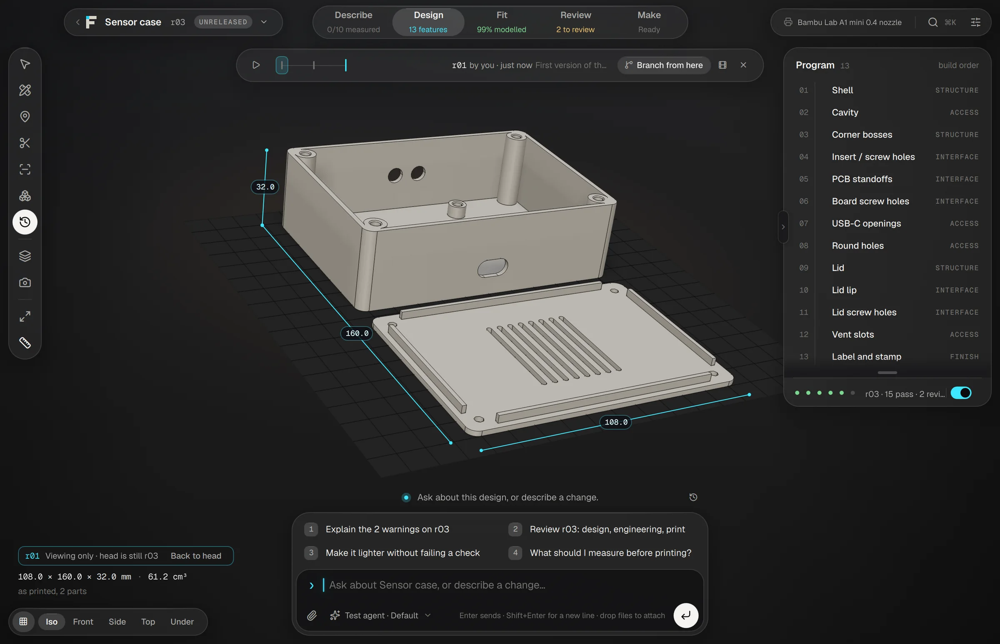

- **Every commit is a revision.** Revisions record their origin (you, the CLI, or the agent by name) and never
  overwrite each other: an agent that commits against an older head is refused.
- **Timeline.** Scrub through revisions in the viewport, play them as a morph, and export the morph as GIF or WebP.
- **Branches.** Check out any earlier revision and continue from it; nothing is deleted.
- **Compare.** Parameters, features, interface dimensions, stability and fit between any two revisions.
- **Variants.** Named sets of values kept next to the revisions ("Travel version", "Thick walls"), compared side by
  side on a variants board and promoted to a revision when you choose.

## Checks and evidence

Each revision is rebuilt and checked on the solid. The standard checks:

| Check | Evidence |
|---|---|
| One valid solid | computed |
| Interfaces as modelled (intended vs measured on the solid) | computed |
| Export mesh is closed | computed |
| STL matches the CAD solid | computed |
| Fits the build volume | computed |
| Thinnest wall | computed |
| Unsupported overhangs | computed |
| Bridged ceilings | heuristic |
| Plate contact | heuristic |
| Tip-over resistance (statics) | model |
| Fit within the tolerance window | model |
| Re-imported in FreeCAD (when installed) | computed |

Recipes add their own: a hook's bending safety factor, a gear pair's centre distance, backlash and contact ratio, a
hinged lid's swing. **Every result says how it is known** (computed, heuristic, model, simulated, measured, physical)
and clicking a result shows where on the part it was found.

## Fit

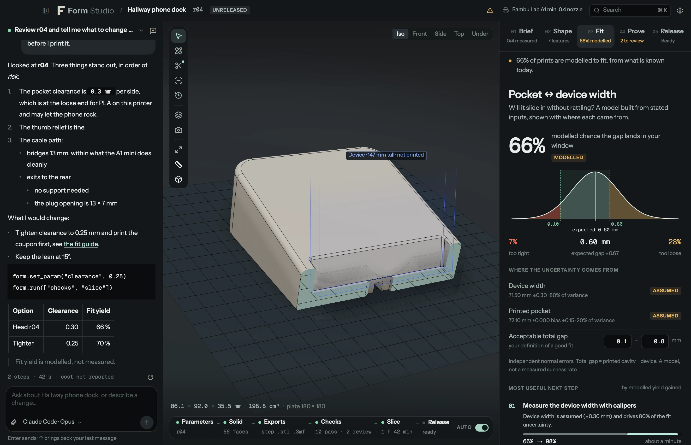

The gap between a printed cavity and the object it holds is modelled from three uncertainties: the object's
dimension (measured, specified or assumed), the printer's bias and spread for this filament, and the tolerance window
you accept. Form Studio reports:

- the **chance the gap lands in the window**, with the chance of too tight and too loose;
- a **section** through the interface with the clearance per side;
- the **recommended clearance** for a centred gap;
- the **cheapest way to raise the odds**: measure the object, print the fit coupon, or print a thin test ring cut from
  the real interface (`slice_test_piece`).

Measurements from a printed coupon calibrate the printer profile and are reused by every later design.

## Analysis and measurement

| | |
|---|---|
|  | 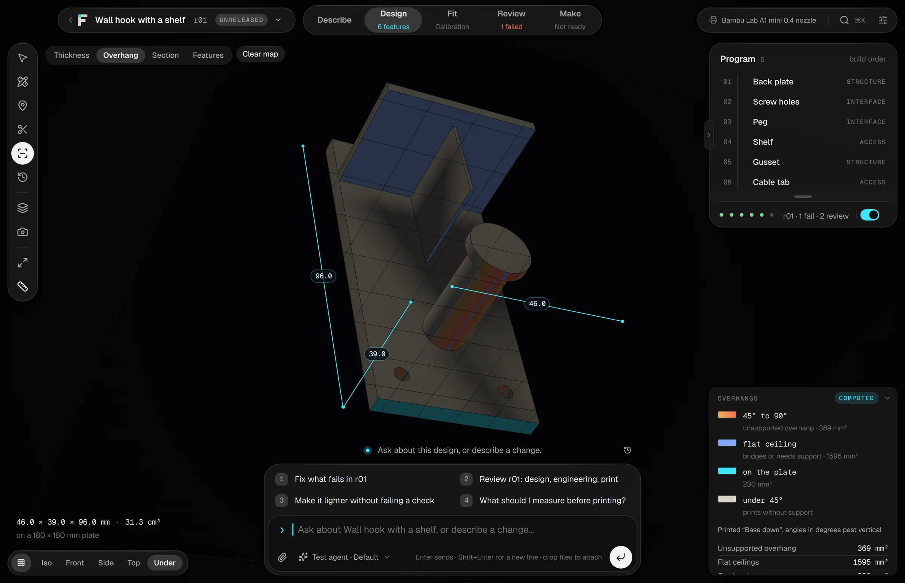 |
| **Wall thickness**, from thousands of surface samples, with the thinnest spot marked. | **Overhangs** by angle, flat ceilings, bridges and plate contact. |

- **Maps on the model:** wall thickness, overhang, layer cross-section and small features, computed from the real
  geometry. Each legend says what the map does not tell you.
- **Measure (M):** point-to-point distance with snapping, face area and tilt, and exact hole diameters from the solid.
- **Section (X):** a clipping plane through the solid with filled cut faces.
- **Orientation finder:** ranks print orientations by overhang area, support, contact and height, with the numbers
  behind the ranking, and applies the one you choose.
- **Tip-over and statics:** where the centre of mass sits, and the push that tips the part, from the solid and the
  slicer's mass.

## Slicing and print simulation

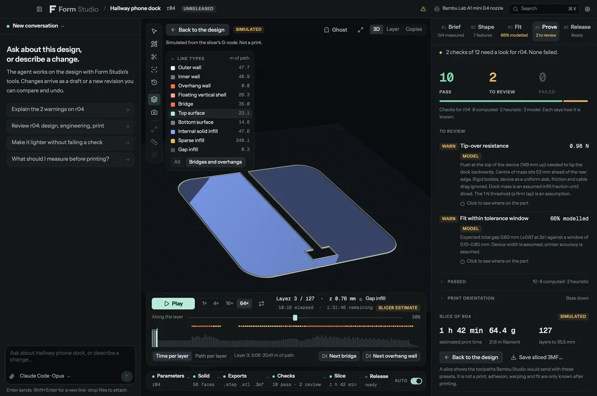

- **Your slicer, your presets.** Bambu Studio, OrcaSlicer, PrusaSlicer, SuperSlicer and QIDISlicer, and OrcaSlicer
  forks such as Creality Print, Elegoo Slicer and Anycubic Slicer Next. Printer, filament and process come from the
  slicer's own selection or are pinned in Settings. Any printer configured in your slicers can be chosen.
- **OrcaSlicer 2.5 packed profiles** (`.opc`) are read directly; a profile never has to be exported by hand.
- **Watch it print.** The G-code is read back and played in 3D with a nozzle marker, line-type filters, a per-layer time
  chart and the slicer's own time and filament estimate. Jump to the next bridge or overhang wall.
- **Copies on a plate:** does N fit, and how they pack.
- **Cost:** filament, electricity and machine time from the slice and your prices. Form Studio never guesses a price.

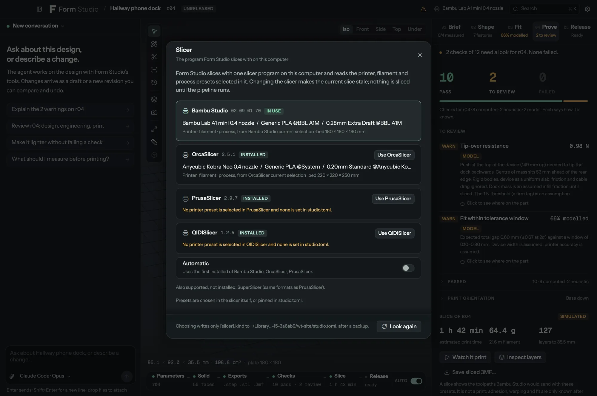

## Assemblies

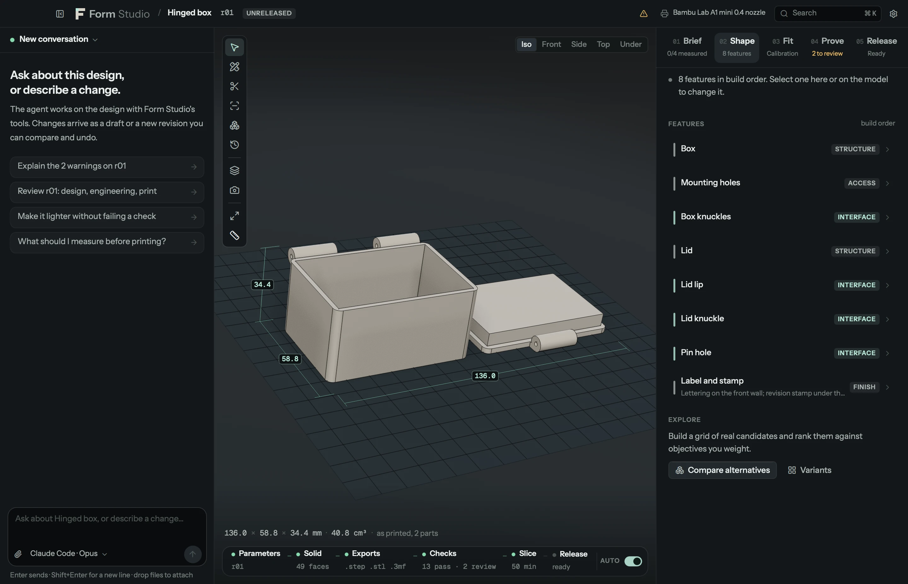

- **Assembled, exploded and print layouts** in the viewport, with hinge and slide joints you can move.
- **Checks from the solids:** overlap when assembled, the smallest gap, each joint swept through its range, and whether
  a screwdriver reaches every screw.
- **A bill of materials** for the bought hardware; a release adds `BOM.csv` and `ASSEMBLY.md`.

## Optimisation and alternatives

- **Goal seek** (`optimize`): search parameter ranges for the lightest, smallest or strongest design that still passes
  its constraints, for example the lightest hook with a safety factor of at least 3. Every candidate is a real kernel
  build.
- **Alternatives:** a grid of real variants over one or two parameters, ranked by objectives you weight (less
  material, harder to tip, fit yield, smaller footprint).

## Pictures: renders, share cards, animations

| | |
|---|---|
| 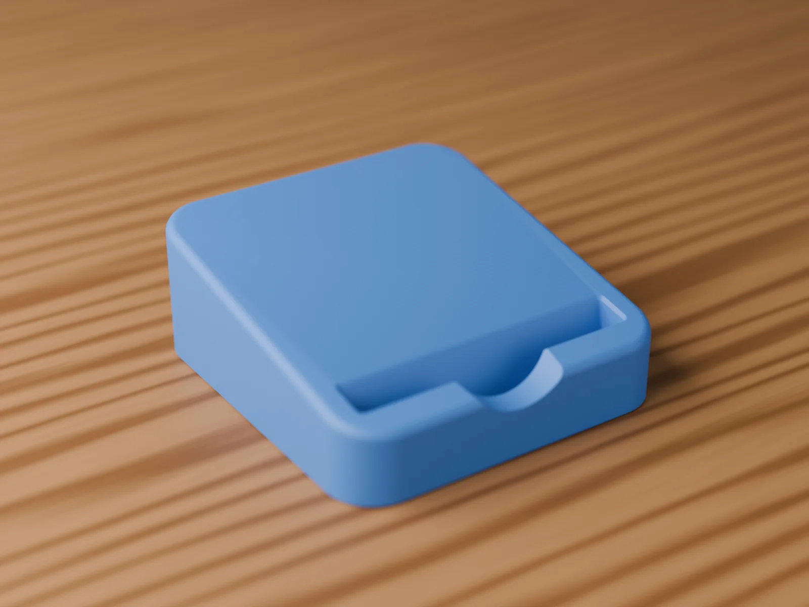 |  |
| **Photoreal render** with Blender: studio, desk or dark scenes, matte, PETG or silk finishes, any colour, layer lines at the slicer's layer height. | **Share card**: the part with its dimensions, print time, filament, checks and fit, each labelled with its evidence. |

- **Engine renders** in any view or as a four-view sheet, coloured by feature, for agents to look at their work.
- **Turntables and revision morphs** as GIF or WebP (`form animate`, `form history --gif`).
- Renders are illustrations and are labelled as such; they are never evidence.

## Release

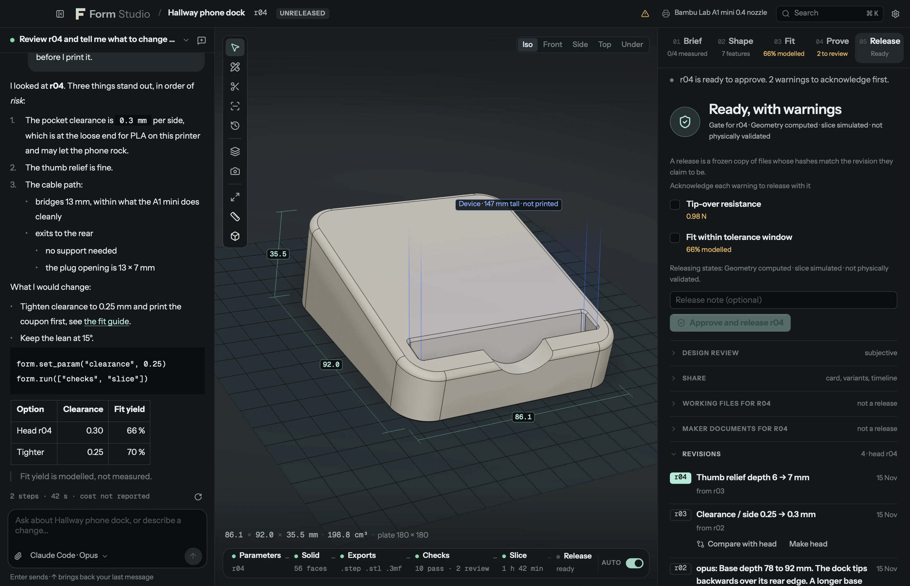

- **A release gate** lists what is current, what is stale and what needs acknowledgement.
- **One approval, by a person**, freezes STEP, STL, 3MF and G-code with SHA-256 hashes and a report of every check and
  its evidence. No agent can approve.
- **Verify at any time** that a release still matches its hashes; a later commit marks it superseded.
- **Export** a design as a `.formproj` archive with its revisions, and import it on another computer.

## Working with other software

| Program | What Form Studio does with it |
|---|---|
| FreeCAD | Opens the STEP, runs a re-import check, and writes a macro with every parameter in a spreadsheet |
| OpenSCAD | Builds `.scad` designs; Customizer ranges become parameters |
| Blender | Photoreal renders; its 3D-Print Toolbox checks when the add-on is installed |
| Your slicer | Slices, and opens the 3MF or G-code in it |
| Any MCP client | The full engine over 44 tools ([MCP reference](MCP.md)) |

## Setup, settings and updates

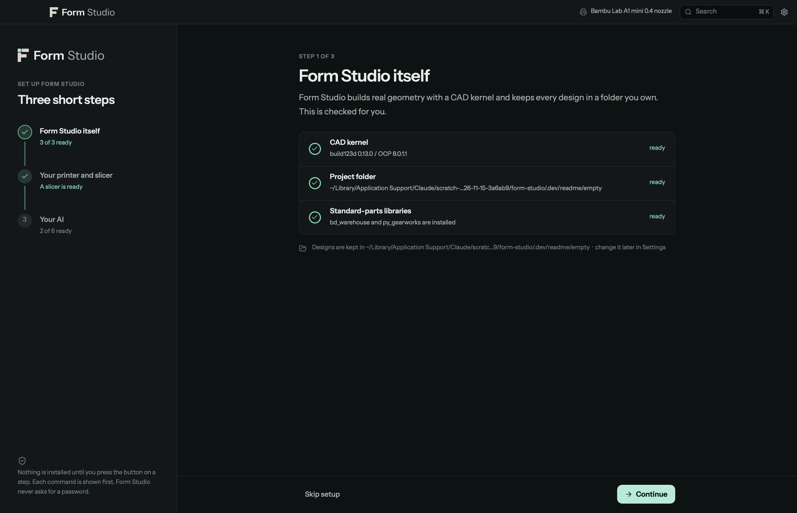

- **First start in three steps:** Form Studio itself, your printer and slicer, your AI. Missing pieces (the
  standard-parts libraries, a slicer, an agent and its sign-in) install from inside the app, hands-free once you
  confirm. Every command is shown before it runs.
- **Settings** (Ctrl/⌘ ,): general, printer and slicer, chat (agents, models, API keys), other apps, and software.
- **What's New** after each update, and updates installed from inside the app.
- **Command palette** (Ctrl/⌘ K) for every action and every design.

