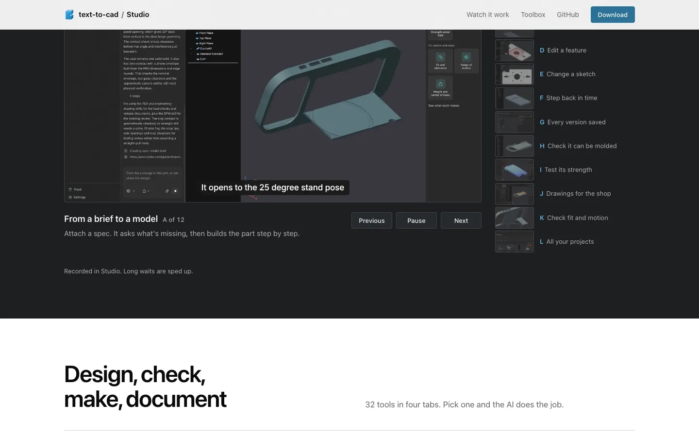
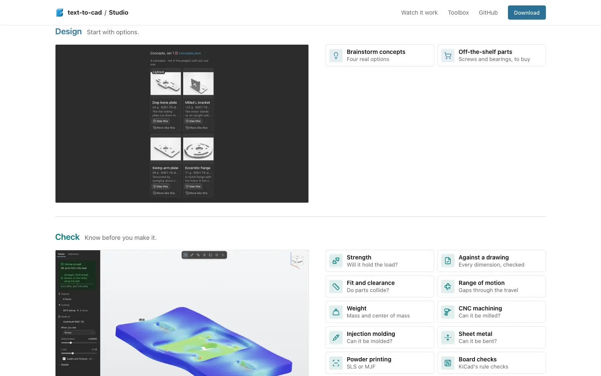
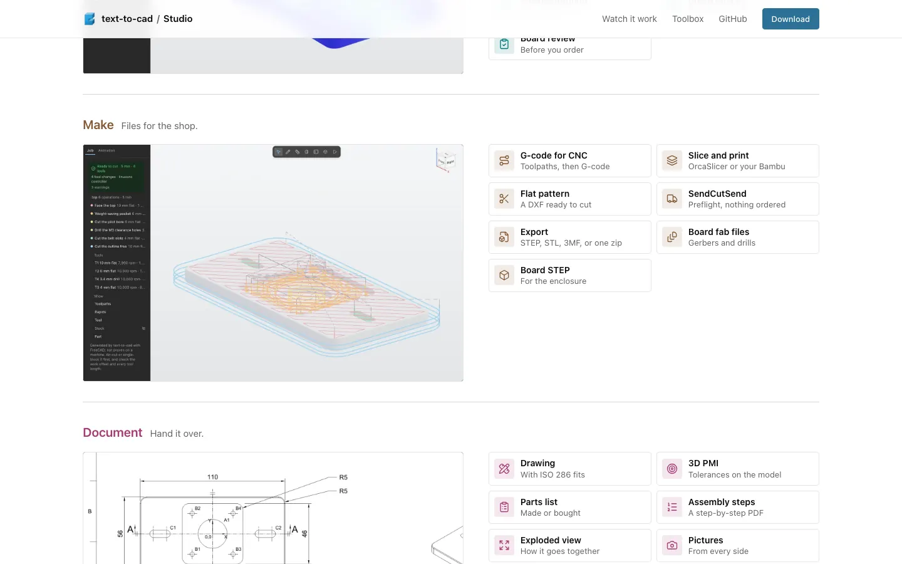
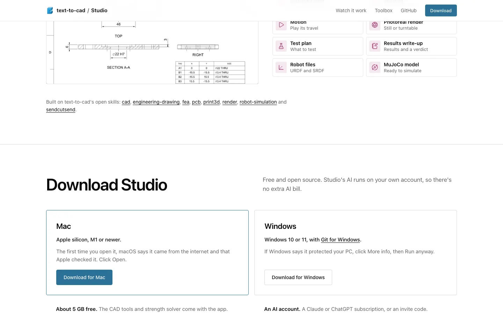

# Toolbox teardown: every tool of text-to-cad Studio, and how Form Studio passes each

Date: 2026-11-28. Branch `dev`, version 1.2.0-dev. Status: research only; no product code changed.

The owner judged the reference's Toolbox richer and more professional than ours. This page reads it to the
algorithm: every tile, every skill behind it, the numbers it uses, what it admits it cannot do, and how the AI is
asked to run it. Then, tool by tool, it says where Form Studio stands, the algorithm we use to pass it, and where it
lives in the approved interface (direction I: four modes and the Bench, `docs/design/directions/i/IA.md`). It ends
with tools nobody in the niche has, ranked, and the waves to add to `docs/plans/2026-11-27-beyond-studio.md`.

- [Sources and how they were read](#sources-and-how-they-were-read)
- [What the Toolbox is, in one paragraph](#what-the-toolbox-is-in-one-paragraph)
- [The Toolbox interface](#the-toolbox-interface)
- [Tab: Design](#tab-design)
- [Tab: Check](#tab-check)
- [Tab: Make](#tab-make)
- [Tab: Document](#tab-document)
- [The skills behind the tiles](#the-skills-behind-the-tiles)
- [Algorithm notes](#algorithm-notes)
- [Honesty patterns worth matching](#honesty-patterns-worth-matching)
- [UX patterns worth exceeding](#ux-patterns-worth-exceeding)
- [Never seen before: tools and algorithms to lead with](#never-seen-before-tools-and-algorithms-to-lead-with)
- [Proposed additions to the plan](#proposed-additions-to-the-plan)
- [Top 10 gaps where theirs is richer today](#top-10-gaps-where-theirs-is-richer-today)
- [What was checked, and what was not](#what-was-checked-and-what-was-not)

## Sources and how they were read

| Repository | Commit | Licence (read from the file) |
|---|---|---|
| `amywork777/studio` (the app) | `f67283b`, 2026-11-27 | MIT, "Copyright (c) 2026 T3 Tools Inc." (`LICENSE`) |
| Its submodule `text-to-cad` (`amywork777/text-to-cad-upstream`, branch `studio-base`) | `bea2bbe`, 2026-11-27 | MIT, "Copyright (c) 2026 Thompson Labs LLC" (`text-to-cad/LICENSE`, and one per skill) |
| `earthtojake/text-to-cad` (upstream) | `981d0f8`, 2026-11-26 | MIT, same holder |
| Site `texttocad.studio`, toolbox section | read 2026-11-28 | Screenshots in `docs/research/assets/2026-11-28-ttc-toolbox-*.webp` |

Both repositories were cloned into a scratch folder outside ours and read as data. No install script, build or
code of theirs was run. The site was loaded in a headless Qt WebEngine view to take the four screenshots. Four
readers covered DFM, FEA/CAM/drawings, boards/robots/render/print, and the Toolbox interface; their citations were
spot-checked against the files (printing angles, unfold, Netgen parameters, the CNC tool floor, the safety factor,
the orientation weights, the clamp factors: all as cited). **No code was copied into Form Studio.**

Citation shorthand: **S** = `amywork777/studio` at `f67283b`; **W** = `S/apps/web/src/components/workbench`;
**T** = `S/text-to-cad` at `bea2bbe`; **P** = `T/packages/cad/src/cad`; **R** = `P/_internal/dfm/README.md` (a
195 KB rule specification). Our own files are `form/...` on `dev` at `44aee9a`.

Two facts that change earlier notes:

- The fork adds two skills that upstream does not ship: **`cam`** and **`work-instructions`**, and a PMI reference
  (`T/skills/cad/references/pmi.md`). Upstream has eight skills (cad, engineering-drawing, fea, pcb, print3d,
  render, robot-simulation, sendcutsend).
- The code has **35** jobs (`W/hardwareActions.ts:146-608`); the site advertises 32. The three not on the site are
  the FDM, resin and metal-printing checks, which sit in Check because they are `checks: true`
  (`W/toolbox.ts:55-60`).

## What the Toolbox is, in one paragraph

Each tile is a sentence. Pressing **Run** writes `Tool: <label>` and a prompt naming the part into the chat and,
when the composer is empty, sends it (`W/StudioToolbox.tsx:93-97`, `W/handToChat.ts:8-31`). The agent then follows
a long skill text and calls the `cad` command-line tools, which hold the real engineering: about 155,000 lines of
Python over build123d and OCCT (`T/packages`). Results come back as files (`result.json` beside `result.glb`) that
Studio reads into badges and an "Open issues" list (`W/checkResults.ts:111-158`). So the richness the owner sees has
two layers: a calm, well-worded launcher, and a deep, carefully sourced engineering library under it. Both have to
be passed.

## The Toolbox interface

| Element | What they do | Citation |
|---|---|---|
| Entry | A named "Toolbox" button in the title bar; a popover hangs from it over the model (no panel width), up to 40 rem tall | `W/ToolboxButton.tsx:9-35`, `W/ToolboxPopup.tsx:15-49`, `W/StudioToolbox.tsx:113` |
| Tabs | Design, Check, Make, Document, as an underline toggle row with a tinted icon each; the last tab is remembered per device | `W/toolbox.ts:15-46, 113-132` |
| Purpose line | One sentence per tab, e.g. Check: "Will it hold, fit, move and be made as it should?" | `W/toolbox.ts:26-31` |
| Row | 32 px tinted icon tile, name, the "gets" line (what you get, at most 100 characters), a star on hover, a **Run** pill | `W/ToolboxJobs.tsx:79-166`, `W/PinStar.tsx:12-30` |
| Dimmed row | Stays in place, icon at 64 % opacity, Run disabled, the line becomes the reason: "Works on an assembly. Open one to use it." | `W/toolbox.ts:163-173` |
| Start instead of Run | When the project has nothing the job works on, Run becomes **Start** and opens New on the right template | `W/toolbox.ts:203-209` |
| Details | The row expands in place: an example result picture, **Works on**, **You give**, **You get**, **Needs** (downloads with sizes), and the exact prompt ("Run asks the AI agent:") | `W/ToolboxJobs.tsx:173-215` |
| Search | Across all tabs; **Enter runs the first match that fits** the file in front | `W/StudioToolbox.tsx:133-138, 194-207` |
| Sections | Lone one-tile sections pair up on a row; starred jobs lead their tab | `W/toolbox.ts:68-111` |
| Process order | The project's chosen process (FDM, CNC, sheet...) leads Make; the others wait under "Other ways to make it" | `W/hardwareActions.ts:645-681` |
| Colour discipline | Kind hues on icons only; red, amber and green are reserved for fail, warn and pass; the star uses the brand hue | `W/kinds.ts:141-165` |
| Running | The chat bubble shows a tool chip instead of the raw `Tool:` line; a one-line breadcrumb of steps under "Working for" | `W/ToolChip.tsx:13-20`, `W/TurnStepLine.tsx:6-14` |
| Results | Part cards carry check badges (fails / passes with warnings / passes); a stale one says "Part changed since this check"; the Overview lists open issues with **Propose a fix** (fills the composer, does not send) and **Show the result** (opens the result's GLB) | `W/CheckBadge.tsx:14-46`, `W/ProjectOverview.tsx:340-424`, `W/checkResults.ts:296-310, 400-416` |
| Drawing check report | The most developed result view: one row per dimension with a crop of the sheet where it is printed, filter chips, Markdown or PDF export | `W/DrawingCheckReport.tsx:133-448` |

What it does not do: **no finding is drawn on the 3D model** (the only on-model colour is the version diff in
`W/WhatChanged.tsx`); no install progress for the downloads; no printer setting; no arrow-key navigation in the list;
results depend on the agent writing a well-formed `result.json`.

## Tab: Design

Two tiles. Columns, in every tab table: what the person sees and gives; what runs; output and honesty; then our
status, the algorithm we pass it with, and the Bench row and mode in direction I.

| Tool | They: sees, gives, runs | They: output, honesty, AI prompt |
|---|---|---|
| **Brainstorm concepts** | A card grid, 2 or 4 columns: picture, name, mass, material; **Use this**, **More like this**, **Open** (`W/BrainstormConcepts.tsx:71-268`). Gives nothing; the LLM writes four `@model` scripts, each "a really different approach" by process, material placement and fastening, builds them with `cad run`, renders a snapshot and reads mass from `cad model inspect` (`S/studio-job-skills/brainstorm/SKILL.md:22-80`) | `concepts.json` with `mass_g` measured or null. Concepts stay out of the project until used. Prompt: "Make 4 concepts ... each a really different way to do its job" (`W/hardwareActions.ts:224-225`) |
| **Off-the-shelf parts** | Gives the part; the agent places bought parts with mates. Order: bd_warehouse by standard (ISO 4762, 4014, 10642, 7380, 4032, 7089, DIN 471/472, ISO 3601, deep-groove bearings, heat-set inserts), then the `step.parts` catalogue of about 17,000 maker STEPs (sha256-checked), then McMaster or MISUMI only as a file the person attaches (`S/studio-job-skills/standard-parts/SKILL.md:19-118`) | Price or part number only if read from the supplier page in this turn, otherwise "look up"; sizes not in a table are never invented (`:30-31, 88`) |

| Tool | Form Studio today | How we pass it | Bench row, mode |
|---|---|---|---|
| Brainstorm concepts | **Equal.** `propose_concepts` builds 3 or 4 real designs in parallel (`form/concepts.py`); cards lack mass and material | Each concept is scored on one card by the kernel: mass with inertia (wave C), the process's DFM verdict (wave E) and, when loads exist, a safety factor (wave D); a Pareto mark over mass, cost and strength (`form/advisor.py:221` already computes dominance) | Design chapter: **Concepts**, Design mode; cards in the conversation |
| Off-the-shelf parts | **Partial.** `form/parts.py` over bd_warehouse with every dimension's source; `BOM.csv` with standard references (`form/maker_docs.py:bom`) | Wave G: pick a hole, get the part and its mating feature cut as one action, the fit proved by the assembly check; fastener **sized from the load** (wave X below), not just placed | Design chapter: **Standard parts**; Document: **Parts list** |

## Tab: Check

Fourteen jobs in code (eleven on the site). The DFM jobs share one engine (section [DFM engine](#dfm-engine)).

| Tool | They: sees, gives, runs | They: output, honesty, AI prompt |
|---|---|---|
| **Strength** | Gives fixtures, loads and a material when asked. Netgen second-order tets, `maxh` = bounding-box diagonal / 40, `curvaturesafety` 1.5, `grading` 0.5, local refine balls (`P/netgen/_mesher.py:108-187`, `P/_internal/fea/mesh.py:104-107`); CalculiX 2.23 deck with `C3D10`, nodal `*CLOAD` only (pressure integrated in Python with a 6-point rule), `*STATIC` (`P/calculix/_files.py:66-115`, `P/_internal/fea/solve.py:38-39`) | Safety factor = yield / peak nodal von Mises (`P/_internal/fea/checks.py:98-100`); fails < 1, close < margin (default 2). Auto re-solve at half size when SF < 3, `mesh_not_converged` past 10 %; reactions must balance within 1e-3; a mandatory hand calculation before the solve, flagged if off by 2x (`checks.py:22-38`, `static.py:231-236`, `T/skills/fea/SKILL.md:88-91`). "A first-pass engineering check, not a certification". Linear static only |
| **Against a drawing** | Gives a dimensioned drawing (PDF). The agent writes one row per dimension *before* modelling, flags chains that do not close and double dimensions, then measures each on the B-rep; Studio, not the agent, judges each against its tolerance or the title block's general tolerance (`S/studio-job-skills/drawing-check/SKILL.md`) | Per-dimension statuses: out of tolerance, to confirm, matches, confirmed, not checked, reference, with sheet crops (`W/drawingCheck.ts:381-389`) |
| **Fit and clearance** | Assembly only. Oriented-box broad phase, mesh proximity (`BRepExtrema_ShapeProximity`), then an exact `BRepAlgoAPI_Common` volume; ≤ 1e-3 mm³ counts as none (`P/build123d/_interference.py:10-358`, `P/_internal/interference.py:37`) | An unmeasured pair (time out, crash) is **not** a pass; 300 s per pair. Intended fits declared with `--fit` globs |
| **Range of motion** | Each joint swept alone, 1° or 1 mm steps, gaps on surface samples at 0.3 mm resolution, stop when > 15 mm² of samples come within resolution (`P/engine/ranges.py:1-300`) | Stops read short of contact ("a lid that lies flat at 180° reads 174°"); closed loops stored but not solved (`T/skills/cad/references/kinematics.md:214-300`) |
| **Weight and centre of mass** | `BRepGProp.VolumeProperties` per solid × density; volume, mass, combined centre of mass, 3×3 inertia (`P/build123d/_geometry.py:101`) | "About 0.4 % high on a lofted solid"; overlaps summed (`inspection-and-validation.md:365-372`) |
| **FDM, resin, powder, metal printing** | Rules per technology from Hubs, Protolabs, Xometry (`P/_internal/dfm/printing.py:204-284`); exact B-rep rays for walls, overhang by face normals, bridges by convex hull of supports (`P/build123d/_dfm_printing.py:726-866`) | ok / failed / **not_checked** (never a pass) with reason codes (R:167-200). No auto-orientation for the check; orientation ranked only with `--candidates` |
| **CNC machining** | Machining frame from clustered normals; line-of-sight access along 6 (3-axis), +15° steps (4/5-axis), 218 cube directions, disc cutters for undercuts; greedy set cover for setups (`P/build123d/_dfm_cnc.py:804-1805`) | Tool is a zero-diameter line: holders and spindle not checked (R:868-887) |
| **Injection molding** | Draft exact on planes, cylinders and cones; undercuts by rays along the opening direction, then side actions, lifters, collapsible cores; rolling-ball thickness; clamp tonnage (`P/build123d/_dfm_molding.py:737-1300`, `P/_internal/molding_geometry.py:347`) | 200,000 rays and 45 s budget; more trapped area unsearched than searched gives NOT CHECKED. Not judged: fill, cooling, warpage, shrinkage, weld lines (R:1389-1416) |
| **Sheet metal** | Thickness as the modal ray distance between skins; bends as coaxial cylinder pairs; own unfold (section [Sheet metal](#sheet-metal-unfold)) (`P/build123d/_dfm_sheet.py:1-40, 3227`) | Bend order, tooling collisions, grain, PEMs not checked (R:1228-1243) |
| **Board checks** | KiCad's own DRC and ERC through `kicad-cli`, from a nightly "kicode" download, about 100 MB (`P/kicad/_check.py:1-12`, `T/skills/pcb/SKILL.md:39-47`) | Each finding with position, item and net; silent net reassignment detected (`P/kicad/_drift.py:1-20`) |
| **Board review** | Fab limits tabulated for JLCPCB, PCBWay, OSH Park (dated 2026-11-04); track width by IPC-2221 `I = k·ΔT^0.44·A^0.725` (`T/skills/pcb/references/manufacturing.md:46-63`, `layout.md:18-20`) | Without the current, "compute nothing: ask"; "No findings is not a manufacturability approval" (`review-electrical.md:21`, `SKILL.md:173-176`) |

| Tool | Form Studio today | How we pass it | Bench row, mode |
|---|---|---|---|
| Strength | **Close to missing.** Closed-form models per building block only (`form/checks.py:156`) | Wave D as planned, plus: a posteriori error (Zienkiewicz-Zhu recovery) over ≥ 3 refinements and Richardson extrapolation, so the result carries "discretisation error ≤ N %" instead of their single 10 % re-solve; singularities named by stress growth under refinement; NAFEMS LE1/LE10 suite; **anisotropic printed parts** (transversely isotropic material from the print orientation, see AB below), which they call "rough" | Check: **Strength**; result strip with error and limits; loads drawn on the part |
| Against a drawing | **Partial.** The brief's numbers as contract assertions (`form/contract.py`) | Wave F's `check_drawing`, plus their two good ideas made exact: rows before modelling, verdict by the app not the agent; DXF dimensions read exactly; each row's crop shown beside the **measured feature lit on the part** | Check: **Against a drawing**; Document for the sheet |
| Fit and clearance | **Better.** Overlap, smallest gap, declared fits, ISO 286, a statistical fit yield with the printer's measured bias (`form/fit.py`, `form/collide.py`) | Keep; add **tolerance stack-up** over mate chains (wave X) | Check: **Fit** |
| Range of motion | **Better.** Chains swept with what they carry, first-contact angle, budget (`form/assembly.py:analyse`) | Exact confirmation at the found stop by a boolean (they say theirs reads short); loops solved by Newton on the loop-closure equations (wave I) | Check: **Motion**; timeline scrubber |
| Weight and centre of mass | **Partial.** Volume × typical density (`form/material_library.py:mass`) | Wave C: GProp per part and assembly in any pose, inertia, each density with its source and spread; mass uncertainty from the spread | Check: **Mass**; size line |
| FDM, resin, powder, metal printing | **FDM better on the print path** (seven slicers, thickness, orientation `form/analysis.py:1192`); resin, SLS, MJF, PBF **missing** | Wave E with rule tables as data with source and date, the same five technologies, **and the fix applied and re-checked** (never seen, rank 1) | Check: **Printing (process)** |
| CNC machining | **Close to missing.** A 0.8 mm minimum feature (`form/purpose.py:43`) | Wave E: visibility on the Gauss map (Chen, Chou and Woo 1993) for setups, then a **tool with a diameter and holder** swept along access directions (a capsule test), which they omit; corner radius against the stated tool; fix = raise the fillet to the tool radius | Check: **Machining**; access map on the part |
| Injection molding | **Close to missing** (`form/purpose.py:47`) | Wave E plus a **proposed pull direction and parting line** (rank 2), sink risk at junctions from rolling-ball thickness | Check: **Moulding**; draft map |
| Sheet metal | **Missing** | Wave H, verified by folding back; plus bend sequence with a press-brake tool collision check (they do not check order) | Check: **Sheet metal**; Make: **Flat pattern** |
| Board checks, review | **Missing** | Wave K: KiCad's results reported as KiCad's; the board as a constraint on the enclosure. Track width by IPC-2152 charts with the IPC-2221 formula as the stated fallback | Check: **Board**, only for a design with a board |

## Tab: Make

| Tool | They: sees, gives, runs | They: output, honesty, AI prompt |
|---|---|---|
| **G-code for CNC** | FreeCAD 1.1 (installed on first use, about 650 MB) Path ops `MillFace`, `Profile`, `PocketShape`, `Adaptive` (clearing), `Drilling` (`P/freecad/_job.py:22-105`). Asks once for the post (no default), max rpm, every tool from the person's own table, material grade, workholding (`T/skills/cam/SKILL.md:106-123`). Feeds from an 11-material table (Vc, chip load, chip thinning `D/(2√(D·ae−ae²))`) (`P/_internal/cam/feeds.py:1-56`) | Gouge (exact distance, 0.03 mm), rapid into stock, uncut, travel checks on the posted moves; G-code withheld on any error; posted files re-parsed for S, F, Q and G5x (`P/_internal/cam/checks.py:50-560`). 3-axis only; cycle time a lower bound. Required sentence: "Prove this program on the machine..." |
| **Slice and print** | The person's own OrcaSlicer; profiles from their saved project 3MF; Bambu through a `bambu-connect://` link (`T/skills/print3d/SKILL.md:37-113`) | "never invent one"; never asks for access codes; never reports a print as started |
| **Flat pattern DXF** | Own unfold, `CUT` and `BEND` layers, deterministic DXF writer that validates closed profiles (`P/build123d/_dfm_sheet.py:3241-3253`, `P/engine/export/dxf.py:8-37`) | Flat area within 3 % of volume / t, else `flat_incomplete` |
| **SendCutSend** | Live `cdn.sendcutsend.com/specs/` guide, catalog and specs JSON; joined by exact SKU; flange lengths checked at every bend (`T/skills/sendcutsend/SKILL.md:35-118`) | ✅ / ❌ / ❓ rows with the JSON field path; "Nothing is uploaded or ordered" |
| **Export** | STEP, STL, 3MF; an imported STEP is left as it is (`W/hardwareActions.ts:439-444`) | - |
| **Board fab files, Board STEP** | `kicad-cli` exports: gerbers, drill, pos, BOM, STEP, ODB, IPC-2581 (`P/kicad/_export.py:53`) | Warns when gerbers lack Edge.Cuts; "measure before designing" for the board STEP |

| Tool | Form Studio today | How we pass it | Bench row, mode |
|---|---|---|---|
| G-code for CNC | **Missing.** A G-code reader and player exist for prints (`form/toolpath.py`, `form/simulate.py`) | Wave J: own 2.5D ops (pyclipper offsets), opencamlib for 3D; **a height-field stock simulation** measured against the solid (gouge and leftover maps), which they do not have; holder collision; posts parsed back and replayed. A few MB instead of 650 MB | Make: **CNC route**; stock on the stage |
| Slice and print | **Better.** Seven slicers, per-design settings with reasons, plates, a played simulation (`form/adapters/*.py`) | Keep; add orientation over anisotropy and time (AB) | Make: **Print route** |
| Flat pattern DXF | **Missing** (DXF read only, `form/formats.py`) | Wave H plus a **DXF cut-file checker** with layer intent, the one thing of theirs we had not planned (their tokens: cut, bend, engrave, reference; `P/engine/formats/dxf.py:318-415`) | Make: **Flat pattern** |
| SendCutSend | **Missing** | Wave H's service preflight with dated tables; no live fetch unless the person opts in | Make: **Service preflight** |
| Export | **Better.** STEP, STL, OBJ, GLB, 3MF with colours, a hashed release zip (`form/kernel.py:987`, `form/maker_docs.py`) | Keep; STEP AP242 with PMI (wave F) | Make: **Exports** |
| Board fab, Board STEP | **Missing** | Wave K with the person's KiCad | Make: **Board files** |

## Tab: Document

| Tool | They: sees, gives, runs | They: output, honesty, AI prompt |
|---|---|---|
| **Engineering drawing** | Asks first: critical interfaces, stage, joint by joint (`T/skills/engineering-drawing/SKILL.md:43-76`). OCCT `HLRBRep_Algo`, tangent edges dropped from the hidden half (ISO 128) (`P/_internal/drawing_views.py:46-80`); ezdxf entities rendered to PDF; ISO A4-A0 and ASME A-E; ISO 5457 border, ISO 7200 title block, ISO 7573 parts list; `part_sheet` auto-dimensions overalls, hole callouts (a table past 6), slopes (`P/eng_drawing.py:1786`) | Values read off the part; a typed value the part contradicts stops the script. **`fit=` checked for syntax only.** Single-segment GD&T; full sections and circular details only (`P/_internal/drawing_annotation.py:217-260`) |
| **3D PMI** | AP242 semantic PMI: datums, sizes and locations with limits, flatness, position, profile, notes (`T/skills/cad/references/pmi.md:11-62`); ISO 286 table c-u, IT4-IT13, 0-500 mm, with the Δ rule for K-U holes (`W/isoFits.ts:9-185`) | "Never recall limits from memory"; inch fits (ANSI B4.1) refused |
| **Parts list** | Prompt only, no skill (`W/hardwareActions.ts:477-488`) | - |
| **Assembly steps** | `work-instructions` skill: picture guide or shop WI; one action per step, arrow chosen by the agent from six; hidden-line figures with the step's parts filled; PDF plus an HTML 3D step-through (`T/skills/work-instructions/SKILL.md:41-260`) | **No sequence planner**: the order is the person's, or a labelled guess. Every torque or adhesive value needs `per=` a source, else a hatched NOT STATED box; `released` refuses open items |
| **Exploded view** | Hierarchical radial layout from bounding boxes: push = `distance·1.5 + childRadius·0.45`, × 0.8 per level, 3 levels, 10 relaxation passes (`P/engine/render/explode.py:36-236`) | Purely geometric: no mates, no insertion direction |
| **Pictures, Motion** | OCCT snapshots from four sides; a named motion the viewer plays (`P/engine/snapshot.py`) | Motion is not a film |
| **Photoreal render** | Blender `bpy` 5.2.3 downloaded (260-430 MB); EEVEE draft, Cycles with OIDN final; turntable by a keyed empty (`T/skills/render/SKILL.md:36-157`) | "Geometry is judged with snapshot, never a render" |
| **Test plan, Results write-up** | Prompts only, no skill | - |
| **Robot files** | URDF from build123d joints, inertials from exact solids × density, limits from the range sweep, pure-Python validator (tree, PSD, triangle inequality, magnitude) (`P/urdf/_source.py:203-869`); SRDF hand-authored and cross-checked | Disabled collisions are only proven by sampling, said so (`srdf-checks.md:39-52`) |
| **MuJoCo model** | MJCF in Menagerie layout, collision as convex hull by default, `fit()` primitives or **CoACD** decomposition (16 hulls, threshold 0.05) (`P/engine/export/mjcf.py:1-753`); `cad mujoco check` health at `qpos0` and `home` | "thresholds are heuristics" (`mjcf-checks.md:31`) |

| Tool | Form Studio today | How we pass it | Bench row, mode |
|---|---|---|---|
| Engineering drawing | **Missing** | Wave F: dimensions from the design's own parameters, so **coverage is computed** ("N of N parameters, 0 twice"); fits from `Mate` printed as limits, not just the class; half, offset and broken-out sections; the release hash in the title block | Document: **Drawing**; the sheet unfolds from the part |
| 3D PMI | **Missing** (STEP without PMI) | Wave F: XCAF write, read back and compared annotation by annotation | Document: **PMI** |
| Parts list | **Equal** (`BOM.csv` with grams and evidence) | Wave G: grouped designations, mass, supplier data only with a link and date | Document: **Parts list** |
| Assembly steps | **Equal** (`form/instructions.py`) | **Assembly sequence planning** (wave Y): order and insertion direction computed from blocking, so the arrow is proved, not chosen | Document: **Instructions** |
| Exploded view | **Equal** (parent-relative offsets, `form/craft/assemble.py`) | Wave Y: explode along each part's computed free direction, in reverse assembly order | Document: **Exploded view** |
| Pictures | **Equal** (`form/render.py`, `form/share.py`) | Keep | Document: **Pictures** |
| Motion | **Partial** (`form/animate.py`: turntables and morphs) | Wave I timeline with clearance trace and torque per joint; film export | Document: **Motion** |
| Photoreal render | **Equal** (`form/adapters/blender.py`) | Keep | Document: **Render** |
| Test plan, Results | **Partial** (`MEASUREMENT_PLAN.md`) | Wave L: one test per contract requirement and study; the report holds only measured numbers | Document: **Test plan**, **Report** |
| Robot files, MuJoCo | **Missing** | Wave I with CoACD (MIT) or V-HACD (BSD) as optional engines; inertias from wave C with sourced densities | Document: **Robot files**, only for a design with joints |

## The skills behind the tiles

| Skill | Size | What it really is | The algorithm worth knowing |
|---|---|---|---|
| `cad` | 18 references | The CAD library and its CLI: models, inspect, snapshot, DFM, exports, mechanisms | DFM rule engine (R); interference in three phases; range sweep on samples |
| `fea` | 3 references | Linear static on CalculiX and Netgen | Hand check required; reaction balance; Gauss/nodal peak ratio 1.5 flags concentration (`checks.py:22-38`) |
| `cam` (fork only) | 1 reference | FreeCAD Path driven headless | Own gouge, rapid and uncut checks after FreeCAD |
| `engineering-drawing` | 1 reference | ezdxf sheets from OCCT HLR | Values read off the part; completeness and redundancy lists |
| `pcb` | 11 references | KiCad files as the source, KiPy edits | Grid A* router with octile heuristic, Prim joining of islands, a "pull" tightening pass; no rip-up (`P/kicad/_routing/search.py:1-133`, `plan.py:1-27`, `tighten.py:1-14`) |
| `print3d` | - | The person's OrcaSlicer and Bambu Connect | Settings verified by grepping the G-code for temperatures |
| `render` | 2 references | Blender in `cad run` | Draft in EEVEE, final in Cycles, compared |
| `robot-simulation` | 15 references | URDF, SRDF, MJCF from CAD | CoACD; principal-axis inertia nudged onto the triangle inequality (`mjcf.py:728-753`) |
| `sendcutsend` | 2 references | Prose only | Five-level conflict order of sources |
| `work-instructions` (fork only) | - | Step PDFs, HTML, GLB | `per=` sourcing and NOT STATED boxes |
| Studio job skills (25) | ~16 lines each | One prompt and a "what they get" line per tile, generated (`W/jobSkills.ts:50-86`) | Only brainstorm, standard-parts, pmi (with `fits.py`) and drawing-check carry their own method |

How the AI is prompted, in general: each tile's prompt names the part as a link, says what to check, and **asks for
missing inputs up front** ("Ask me which printer and filament", `W/hardwareActions.ts:247`; "ask me for the loads,
supports and material", `:157`). The skill texts then carry hard rules in imperative form: ask, never guess; say a
fixed sentence; report every result with its class (pass, fail, review, unverified).

## Algorithm notes

### DFM engine

Two layers (R:7-21): a **type side** holding rules as data (`P/_internal/dfm/{printing,cnc,molding,sheet}.py`), and
measurement on the exact B-rep (`P/build123d/_dfm_*.py`), with a mesh path for printing only. A rule
(`P/_internal/dfm/rules.py`) has a field, an operator, a limit, a unit, a **source** (publisher and title, or
"cad's own"), a severity (error = feasibility, warning = recommendation), a scale (by thickness, by tool diameter),
and fix text with the numbers filled in. Five outcomes per rule: passed, failed, partial, not evaluated, not
applicable. Findings name the most specific topology reference and an `xyz`; after eight per rule the rest roll up.

Printing, the main figures (`printing.py:48, 213-284`): overhang from horizontal FDM 45°, SLA 19°, PBF 45° (Hubs'
50° refused because its reference is unstated, `:229-232`); FDM wall 0.8 mm (two beads of 0.4); FDM bridge 5 mm;
clearance between parts FDM 0.762 mm, SLS 0.3 mm; escape holes ≥ 3.5 mm. Walls by **rays into the material** from
area-weighted face samples, a hit counted only if the far normal is within 45° of the reversed ray; bridges as
flat ceilings whose farthest point lies inside the convex hull of the supporting concave edges (length = twice that
distance); trapped volumes by a ball-flooded voxel field of at most 1.5 M voxels (`meshops_printing.py:1076`);
support volume as a vertical column fill on at most 90,000 columns (no tree supports). Orientation candidates are the
six axes plus the four largest flat faces, scored with fixed weights: support volume 0.30, contact 0.15, cosmetic
contact 0.10, height 0.15, overhang 0.10, stair-step area 0.10, lack of bed contact 0.10 (`meshops_printing.py:1724-1729`).

CNC (`cnc.py:195-530`): internal corner ≥ 0.025 mm error, ≥ 1.25 mm warning; corner reach ≤ 4 diameters warning,
30 error; pocket depth/width ≤ 4; walls 0.5 / 1.0 mm (metal / plastic); hole depth ≤ 4 d warning, 40 d error;
threads ≥ M6, length 1.5 to 3 d; setups ≤ 5. Access is line of sight with a zero-diameter tool
(`_dfm_cnc.py:804`); setups a greedy set cover.

Moulding (`molding.py:89-371`): draft ≥ 0.5° (Protolabs), 2° preferred (Hubs); rib ≤ 0.6 × wall, ≤ 3 × wall high;
wall ranges per resin; clamp tonnage = projected area (in²) × a Moldminds factor (ABS 3.25, PC 4.0, nylon 4.5) ×
cavities × 1.15. Undercuts by rays along the opening direction, then side actions in the feature's own directions
plus eight around the parting plane, lifters with stroke up to a quarter of the part, collapsible cores
(`_dfm_molding.py:1300`). Thickness by a **rolling ball** capped by the straight ray (`molding_geometry.py:347`).

### Sheet metal unfold

Their own unroll, not OCCT's (`_dfm_sheet.py:26-33, 3227`): breadth-first from the largest flange; each flange gets
an exact rigid transform about its bend, offset by the bend allowance `BA = θ·(r + K·t)`; each bend becomes its
cylinder's outline unrolled into a strip BA wide; pieces fused by OCC booleans. K-factor default from Hubs' air
bending chart by hardness and r/t (soft 0.33 / 0.40 / 0.50; medium 0.38 / 0.43 / 0.50; hard 0.40 / 0.45 / 0.50 at
r ≤ t, t to 3t, over 3t; `sheet.py:78-128`). Check: flat area at K = 0.5 against volume / t within 3 %. Flange
≥ 2t + r; hole to bend ≥ 2t; relief width ≥ t; hems ≥ 175° with inside diameter ≤ 4t.

Our answer (wave H): the same DIN 6935-style bend allowance, but the K-factor is a sourced, replaceable number, and
the flat is **folded back numerically** and compared with the solid (developed length to 0.01 mm), a stronger proof
than an area ratio. Bend sequence: a search over bend orders with a 2D press-brake punch and die profile checked for
collision at each bend (de Vin et al. 1996 style), which nobody in the niche offers.

### FEA

Their error control is one automatic re-solve at half element size when the safety factor is under 3, a 10 % change
flagging non-convergence, and a Gauss-to-nodal peak ratio over 1.5 flagging concentration (`checks.py:22-38`,
`run.py:559-586`). DOF cap 250,000. No `*DLOAD`: pressure and traction become nodal forces in Python.

Our answer (wave D): scikit-fem (BSD-3) P2 tetrahedra on Netgen meshes (LGPL-2.1 wheel), conjugate-gradient with an
algebraic multigrid preconditioner (PyAMG, MIT) to lift the DOF cap without CalculiX; Zienkiewicz-Zhu stress
recovery as an a posteriori error indicator driving adaptive refinement (Zienkiewicz and Zhu 1987); the reported
value extrapolated over three refinements with its error; a singularity named when the peak grows with refinement at
a re-entrant corner or a point load (the Williams 1952 corner exponent tells which). CalculiX stays an optional
cross-check. Verification: NAFEMS LE1 and LE10 (NAFEMS, *The Standard NAFEMS Benchmarks*, 1990), Peterson's Kt = 3
for a hole in a wide plate, Euler buckling, free-free beam frequencies.

### CAM

FreeCAD does the toolpaths; text-to-cad checks them afterwards: gouge as the exact distance from the real tool profile
to points sampled on the part (0.03 mm), rapids through a lowered stock grid, uncut floor within 0.05 mm
(`P/_internal/cam/checks.py:50-560`). Our answer (wave J): own 2.5D ops (Held 1991 offset pocketing on pyclipper),
opencamlib (LGPL-2.1) drop-cutter for 3D, and a **dexel or height-field stock** cut by the swept tool and compared
with the target by a signed distance, giving a gouge map and a leftover map on the part, plus a holder capsule test.
Feeds from a sourced table, every value the person did not confirm marked *assumed* and blocking release.

### Boards

A* on an octilinear grid with layer costs, an octile heuristic (bounded suboptimal), Prim-style joining of
same-net islands from the island with most pads, widening search windows on failure, and a pull-tight pass to the
farthest clear straight or 45° elbow (`P/kicad/_routing/*`). No rip-up and reroute, no push and shove. Wave K stays
out of routing (owner decision 1 puts it in a later K2); if K2 comes, negotiated congestion routing (PathFinder,
McMurchie and Ebeling 1995) is the step past theirs.

### Explode and instructions

Bounding-box radial explode with relaxation (`explode.py:36-236`); instructions with an agent-chosen arrow from six.
Our answer (wave Y): a **non-directional blocking graph** (Wilson and Latombe 1994): for each pair of parts in
contact, the directions in which one can leave the other, from contact normals and a swept-collision test; a
disassembly order by repeatedly removing a part whose free cone is non-empty; assembly is that order reversed. The
explode then moves each part along its own free direction, and each step's arrow is that direction, proved.

## Honesty patterns worth matching

They are strict, and the owner should know it. Each of these is already our principle or should become one:

- **Not checked is never a pass** (exit 3, with a reason code; R:167-200). An unmeasured interference pair fails.
- **Every limit has a source**, and a figure that is the tool's own is labelled "cad's own".
- **Ask, never guess**: no material table for FEA, no default post processor, no tool dimensions filled in, no
  printer preset invented; "compute nothing: ask" for a board current.
- **A hand calculation before the solve**, compared after it; reactions must balance.
- **Required sentences** for G-code and certification ("a first-pass engineering check, not a certification").
- **`per=` sourcing** in work instructions: a missing torque prints NOT STATED and blocks release.
- **Stale results say so** on the part card.

Where they stop short and we can go further: no error bar on any number (only pass, close, fail); rule thresholds
without a spread; the drawing's fit checked for syntax only; an orientation score with fixed weights the person
cannot see; no finding located on the part.

## UX patterns worth exceeding

| Their pattern | Why it works | Our version in direction I |
|---|---|---|
| One named place for every job, four verbs | Discoverable; the verbs are the work | The four modes and the Bench, already approved: all four chapters on one sheet (⌘B), nothing hidden behind tabs |
| A tile says what you get, in one line, and what it needs | No guessing before pressing | Every Bench row: state, name, headline number, evidence word; the opened row adds **You give**, **You get**, **Needs** (engine and size, with an install button and progress, which they lack) |
| The exact request is shown before Run | Trust in the agent | The opened row shows the request **and** the engine call (`form tool run_study ...`), because our studies run without the agent too |
| A dimmed tile says what it works on and becomes Start | No dead ends | Same reason text; Start opens the right starter |
| Enter runs the first search match | Speed | ⌘K palette runs the first match that fits the design in front |
| Starred jobs lead their tab | Personal shelf | Pinned rows lead each chapter, stored with the person's settings, not per device |
| Stale badge on the part card | Honest state | Already better: staleness by `Studio.keys`; the row's dot shows it and names the revision |
| Propose a fix fills the composer, does not send | Person in control | **Fix** applies a proposed change as a draft revision, re-runs the check and shows before and after; the person keeps or drops it |
| Results as badges and an issues list | Clear verdicts | **The result is on the part**, with the legend strip: scale, how known, error, what it does not tell; each finding a marker at its `xyz` that lights its faces |
| Drawing check with sheet crops | Fast review | Same crops, side by side with the measured feature lit on the part |
| Process chosen in setup reorders Make | Relevance | The design's purpose and process already exist (`form/purpose.py`); the Make chapter leads with that route |

## Never seen before: tools and algorithms to lead with

Feasibility: **high** (known methods, our engine has the inputs), **medium** (known methods, new engine work),
**research** (methods exist, robustness on arbitrary parts is the open question). Effort in agent-days, including
tests and docs. Libraries are MIT-compatible (MIT, BSD, Apache-2.0, or LGPL used as unmodified wheels). "Seen" means
seen in any of the twenty-odd apps of the niche sweep; none has these as one-click tools with stated error.

| Tool | What it does | Algorithm and sources | Libraries | Feasibility | Effort | Honesty constraint |
|---|---|---|---|---|---|---|
| **DFM fix, proven** | Each finding carries a change; Fix applies it as a revision and re-runs the same rule; only a fix that turns the finding to pass is offered | Rule → operation map (draft on faces, fillet to tool radius, thicken wall, add escape hole); `edit_design` op; re-check under the new key | Our engine | High | +2 on wave E | A fix that breaks another check is shown as a trade, never applied silently |
| **Pull direction and parting line** | Proposes the pull that minimises undercut area, draws the parting line, lists side actions needed | Visibility on the Gauss map: sample directions on a Fibonacci sphere, area visible from ±d by rays; silhouette edges for the chosen d as the parting line (Chen, Chou and Woo 1993; Weinstein and Manoochehri 1996) | numpy, OCCT | High | +2 on wave E | "Parting surface not designed; line proposed for a two-plate tool" |
| **Inverse design: make it survive X** | "It must hold 200 N here with SF 2": a study, then a search over the design's own parameters for the lightest that passes | Goal seek on kernel builds (`form/optimize.py`) with the FEA study as the constraint; surrogate (Gaussian process) to save solves | scikit-learn (BSD) or own GP | High after D | 3 | Each candidate's SF carries its discretisation error; a candidate within the error band is "close", not passing |
| **Snap-fit and living hinge by strain** | Size a cantilever or annular snap or a hinge from material and cycles; deflection force and mating force from lead angle and friction | Cantilever ε = 1.5·t·y/L² with permissible strain per material, mating force W = P·(μ + tan α)/(1 − μ·tan α) (Bayer *Snap-Fit Joints for Plastics*; BASF design guide); hinge ε = t/(2R); we already build both (`form/craft/mechanisms.py:168-226`, `form/function_checks.py:153`) | Our engine | High | 2.5 | Permissible strain from a named guide per resin; printed parts get a stated knock-down by layer direction |
| **Spring design** | Compression, extension and torsion springs to a rate and a load, with buckling and stress | EN 13906-1 (Wahl factor, solid length, buckling by end conditions); printed flexure springs by beam theory | Our engine | High | 2 | Wire stress against EN 10270 tables; printed springs labelled for a few cycles only |
| **Print orientation over strength, support and time** | Ranks orientations by support volume, **strength along the load** and print time, the weights visible and editable | Our candidates (`form/analysis.py:1192`) plus the principal stresses from wave D dotted with the layer normal, the z knock-down from a source; time from the slicer per candidate; Pareto set shown | Our engine | High | 3 | Strength term is "modelled (anisotropy factor, source)"; never a predicted failure load |
| **Fastener sizing from loads** | Picks screw size and class for a joint's load, with preload, slip and thread stripping | VDI 2230-1 (2015) simplified: required clamp force, tightening factor αA, ISO 898-1 classes, thread stripping (Alexander 1977); heat-set insert pull-out from maker tables | Our engine; `form/parts.py` sizes | High | 3 | Friction and αA stated as assumed ranges; torque never given without the friction class |
| **Printed-part FEA, anisotropic** | Strength study with a transversely isotropic material set by the print orientation | Orthotropic elasticity in scikit-fem; Tsai-Hill or max-stress criterion per layer direction | scikit-fem | Medium after D | 3 | "Modelled anisotropy from (source); infill not simulated" |
| **Tolerance stack-up from mates** | Worst case, RSS and Monte Carlo of a chosen gap through the mate chain; each contributor's share | Vector loop (Chase and Greenwood 1988); ISO 286 limits from `form/craft/fits.py`; printer bias and spread from `form/fit.py`; thermal growth at a stated ΔT (α from wave C) | numpy | High | 4 | Distributions labelled specified, measured or assumed; RSS states its normality assumption |
| **Assembly sequence and insertion directions** | Order of assembly, each part's insertion direction, the steps that need a tool or a fixture | Non-directional blocking graph (Wilson and Latombe 1994) over contact normals plus swept collision (`form/collide.py`) | Our engine | Medium | 5 | "Geometric feasibility only: no gravity, flexible parts or tool access unless stated" |
| **Generative variants on a Pareto front** | Many builds of the design over its parameters; mass, strength, cost and DFM on one chart; pick a point | NSGA-II (Deb et al. 2002) over kernel builds; dominance already in `form/advisor.py:221` | pymoo (Apache-2.0) | High after C, D | 4 | Every point is a real build; unsolved or failed points shown, not dropped |
| **Gears and cams, complete** | Spur and helical pairs with profile shift, backlash from centre-distance tolerance, contact ratio, bending and contact stress; cams with pressure angle and undercut checks | Involute from py_gearworks (`form/parts.py:407-465` already has contact ratio); Lewis with ISO 6336-3 factors simplified; undercut at z < 2/sin²α; cam radius of curvature vs roller | py_gearworks (MIT) | High | 3 | Stress method named (simplified ISO 6336); printed gears get a material table with source |
| **Kinematic synthesis** | "A linkage that moves this point through these three positions": a four-bar found, built and swept | Burmester theory, three-position synthesis by complex numbers (Erdman and Sandor); Grashof check; transmission angle | numpy | Medium | 3 | Precision points met exactly, the path between them shown, not claimed |
| **Cost per process with sourced rates** | Quote-style estimate for FDM, SLS, CNC, moulding and sheet metal, each rate with its source and date | CNC: time from wave J or feature counts (Boothroyd, Dewhurst and Knight); moulding: tool cost from projected area and complexity, cycle time from cooling t² (Boothroyd); sheet: cut length × rate + bends; print: `form/cost.py:114` | Our engine | Medium | 5 | "Estimate class C" with the range; rates the person sets are *specified* |
| **FDM warp prediction** | Ranks risk of corner lift by orientation and material, maps where it starts | Layer-wise inherent-strain thermoelastic model on the part (Wang, Xi and Jin 2007 warp model as the cheap tier; scikit-fem thermoelastic as the full tier) | scikit-fem | Research | 5 | Ranking and map only, never a predicted lift in mm without a measured calibration |
| **Photo plus scale to CAD** | One or two photos with a card or ruler give a profile in mm, extruded or revolved, with uncertainty | Homography from the known object (OpenCV, Apache-2.0), segmentation of the silhouette, Douglas-Peucker to lines and arcs, then our sketch solver; error propagated from the reference's pixel size | OpenCV | Medium | 5 | Dimensions stay *assumed* with ± from the pixel scale until measured (triage already says so, `form/triage.py:645`) |
| **Topology optimisation as features** | Load and keep-out regions in; the lightest layout out, **written back as pockets and ribs in the design's code**, then verified by a strength study | SIMP with density filter and optimality criteria (Bendsøe and Sigmund 2003; Andreassen et al. 2011 "88 lines"), extrusion and pull constraints for 2.5D, the boundary read per pull direction as pyclipper polygons, simplified to arcs and lines, emitted as pocket features | scikit-fem, pyclipper | Research | 10 | The written design is re-studied; the optimum is for the stated loads only |
| **Lattice and TPMS as B-rep** | Strut lattices and gyroid or Schwarz infill inside a region, as exact solids or as 3MF beam lattices | Strut: cylinders and nodes fused per cell, patterned; TPMS: a NURBS fit to one unit cell of the implicit surface, thickened and patterned (our `form/sculpt.py` fitting); 3MF beam lattice extension for printers | OCCT, numpy | Research | 6 | Cell count capped by a stated face budget; mechanical properties only from a cited homogenisation, labelled modelled |

### Ranked by impact over effort

Impact is 1 to 5 (how often an engineer needs it, and how visibly it beats the niche). Score = impact / effort.

| Rank | Tool | Impact | Effort | Score |
|---|---|---|---|---|
| 1 | DFM fix, proven | 5 | 2 | 2.50 |
| 2 | Pull direction and parting line | 4 | 2 | 2.00 |
| 3 | Inverse design: make it survive X | 5 | 3 | 1.67 |
| 4 | Snap-fit and living hinge by strain | 4 | 2.5 | 1.60 |
| 5 | Spring design | 3 | 2 | 1.50 |
| 6 | Print orientation over strength, support and time | 4 | 3 | 1.33 |
| 7 | Fastener sizing from loads | 4 | 3 | 1.33 |
| 8 | Printed-part FEA, anisotropic | 4 | 3 | 1.33 |
| 9 | Tolerance stack-up from mates (with thermal growth) | 5 | 4 | 1.25 |
| 10 | Assembly sequence and insertion directions | 5 | 5 | 1.00 |
| 11 | Generative variants on a Pareto front | 4 | 4 | 1.00 |
| 12 | Gears and cams, complete | 3 | 3 | 1.00 |
| 13 | Kinematic synthesis | 3 | 3 | 1.00 |
| 14 | Cost per process with sourced rates | 4 | 5 | 0.80 |
| 15 | Photo plus scale to CAD | 3 | 5 | 0.60 |
| 16 | FDM warp prediction | 3 | 5 | 0.60 |
| 17 | Topology optimisation as features | 5 | 10 | 0.50 |
| 18 | Lattice and TPMS as B-rep | 3 | 6 | 0.50 |

Ranks 3, 6, 8, 11 and 17 depend on wave D; 9 and 11 on wave C. Topology optimisation is last by this score but is the
largest headline; it should start once D's verification suite passes.

## Proposed additions to the plan

Sizes are agent-days for one agent, including tests, docs and screenshots. The letters continue after W.

| Item | Size | Outcome | Depends on |
|---|---|---|---|
| A+ Bench row anatomy | +1 | Opened row with You give, You get, Needs with install and progress, the exact request and engine call, an example result; Start for a design that lacks what the row works on; Enter in ⌘K runs the first fitting match | A |
| D+ Strength honesty | +1 | Hand estimate required where the geometry reads as a beam or plate; reaction balance; Gauss-to-nodal peak ratio flag | D |
| E+ Rule breadth and proof | +4 | Five printing technologies (FDM, SLA, SLS, MJF, PBF) with sourced tables; fix proven by re-check (rank 1); pull direction and parting line (rank 2); side actions and lifters; clamp tonnage; holder-aware CNC access | E |
| F+ Drawing check with crops | +1 | Per-dimension rows with sheet crops, verdict by the app, the measured feature lit on the part | F |
| H+ Cut-file checker and bend order | +2 | DXF layer intent and defect findings; bend sequence with press-brake collision | H |
| **X. Engineering calculators on the B-rep** | 9 | Snap-fit and living hinge (rank 4), springs (5), fasteners VDI 2230 (7), gears and cams complete (12), fits at temperature; each a Bench row in Check with its standard named | C |
| **Y. Assembly sequence** | 5 | Blocking graph, order, insertion directions; instructions' arrows and the explode follow it (rank 10) | I |
| **Z. Stack-up and tolerances** | 4 | Worst case, RSS, Monte Carlo through mate chains, contributions, thermal growth (rank 9) | C, F |
| **AA. Print physics** | 6 | Orientation over strength, support and time (rank 6); anisotropic printed-part FEA (rank 8); warp risk map, first tier (rank 16) | D |
| **AB. Design search** | 7 | Inverse design (rank 3); NSGA-II variants on a Pareto front (rank 11) | C, D |
| **AC. Cost per process** | 5 | FDM, SLS, CNC, moulding, sheet metal with sourced, dated rates (rank 14) | E, J |
| **AD. Topology optimisation as features** | 10 | SIMP with manufacturing filters, written back as pockets and ribs, re-studied (rank 17) | D, AB |
| **AE. Lattices and TPMS** | 6 | Strut and TPMS regions as B-rep; 3MF beam lattice (rank 18) | AD optional |
| **AF. Photo and linkage starts** | 8 | Photo plus scale to a profile (rank 15); kinematic synthesis of four-bars (rank 13) | B3 |

Total added: **69 agent-days** (increments 9, new waves 60). Order: the increments ride with their waves (A+ with A,
E+ with E, and so on). Then X right after C (it needs only mass and materials and is cheap and visible); Z after F;
AA and AB as soon as D's suite passes; Y with I; AC after E and J; AD, AE and AF last. In direction I every new row
lives in the Check chapter except AC (Make), Y (Document) and AF (Design).

## Top 10 gaps where theirs is richer today

1. **Strength.** Netgen and CalculiX with C3D10, auto re-solve, reaction balance and a required hand check. Ours:
   closed-form models only. Wave D.
2. **Manufacturability breadth.** Four processes and five printing technologies, about a hundred sourced rules, exact
   B-rep rays, 3/4/5-axis access, side actions and lifters, clamp tonnage. Ours: a minimum feature size. Wave E, E+.
3. **Drawings and PMI.** OCCT hidden lines, ISO sheets, auto-dimensions and hole tables, ISO 286 table, AP242 PMI.
   Ours: none. Wave F.
4. **Sheet metal.** Own unfold with K-factor table, flat pattern DXF with bend layers, a DXF cut-file checker, a
   SendCutSend preflight. Ours: none. Wave H, H+.
5. **CAM.** FreeCAD ops, seven posts, a feeds table, gouge, rapid and uncut checks. Ours: none. Wave J.
6. **Boards.** KiCad DRC and ERC, its own A* router, fab review per fab, gerbers and board STEP. Ours: none. Wave K.
7. **Robot files.** URDF, SRDF and MJCF with computed inertials, validators, CoACD, a MuJoCo health check. Ours: none.
   Wave I.
8. **A single Toolbox.** One named surface, purpose lines, what each tool gives and needs, the exact request shown,
   dimmed rows with reasons, search that runs. Ours: tools spread across the dock and the palette. Wave A, A+.
9. **Drawing check.** One row per dimension, written before modelling, judged by the app, with sheet crops. Ours: the
   brief's numbers as a contract. Wave F+.
10. **Mass properties.** Inertia tensor and combined centre of mass from the exact solids. Ours: volume × a typical
    density. Wave C.

Where we are already ahead and must stay ahead: slicing on seven slicers, fit yield with a printer's measured bias,
the motion sweep, mesh and scan to CAD with measured deviation, the brief as a contract, revisions with diffs,
staleness by keys, a native app at a sixth of their size, no usage data.

## What was checked, and what was not

- Read: their Toolbox code (`W/toolbox.ts`, `W/hardwareActions.ts` in full; the rest through one reader each), every
  skill's `SKILL.md`, the DFM README and rule modules, the FEA, CAM, drawing, interference, range, explode, URDF and
  MJCF modules. Licences read from the files themselves.
- Spot-checked against the files: printing overhang defaults, unfold entry, Netgen parameters, the CNC tool floor,
  the safety factor formula, orientation weights, clamp factors.
- Not run: none of their code was executed, so their outputs and timings are as their code and docs state them.
  Their UI was read in code and seen only on their public site, not in the app.
- Line numbers in their files come from four readers and a few may be off by one or two; file names are exact.
- Our efforts are estimates. Feasibility of ranks 15 to 18 on arbitrary parts is the open question and is marked
  research. Citations of papers and standards are from knowledge of the literature, not opened for this work.
